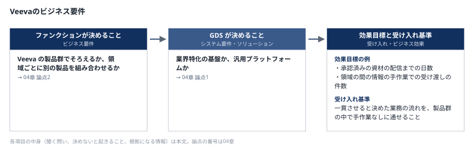

# 05 Veevaのビジネス要件

## 要旨

Veeva の製品群でそろえるかを決める前に、ファンクション（品質・薬事・臨床・営業）には**領域をまたいで情報を一貫させたい業務はどれか**を決めてもらう。製品群でそろえる利点は、その業務が実際にあるときにだけ生じる。

この章は、governance/budget-transfer の kickoff 資料（IT 予算移管の要点）にある役割分担を、この技術について具体化したものである。

*図1　Veevaのビジネス要件（ファンクションが決めたビジネス要件をもとに GDS がシステム要件とソリューションを決め、効果目標と受け入れ基準で確かめる）*

## ファンクションが決めること（ビジネス要件）

### Veeva の製品群でそろえるか、領域ごとに別の製品を組み合わせるか

- **決めること**：領域をまたいで一貫させたい業務（→ 04章 論点2）
- **聞く問い**：「資材の承認から配信・活動の記録まで、または臨床から申請まで、つながっていないことで困っている業務はどれか」
- **決めないと起きること**：つながりの利点がない領域まで製品群でそろえ、依存だけが深まる
- **根拠になる情報**：領域をまたぐ業務の流れ、いま手作業で受け渡している情報

## GDS が決めること

- 業界特化の基盤か、汎用プラットフォームか（→ 04章 論点1）。業務の進め方への影響が大きいため、比較の結果はファンクションと合意する

## 効果目標と受け入れ基準

- **効果目標の例**：承認済みの資材の配信までの日数、領域の間の情報の手作業での受け渡しの件数
- **受け入れ基準**：一貫させると決めた業務の流れを、製品群の中で手作業なしに通せること

## 部門に閉じた案件として扱えないとき

- 品質・薬事・臨床・CRM の複数の領域にまたがるため、1つの部門に閉じない
- Vault の版の更新は年3回あり、GxP の対象の業務では検証の追随が要る

境界の詳細（どのシステムが何を持つか）は [function-allocation](../../../cross-cutting/function-allocation/function-allocation.md) を参照。

---

**出典**（確認日：2026-11-15）

- 役割分担の原則と4つの場面：governance/budget-transfer の kickoff 資料（IT 予算移管の要点、2026-11-02 初版）
- 項目の立て方、問い、例は、04章の論点をもとにした本資料の整理
