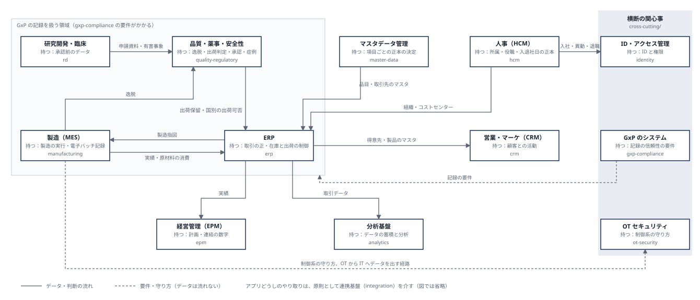
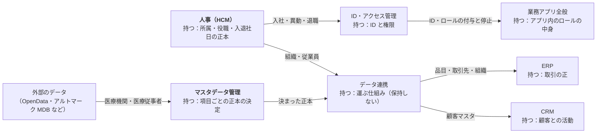
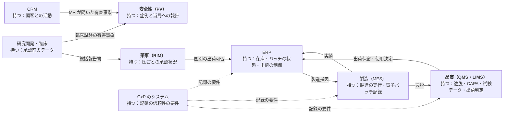
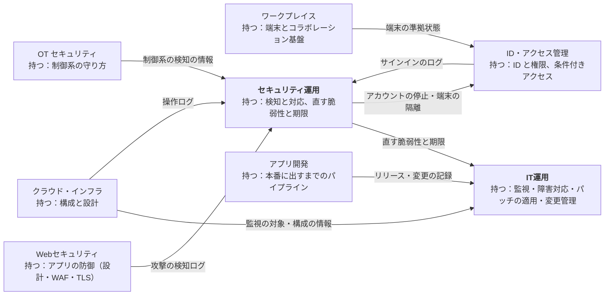

# 機能配置：システム間の境界

## 要旨

企業のシステムは、**1つのデータ・判断の正本を1つのシステムだけが持ち、他のシステムはそれを受け取って使う**ように配置する。アプリどうしは直接つながず、連携基盤（integration）が運ぶ。連携基盤は運ぶだけで、業務のロジックと正本は持たない。横断の関心事（ID・GxP・セキュリティ）は自分ではデータの正本を持たず、すべての領域に**要件**をかける。

この資料は、各トピックの境界を1か所にまとめたものである。境界を2つのトピックに分けて書くと食い違うため、境界はここにだけ書く。各トピックの中身（何をするか）は各トピックの01〜04章に、当社の現状は各トピックの06章に書く。

## 全体の俯瞰

*図1　主要な機能配置と、重要なやり取り（本資料の整理。すべての線は描いていない）*

図の読み方は次のとおり。

- 各箱の「持つ：」が、そのシステムが正本として持つものである。ERP は取引と在庫・出荷の制御を持ち、品質・薬事は「出荷してよいか」の判断の材料（逸脱・出荷判定・承認状況）を持つ。判断の材料と、出荷を止める制御は別のシステムにある。
- 人とマスタの正本は、業務のシステムの外（HCM・MDM）にあり、そこから ERP などへ配られる。
- 左上の枠で囲んだ領域は GxP の記録を扱い、gxp-compliance の要件がかかる。破線は、データではなく要件や守り方の関係である。

## 重要な関係性

### パターン1：人とマスタの正本を配る

人（従業員・組織）とマスタ（品目・取引先・顧客）は、それぞれ1つの正本から配る。ID と権限は、人の正本から作る。

*図2　人とマスタの正本の配り方（本資料の整理）*

- 人事情報は個人情報のため、連携基盤は中継に徹し、保持しない設計をとることが多い。
- ERP が品目・取引先の正本を兼ねる構成もある。その場合 MDM は、ERP の外のシステムとの食い違いの管理を持つ。

### パターン2：品質・規制の判断を出荷の制御につなぐ

規制当局への説明責任を負う記録（逸脱・承認状況・症例）は品質・薬事・安全性のシステムが持ち、出荷を止めるかどうかの制御は ERP が持つ。有害事象の入口は複数ある。

*図3　品質・規制の判断と出荷の制御（本資料の整理）*

- Veeva では、品質・薬事・臨床・CRM が同じ Vault の基盤にあり、図の線の多くが製品の中に入る（→ [veeva-platform 付録I](../../application/veeva-platform/appendix/I_system-of-record.md) のデータ責任分界）。

### パターン3：基盤・運用・セキュリティの分担

基盤（infrastructure）は構成を、IT運用は動かし続けることを、セキュリティ運用は異常の検知と対応を持つ。セキュリティ運用は他の領域の仕組みのログを受け取り、他の領域の仕組みを使って止める。

*図4　基盤・運用・セキュリティの分担（本資料の整理）*

- EDR は端末に入るため、導入と更新はワークプレイスの手順に乗る。更新の不具合は全端末に及びうる。
- 制御系では、止めてよいかの判断を ot-security が持つ。全社の SOC が制御系の機器を自動で隔離しない取り決めが要る。

## 境界の一覧

上の3つのパターンは、分かりやすさのために重要な関係だけを抜き出したものである。各トピックの間の境界を、ここに列挙する（本資料の整理）。GxP のシステムとの境界では、「主なやり取り」の欄に要件が強くかかるところを書いた。Veeva の製品の中の境界（データ領域ごとの System of Record）は、veeva-platform 05章の補足にある。

### アプリケーションどうし

| 境界 | どちらが何を持つか | 主なやり取り |
|---|---|---|
| ERP ↔ CRM | 受注・請求・在庫は ERP。CRM は活動を持つ | ERP → CRM：得意先・製品のマスタ／CRM → ERP：試供品などの発注 |
| CRM ↔ 品質・薬事・安全性 | 有害事象の評価と報告は安全性部門のシステム。CRM は MR が聞いた情報を伝える入口 | CRM → 安全性：有害事象の情報 |
| ERP ↔ 経営管理（EPM） | 取引と仕訳の正は ERP。EPM は実績を集計し、計画・連結を持つ | ERP → EPM：実績／EPM → ERP：予算（予算統制に使う場合） |
| 経営管理（EPM） ↔ 人事（HCM） | 人員・等級・給与の正は HCM。EPM は人件費の計画を持つ | HCM → EPM：人員、人件費の実績 |
| ERP ↔ 製造（MES） | ISA-95 では、ERPは計画・資源・原価（Level 4）、MESは製造の実行（Level 3）を担う。電子バッチ記録はMES | ERP → MES：製造指図、マスタ／MES → ERP：実績、原材料の消費、出来高 |
| ERP ↔ 製造（原価と会計） | C（原価）のうち、工数・材料使用実績の集計と標準原価との突合は生産管理システム、総勘定元帳への計上と財務諸表化は会計 | 原価の実績 → 会計 |
| ERP ↔ 品質（QMS・LIMS） | 逸脱・CAPA・変更管理などの記録はQMS、試験データはLIMS。在庫を使ってよいか（バッチの状態）はERP | 逸脱の発生 → バッチの出荷保留、試験結果 → 使用決定 |
| ERP ↔ 薬事（RIM） | 国ごとの承認情報はRIM。その国へ出荷してよいかの制御はERP | 承認状況 → 国別の出荷可否 |
| ERP ↔ 人事（HCM） | 人事情報はHCM。ERPは原価計算や承認に必要な範囲だけを持つ | 組織、従業員、コストセンター |
| 製造 ↔ 品質（QMS・LIMS） | Q（品質）は専用の品質管理システムが担う。生産管理システムは実績データの一部（不良数・検査結果の入力など）を提供する | 実績データ → SPC・検査帳票・是正処置 |
| 品質・薬事・安全性 ↔ 製造 | 製造の実行と電子バッチ記録は MES。逸脱と出荷判定の記録は QMS | MES → QMS：逸脱／QMS → 製造：出荷の可否 |
| 研究開発・臨床 ↔ 品質・薬事・安全性 | 臨床試験の運営とデータは rd。申請と市販後は品質・薬事・安全性 | 臨床 → 薬事：総括報告書／臨床 → 安全性：有害事象 |
| 研究開発・臨床 ↔ 製造 | 製造の試験と出荷判定に使う QC の LIMS は、製造・品質の側に置かれることが多い（本資料の整理） | 試験結果 |

### アプリケーションとデータ

| 境界 | どちらが何を持つか | 主なやり取り |
|---|---|---|
| CRM ↔ マスタデータ管理 | 医療従事者・医療機関のマスタの正本と、外部データとの対応づけ | 顧客マスタ |
| CRM ↔ 分析基盤 | 活動の記録と、処方・売上のデータを組み合わせた分析 | 活動の記録 |
| CRM ↔ データ連携 | CRM と ERP・分析基盤の間の受け渡し | 上記のやり取り |
| 経営管理（EPM） ↔ マスタデータ管理 | 勘定科目・組織・コストセンターの階層の正本 | 集計の軸 |
| 経営管理（EPM） ↔ 分析基盤 | 計画と実績の公式の数字は EPM。他の業務データと組み合わせた分析は analytics | EPM → 分析基盤：計画・見込み |
| 経営管理（EPM） ↔ データ連携 | ERP・HCM から EPM への実績の取り込み | 実績データ |
| ERP ↔ 分析基盤 | 分析はDWH。ERPは取引の正を持つ | 取引データの抽出 |
| ERP ↔ マスタデータ管理 | 品目・取引先などの項目ごとに、どのシステムが正（System of Record）かを決める | マスタの配信 |
| ERP ↔ データ連携 | 上記のやり取りを、ERPの中に作り込まず外の連携基盤に置く | 上記すべて |
| 人事（HCM） ↔ データ連携 | 人事情報を各システムへ配る。個人情報のため、中継に徹し保持しない設計をとることが多い | 組織、従業員、異動 |
| 人事（HCM） ↔ 分析基盤 | 人員構成・離職などの分析。個人を特定できる情報の扱いに注意が要る | 人事データ |
| 品質・薬事・安全性 ↔ マスタデータ管理 | 製品・物質のマスタ（IDMP）は、申請と安全性の報告の単位になる | 製品・物質のマスタ |
| 品質・薬事・安全性 ↔ データ連携 | 品質・薬事と ERP・MES の間の受け渡し | 上記のやり取り |
| 研究開発・臨床 ↔ マスタデータ管理 | 製品・物質の識別（IDMP）は、開発の段階から使われる | 製品・物質のマスタ |
| 研究開発・臨床 ↔ 分析基盤 | 研究・臨床のデータの蓄積と横断の分析 | 研究データ、臨床データ |
| Veeva ↔ データ連携 | 品質イベント・承認情報・顧客活動の正は各アプリケーション。連携基盤はそれらを ERP などへ運ぶ | 逸脱 → 出荷保留、承認状況 → 国別の出荷可否、得意先・製品マスタ、試供品の発注 |
| 製造 ↔ データ連携 | 製造の実行はMES。ERPとMESの間の指図・実績の受け渡しを連携基盤が担う構成と、直接つなぐ構成がある | 製造指図、実績、原材料の消費 |
| Veeva ↔ マスタデータ管理 | Veeva の内部では、データ領域ごとに SoR が決まっている。医療機関・医師のマスタは外部 DB と結びつく | 顧客マスタ、製品マスタ |

### データどうし

| 境界 | どちらが何を持つか | 主なやり取り |
|---|---|---|
| データ連携 ↔ 分析基盤 | 業務システムから分析基盤への抽出・変換・書き込み（ETL／ELT）は、連携基盤と分析基盤のどちらが担うかが製品によって重なる | 取引データの抽出 |
| マスタデータ管理 ↔ 分析基盤 | マスタの正本は MDM。分析基盤はそれを分析の軸として使う | 顧客・製品・組織のマスタ |
| データ連携 ↔ マスタデータ管理 | 項目ごとにどのシステムが正かを決めるのは MDM。連携基盤は決まった正本から配るだけ | マスタの配信 |

### アプリケーション・データと基盤

| 境界 | どちらが何を持つか | 主なやり取り |
|---|---|---|
| ERP ↔ アプリ開発 | ERP の標準と拡張の仕組みは erp。拡張を作り、届ける工程は app-development | 拡張の開発 |
| 研究開発・臨床 ↔ AI | 研究データを使った予測、文書作成の支援 | 研究データ、文書 |
| 分析基盤 ↔ AI | 生成AIや機械学習は、分析基盤のデータを学習や検索（RAG）に使う | 学習データ、検索の対象 |
| 分析基盤 ↔ クラウド・インフラ | 分析基盤の多くはクラウドのサービスとして動く。置き場所（リージョン）と通信経路は infrastructure | 保管場所、ネットワーク |
| データ連携 ↔ クラウド・インフラ | 連携基盤と社内・各クラウドをつなぐネットワーク（VPN、専用線、プライベート接続）、置き場所（リージョン） | 通信経路、暗号化 |
| データ連携 ↔ IT運用 | 連携の監視・エラー対応、ジョブ管理ツールとの実行順の調整 | 実行状況、アラート |
| データ連携 ↔ AI | integration はシステム間の連携。MCP は AI と業務システムをつなぐ新しい連携の形でもある | 業務システムへの接続 |
| データ連携 ↔ アプリ開発 | システム間の連携の基盤は integration。アプリが公開・利用する API の開発は app-development | API |
| ERP ↔ クラウド・インフラ | アプリのトピックは製品と提供形態（SaaS か自社運用か）を扱う。インフラは、自社運用の場合の基盤を提供する | インフラ → アプリ：サーバー・データベース・ネットワーク |

### 基盤どうし

| 境界 | どちらが何を持つか | 主なやり取り |
|---|---|---|
| クラウド・インフラ ↔ AI | インフラは GPU とクラウドの基盤。AI は、その上のモデルの提供サービスと使い方 | GPU、AI のマネージドサービス |
| ワークプレイス ↔ AI | workplace は Copilot などのライセンスと配布、文書の共有設定。AI は、その上での回答の仕組みとリスク | ライセンス、文書の共有設定 |
| IT運用 ↔ AI | IT運用は AI を使った問い合わせ対応・障害分析の利用者 | AI による一次回答 |
| アプリ開発 ↔ AI | AI の仕組みとリスクは ai。AI を使った開発の支援と、AI を組み込んだアプリを作る工程は app-development | AI のサービスの利用 |
| IT運用 ↔ アプリ開発 | 本番の監視・障害対応・変更管理は it-operations。本番に出すまでのパイプラインは app-development | リリース、変更の記録、障害の情報 |
| ワークプレイス ↔ アプリ開発 | Microsoft 365 などの利用環境は workplace。その上で Power Platform などでアプリを作る仕組みと統制は app-development | ライセンス、テナントの設定 |
| クラウド・インフラ ↔ アプリ開発 | 実行環境（クラウド・コンテナ・サーバ）は infrastructure。そこへの配置の自動化は app-development | 環境の構成、デプロイ |
| クラウド・インフラ ↔ IT運用 | インフラは構成と設計。IT運用は監視・障害対応・バックアップ・変更の管理 | インフラ → IT運用：監視の対象、構成の情報 |
| ワークプレイス ↔ IT運用 | workplace は端末とコラボレーション基盤。IT運用は、その問い合わせと依頼を受け付けるサービスデスク | 問い合わせ、端末の手配・回収の依頼 |
| クラウド・インフラ ↔ ワークプレイス | クラウド PC・VDI の基盤はクラウドの上にある。ワークプレイスは、それを社員の端末として提供する | 仮想デスクトップの基盤 |

### 横断の関心事との境界

| 境界 | どちらが何を持つか | 主なやり取り |
|---|---|---|
| ERP ↔ GxP のシステム | ERP の機能は erp。GMP に関わる記録（ロット・品質の状態・出荷の可否）の信頼性とバリデーションは gxp-compliance | 検証の記録 |
| 人事（HCM） ↔ ID・アクセス管理 | 所属・役職・入退社日の正本は HCM。identity はそれを受けて ID と権限に変える | HCM → IGA：入社・異動・退職 |
| 製造 ↔ GxP のシステム | MES などの機能と設備の適格性評価は manufacturing。電子バッチ記録などの記録の信頼性とバリデーションは gxp-compliance | 検証の記録 |
| 製造 ↔ OT セキュリティ | どのシステムが何をするかと、IT と OT の管掌の区分は manufacturing。制御系の守り方（ネットワークの分離・リモートアクセス・補償的な対策）は ot-security | 資産の一覧、管掌の区分 |
| 品質・薬事・安全性 ↔ GxP のシステム | 業務の機能は quality-regulatory。記録の信頼性（ALCOA+）とバリデーションの考え方は gxp-compliance | 検証の記録、監査証跡の確認 |
| 研究開発・臨床 ↔ GxP のシステム | ELN・LIMS・EDC などの機能は rd。GCP・GLP の記録の信頼性とバリデーションは gxp-compliance | 検証の記録 |
| Veeva ↔ GxP のシステム | Vault の監査証跡などの機能と、Veeva の検証の資料は veeva-platform。GxP の要件と、更新への追随の考え方は gxp-compliance | 版の更新の影響評価 |
| データ連携 ↔ GxP のシステム | 連携の仕組みは integration。GxP のデータを受け渡すインターフェースの検証と、規制対象のデータを流すかの判断の前提はこのトピック | インターフェースの検証、GxP と非 GxP の環境の分離 |
| マスタデータ管理 ↔ GxP のシステム | マスタの正本と管理は master-data。GxP に関わる品目・規格のマスタの変更管理はこのトピックの要件がかかる | 品目・規格のマスタの変更 |
| IT運用 ↔ GxP のシステム | 変更管理・バックアップ・障害対応の運用は it-operations。GxP のシステムで求められる水準（記録・承認・復元の確認）はこのトピック | 変更管理、バックアップと復元、インシデント |
| クラウド・インフラ ↔ GxP のシステム | 基盤の構成は infrastructure。クラウドの基盤を GxP で使う場合の適格性評価と責任分担はこのトピック | IaaS・PaaS の適格性評価 |
| アプリ開発 ↔ GxP のシステム | 開発の工程と仕組みは app-development。GxP のシステムを開発・変更するときの検証の要件はこのトピック | 自社開発・拡張（GAMP 5 のカテゴリ5）、ローコードのアプリ |
| AI ↔ GxP のシステム | AI の仕組みは ai。GMP での AI の使い方の要件（Annex 22 の案）はこのトピックで扱う | GMP の判断に AI を使う場合 |
| ERP ↔ ID・アクセス管理 | 業務アプリは、アプリ内のロール（承認権限など）の中身を持つ。IAM は、誰にどのロールを与えるかの申請・承認・見直しを持つ | IGA → 業務アプリ：ロールの付与・削除 |
| ワークプレイス ↔ ID・アクセス管理 | 端末の管理はワークプレイス。IAM は、端末の状態（管理下にあるか）を条件付きアクセスの判断材料に使う | 端末管理 → IdP：端末の準拠状態 |
| アプリ開発 ↔ ID・アクセス管理 | ID の基盤は identity。開発者の権限と、パイプライン・アプリのサービスアカウントの扱いは app-development | 開発者・サービスの ID |
| クラウド・インフラ ↔ OT セキュリティ | 全社のネットワークの基盤は infrastructure。工場のネットワークの分離と産業用 DMZ の設計は ot-security | ネットワークの接続点 |
| データ連携 ↔ OT セキュリティ | 連携の仕組みは integration。OT から IT へデータを出すときの経路（DMZ を通すこと）は ot-security が決める | MES・ヒストリアンのデータ |
| 分析基盤 ↔ OT セキュリティ | データの蓄積と分析は analytics。IIoT のデータをクラウドに送る経路の守り方は ot-security | 設備のデータ |
| IT運用 ↔ セキュリティ運用 | IT運用はシステムの稼働監視と障害対応、パッチの適用作業。セキュリティ運用は、どの脆弱性をいつまでに直すかを決め、直ったかを確かめる | 脆弱性管理 → IT運用：修正の依頼と期限／IT運用 → 脆弱性管理：適用の結果 |
| ワークプレイス ↔ セキュリティ運用 | 端末の配布と管理はワークプレイス。EDR は端末に入るため、導入と更新はワークプレイスの手順に乗る | 端末管理 → EDR：配布・更新（更新の不具合が端末を止めた例がある → 03章）／EDR → 端末：隔離 |
| クラウド・インフラ ↔ セキュリティ運用 | インフラは構成と稼働。セキュリティ運用は、クラウドの操作ログと設定の誤りを監視する | クラウド → SIEM：操作ログ |
| アプリ開発 ↔ セキュリティ運用 | 全社の脆弱性管理は security-operations。開発の中で使う部品の脆弱性の検査は app-development | 脆弱性の情報 |
| 分析基盤 ↔ ID・アクセス管理 | 誰がどのデータを見てよいかの元になる ID と所属は identity。分析基盤はそれに基づいて行・列の単位で権限をかける | ID、グループ |
| データ連携 ↔ ID・アクセス管理 | 連携基盤が各システムに接続するための認証（サービスアカウント、OAuth など）の管理 | 認証情報、権限 |
| マスタデータ管理 ↔ ID・アクセス管理 | 従業員マスタは人事が正本で、identity はそれを ID に変える。MDM は、組織・コストセンターなどのマスタと接する | 組織、従業員 |
| AI ↔ ID・アクセス管理 | identity は誰に何の権限を与えるか。AI は、その権限の範囲でデータを使う。AI エージェントにも ID と権限が要る | 利用者の権限、エージェントの権限 |
| AI ↔ Webセキュリティ | web-security はアプリの脅威と防御の一般論。AI は、LLM に固有の脅威（プロンプトインジェクションなど） | アプリの設計の原則（入力の検証、出力の扱い） |
| AI ↔ セキュリティ運用 | security-operations は攻撃の検知と対応。AI の利用ログや異常な使い方の監視も対象になる | AI の利用ログ |
| アプリ開発 ↔ Webセキュリティ | 脅威・設計原則・認証・認可の考え方は web-security。それを開発の工程（レビュー・試験・検査）に組み込むのは app-development | 設計の原則 → 開発の基準 |
| クラウド・インフラ ↔ ID・アクセス管理 | identity は誰がクラウドの環境に入れるかを管理する。インフラは環境の区切り方（アカウント構成）を決める | 環境ごとの権限 |

### 横断の関心事どうし

| 境界 | どちらが何を持つか | 主なやり取り |
|---|---|---|
| ID・アクセス管理 ↔ GxP のシステム | ID とアクセス権の仕組みは identity。個人ごとの ID・権限の見直しを GxP の要件として求めるのはこのトピック | 共有アカウントの禁止、権限の定期的な見直し |
| OT セキュリティ ↔ GxP のシステム | 制御系の守り方は ot-security。製造の記録の信頼性に関わる部分はこのトピック | 設備のデータの改ざんの防止 |
| ID・アクセス管理 ↔ Webセキュリティ | IAM は IdP・SSO・MFA の方針と ID の運用。web-security は、アプリが IdP に認証を委ねる作り方（OIDC・SAML）と、アプリの中の認可 | IdP → アプリ：認証結果（トークン・アサーション） |
| ID・アクセス管理 ↔ セキュリティ運用 | IAM は権限を与える・外す。セキュリティ運用は、ログインや権限の使われ方を監視し、不審なものを検知・対応する | IdP → SIEM：サインインのログ、権限変更の記録／SOC → IdP：アカウントの停止 |
| ID・アクセス管理 ↔ OT セキュリティ | ID の基盤は identity。制御系への特権の接続と、保守ベンダーのリモートアクセスの管理は ot-security | 特権 ID、外部の利用者の ID |
| セキュリティ運用 ↔ OT セキュリティ | 全社の EDR・SIEM・SOC と脆弱性管理の運用は security-operations。制御系に固有の検知と、止めないための対応の判断は ot-security | 制御系の検知の情報、脆弱性の情報 |
| Webセキュリティ ↔ セキュリティ運用 | web-security はアプリの防御（設計、WAF、TLS）。セキュリティ運用は、その防御が出すログと警告を監視する | WAF・アプリ → SIEM：攻撃の検知ログ |

## 境界の原則

- **正本は1つ**：1つのデータ・判断について、正本を持つシステムは1つにする。他のシステムは参照し、書き換えない。正本を決めるのは MDM（マスタ）または各業務のシステム（取引・記録）である。
- **連携は外に置く**：やり取りを業務のシステムの中にアドオンで作り込まない。作り込むと、そのシステムの業務機能を使わなくなっても、連携のためだけに止められなくなる。
- **判断の材料と制御を分ける**：品質の判断は QMS、承認状況は RIM、出荷を止める制御は ERP が持つ。どちらか一方に寄せると、規制の記録か在庫の正しさのどちらかが崩れる。
- **横断の関心事は要件を持つ**：ID・GxP・セキュリティのトピックは、各システムに要件をかけ、満たす仕組みを提供する。各システムが何をするかは、各領域のトピックが持つ。
- **IT と OT は機能で分ける**：管掌の区分は「どの階層のシステムか」ではなく、機能ごとの観点（即応性、設備との接続、安全への影響）で決める（→ [manufacturing 02章](../../application/manufacturing/chapters/02_structure.md) の区分基準）。

## 動く境界・重なる境界

製品の機能が広がると、境界が製品の中に入ったり、2つのトピックの担当が重なったりする。製品を比べるときは、ここが選定の論点になる（→ 各トピックの04章）。

- **ERP と MES**：Dynamics 365 Supply Chain Management は製造現場の実行機能の一部（スケジューリング・作業の割り当て・実績収集）を標準で持つ。品質・保全・トレーサビリティまで ERP で賄えるかは製品ごとに違う。
- **HCM と ERP**：Workday・Oracle・SAP は人事と財務の両方を持つ。同じ提供元でそろえると、人事と会計の境目は製品の中に入る。
- **ERP と EPM**：Oracle は EPM を Cloud ERP の製品群として提供する。
- **連携基盤と分析基盤**：抽出・変換・書き込み（ETL／ELT）を、連携基盤と分析基盤のどちらが担うかは製品によって重なる。Salesforce は Informatica の買収で、連携・品質・MDM を自社のデータ基盤にまとめた。
- **分析基盤とデータベース**：Databricks は業務用のデータベース（Lakebase）を出し、業務の処理と分析を1つの基盤に寄せる方針を示している。
- **IdP と特権管理**：Microsoft Entra PIM のように IdP の側が管理者権限の時間制限を持つと、特権管理の一部が IdP に入る。
- **ID とセキュリティ運用**：EDR のベンダーが ID への攻撃の検知を製品に加えており、どちらの側で検知するかが重なる。
- **SIEM と IT運用の監視**：Cisco は Splunk の買収で、セキュリティと可観測性を1つの基盤にまとめる方針を示した。ログの基盤を共有するかどうかが論点になる。
- **IT と OT の資産管理**：ServiceNow による Armis の買収は、IT・OT・IoT の資産を1つの基盤で把握する方向を示す。
- **セキュリティと GxP**：EU GMP Annex 11 の改訂案はセキュリティを詳しく扱っており、IT のセキュリティの管理が GMP の査察の対象に入りつつある。AI を GMP の判断に使う場合の要件（Annex 22 の案）も、ai と gxp-compliance の境界になる。

**関連トピック**：[erp](../../application/erp/README.md)、[epm](../../application/epm/README.md)、[crm](../../application/crm/README.md)、[rd](../../application/rd/README.md)、[quality-regulatory](../../application/quality-regulatory/README.md)、[manufacturing](../../application/manufacturing/README.md)、[hcm](../../application/hcm/README.md)、[veeva-platform](../../application/veeva-platform/README.md)、[integration](../../data/integration/README.md)、[master-data](../../data/master-data/README.md)、[analytics](../../data/analytics/README.md)、[infrastructure](../../platform/infrastructure/README.md)、[workplace](../../platform/workplace/README.md)、[it-operations](../../platform/it-operations/README.md)、[app-development](../../platform/app-development/README.md)、[ai](../../platform/ai/README.md)、[identity](../identity/README.md)、[web-security](../web-security/README.md)、[security-operations](../security-operations/README.md)、[ot-security](../ot-security/README.md)、[gxp-compliance](../gxp-compliance/README.md)

---

**出典**（確認日：2026-11-15）

- 境界の線引き、原則、3つのパターンは、各トピックの01〜05章（2026-11-14 時点）をもとにした本資料の整理
- 動く境界の各事例の出典は、各トピックの03章を参照（Dynamics 365 の製造の機能：manufacturing、Informatica の買収：master-data、Databricks Lakebase：analytics、Entra PIM：identity、Splunk の買収：security-operations、Armis の買収：ot-security、Annex 11・Annex 22：gxp-compliance）
