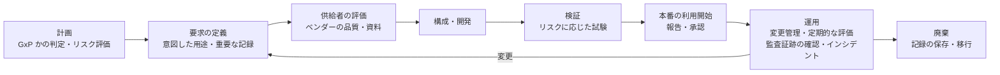

# 02 GxP のコンピュータ化システムの構造

## 要旨

GxP のシステムに求められることは、**記録の性質（ALCOA+）**、**それを守るシステムの機能（アクセス制御・監査証跡・電子署名など）**、**システムを導入から廃棄まで管理する手順（ライフサイクル）**の3つに分けて捉えられる。確かめる手間は一律ではなく、**システムの種類（GAMP 5 のカテゴリ）と、品質へのリスク**に応じて変える。

## 構成要素

| 要素 | 役割 |
|---|---|
| 記録の性質（ALCOA+） | 守るべき記録の状態を定める |
| システムが備える機能 | 記録の状態を、システムの仕組みで守る |
| ライフサイクル | 導入から廃棄まで、システムが意図どおりに動く状態を保つ |
| ソフトウェアのカテゴリ | 確かめる手間の目安を決める |

## 記録の性質：ALCOA+

FDA の2018年のガイダンスは、完全・一貫・正確なデータが持つべき性質として ALCOA の5つを挙げる。PIC/S PI 041-1 などはこれに4つを加え、ALCOA+ とする。

| 性質 | 意味 | 主に支えるシステムの機能（本資料の整理） |
|---|---|---|
| Attributable（帰属性） | 誰が記録・変更したかが分かる | 個人ごとの ID、共有アカウントの禁止、監査証跡 |
| Legible（判読性） | 読める。後から読み返せる | 保存形式の管理、読み出しの手段の維持 |
| Contemporaneous（同時性） | 行為と同時に記録される | 正確な時刻（時刻の同期）、入力の時点の記録 |
| Original（原本性） | 最初の記録、またはその真正な写し | 原本の保存、写しの作成の管理 |
| Accurate（正確性） | 誤りがない | 入力の検証、計算・インターフェースの検証 |
| Complete（完全性）＋ | 再処理・削除を含めてすべて残る | 削除の制限、監査証跡、再処理の記録 |
| Consistent（一貫性）＋ | 順序と時刻が矛盾しない | 時刻の同期、手順どおりの処理 |
| Enduring（永続性）＋ | 保存期間のあいだ失われない | バックアップ、アーカイブ、媒体の移行 |
| Available（可用性）＋ | 必要なとき（査察など）に取り出せる | 検索・出力の機能、保存先の管理 |

## システムが備える機能

| 要素 | 役割 |
|---|---|
| アクセス制御 | 個人ごとの ID と、役割に応じた権限。権限の定期的な見直し（→ identity） |
| 監査証跡 | 作成・変更・削除を、旧い値・新しい値・日時・実行者・理由とともに自動で残す。利用者が止めたり消したりできない。記録とあわせて定期的に確認する |
| 電子署名 | 署名者の氏名・日時・署名の意味（承認・確認など）を表示し、署名と記録を切り離せないようにする |
| 時刻 | システムの時刻を正しく保つ。記録の順序と同時性の前提になる |
| バックアップと復元 | 定期的に取り、復元できることを確かめる（→ it-operations） |
| 保存とアーカイブ | 決められた期間、読める形で残す。システムを入れ替えても読めるようにする |
| データ移行 | 旧システムから移すときに、内容と意味が失われていないことを確かめる |
| インターフェース | システム間で受け渡すデータが正しく届くことを確かめる（→ integration） |

## 仕組み：ライフサイクル

*図1　コンピュータ化システムのライフサイクル（GAMP 5 と Annex 11 の考え方をもとにした本資料の整理）*

- **導入時の検証で終わりではない**。Annex 11 は、システムがバリデートされた状態を保っているかを定期的に評価することを求め、逸脱・インシデント・更新の履歴などを見直す対象に挙げる。
- **対象の一覧（インベントリ）を持つ**。Annex 11 はツールで例外を設けておらず、GMP の計算に使う表計算のファイルも一覧に載せる対象になるとの解説がある。

## GAMP 5 のソフトウェアカテゴリ

ISPE の GAMP 5 は、ソフトウェアをカテゴリに分け、確かめる手間の目安にする。第2版（2022年）では、カテゴリは連続したものとして見るべきで、システムの重要度・複雑さ・新しさも手間を決めると強調している。旧版のカテゴリ2（ファームウェア）は使われていない。

| カテゴリ | 内容 | 例 |
|---|---|---|
| 1：基盤のソフトウェア | 他のソフトウェアが動く環境 | OS、データベース、ネットワークの機器 |
| 3：設定しない製品 | 市販のまま使う | 標準の測定機器のソフトウェア |
| 4：設定する製品 | 標準の機能を設定で業務に合わせる | ERP、QMS、LIMS などの業務パッケージ、SaaS |
| 5：個別に作るもの | 自社や委託先が作る | 独自のアプリ、マクロ、拡張の開発 |

1つのシステムは複数のカテゴリの部品からできていることが多い（たとえば、カテゴリ4のパッケージに、カテゴリ5の拡張を加える）。

## CSV と CSA：確かめ方の違い

| | 従来の CSV の進め方 | CSA の考え方 |
|---|---|---|
| 重点 | 文書と手順をそろえること | 品質と患者の安全へのリスクを判断すること |
| 試験 | 機能ごとに台本どおりの試験を行い、記録を残す | リスクの高い機能は台本どおりの試験、低い機能は台本なしの試験なども使う |
| 記録 | 画面の写しなどの証拠を多く残す | 判断に必要な記録に絞る |

GAMP 5 第2版は、専門家の批判的な思考を重視し、アジャイルな開発やクラウドも扱う。CSA と GAMP 5 第2版は、対立するものではなく補い合うものとされる。どちらの進め方をとるかは 04章の論点1。

---

**出典**（確認日：2026-11-14）

- ALCOA（5つの属性）：FDA「Data Integrity and Compliance With Drug CGMP」（2018-12）— https://fda.gov/media/119570/download 、ALCOA と ALCOA+ の違い：CASRAI — https://casrai.org/guides/fda-data-integrity-guidance-cgmp
- ALCOA+：PIC/S PI 041-1 — https://picscheme.org/docview/4234 、PwC（2023-05）— https://www.pwc.com/jp/ja/knowledge/prmagazine/pwcs-view/202305/44-07.html
- 定期的な評価、表計算のファイルの扱い：LearnSignal — https://www.learnsignal.com/blog/computer-system-validation-eu-gmp-annex-11-requirements-guide/
- GAMP 5 のカテゴリと第2版の変更点：IntuitionLabs — https://www.intuitionlabs.ai/articles/gamp-5-categories-explained 、CASRAI — https://casrai.org/compare/gamp-4-vs-gamp-5 、CSA との関係：IntuitionLabs — https://intuitionlabs.ai/glossary/gamp-5
- CSA の試験の方法（台本どおりの試験と台本なしの試験）：FDA「Computer Software Assurance for Production and Quality System Software」— https://www.fda.gov/regulatory-information/search-fda-guidance-documents/computer-software-assurance-production-and-quality-system-software
- 臨床試験の電子システムで、機能・設定・カスタマイズ・データの受け渡し・インターフェースを検証の対象とすること：WCG — https://www.wcgclinical.com/?p=28736
- ALCOA+ とシステムの機能の対応、システムが備える機能の表、図1、CSV と CSA の比較の表は、上記をもとにした本資料の整理
