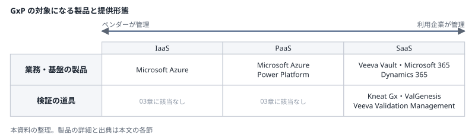

# 03 GxP のコンピュータ化システムの製品と提供形態

## 要旨

GxP の要件を満たすための「製品」は、1つの製品分野ではない。**業務システムそのものが GxP の機能（監査証跡・電子署名など）を備える**ことに加え、**クラウドのベンダーが出す検証の資料**、**検証の作業を電子化する製品（デジタルバリデーションツール）**、**検証の外部委託**を組み合わせる。クラウドと SaaS では、**ベンダーと利用企業の責任分担**が選定と運用の前提になる。

*図1　GxP の対象になる製品と提供形態（縦は製品の区分、横は提供形態。本資料の整理）*

## 主要な製品

### ベンダーが出す検証の資料

| 製品 | ベンダー | 特徴 |
|---|---|---|
| Veeva Vault | Veeva | 約4か月ごと（年3回）に新しい版を出し、版ごとに回帰試験を行う。版ごとに検証の資料一式（検証計画、要求の文書、試験の手順書、IQ/OQ、トレーサビリティ表、検証の報告書）を顧客に提供する。新しい版を事前に試せる環境（pre-release Vault）を用意し、2年ごとにすべての機能を再検証する |
| Microsoft Azure | Microsoft | 第三者（Montrium）による GxP の評価に基づく、Azure の GxP のガイドラインを公開。Microsoft と顧客の責任分担を示す |
| Dynamics 365・Power Platform | Microsoft | Dynamics 365 と Power Platform の GxP のガイドラインを公開。内部の開発・品質の管理を説明する |
| Microsoft 365 | Microsoft | Microsoft 365 の GxP のガイドライン（2020年7月）を公開 |

ベンダーの資料は、ベンダーの要求に対する検証であり、**自社の意図した用途に対する検証の代わりにはならない**。差の部分は自社で埋める必要がある。

### 検証の作業を電子化する製品

検証の計画・試験の実行・逸脱・報告を紙や PDF ではなく電子で行う製品。Gartner は「Digital Validation Tools for Life Sciences」の市場として利用者の評価を集めている。

| 製品 | ベンダー | 特徴 |
|---|---|---|
| Kneat Gx | Kneat（2026年8月に Thoma Bravo が買収し、非公開化） | CSV のほか、設備の適格性評価・工程・洗浄などの検証も扱う。21 CFR Part 11・Annex 11 に対応し、検証の文書の工数を最大50%減らすと同社は説明する |
| ValGenesis | ValGenesis | 検証の文書化・実行を中心に、洗浄のバリデーションなども扱う |
| Veeva Validation Management | Veeva | Vault の上で動き、QualityDocs や QMS とつながる |

製品の比較は、提供元や関係者の発信が多く、中立的な評価は少ない（本資料の整理）。

### 検証の外部委託

SaaS の更新ごとの影響評価・試験・資料づくりを、外部の専門の事業者に継続的に委ねる形もある。

## 国内の製品と日本固有の要素

検証の電子化の国内ベンダーの製品は、本資料では確認していない。日本では、厚生労働省の「コンピュータ化システム適正管理ガイドライン」に沿った検証が求められる（→ 01章）。グローバルのベンダーの検証の資料は、日本の要件との差を自社で埋める必要がある（本資料の整理）。

## 他の製品に付属する機能

| 付属先 | 付属する機能 | 補足 |
|---|---|---|
| 業務システム（Vault、ERP、MES など） | 監査証跡・電子署名・アクセス管理などの GxP の機能 | システムそのものが機能を持つ。検証はシステムごとに行う（→ 02章） |
| Veeva Vault | Veeva Validation Management（検証の電子化） | QualityDocs・QMS と同じ基盤でつながる（上表） |

## 提供形態

クラウドでは、検証の責任はベンダーと利用企業で分担される。ただし、GxP の最終的な責任は利用企業に残る。

| 形態 | 誰が何を管理するか（ベンダー） | 誰が何を管理するか（利用企業） |
|---|---|---|
| IaaS | 基盤（施設・物理サーバ・ネットワーク）の品質と管理 | OS から上の構成と検証、アプリ、データ |
| PaaS | 基盤に加えて、実行環境・データベースなどの管理 | アプリの開発と検証、データ |
| SaaS | アプリの開発・試験・リリース・障害対応 | 意図した用途の定義、ベンダーの評価、設定、利用者による試験、リスク評価、データインテグリティ、変更管理 |

*表は、AWS・Microsoft の GxP の資料と USDM の解説をもとにした本資料の整理*

SaaS では更新が年に何回も来て、そのたびに GxP の機能に影響しうる。導入時の検証より、**更新のたびの影響評価と、定期的な評価を続けること**が負担の中心になる（→ 04章 論点2）。

## 市場の動き

| 時期 | できごと |
|---|---|
| 2025年 | FDA が CSA のガイダンスを最終化した。EU は Annex 11 の改訂案を公表した（2025年7月、→ 01章） |
| 2026年6月8日 | Thoma Bravo が Kneat を約6.5億カナダドルで買収すると発表した |
| 2026年8月11日 | Thoma Bravo が Kneat の買収を完了し、Kneat は非公開化した |

## 本資料でまだ扱っていないもの

- AWS・Google Cloud・Salesforce・SAP などの GxP の資料の内容
- 国内の検証の支援事業者
- 検証の電子化の製品の料金と導入の規模

---

**出典**（確認日：2026-11-14）

- 責任分担、最終的な責任が利用企業に残ること：USDM — https://usdm.com/resources/white-papers/validation-requirements-and-responsibilities 、AWS「GxP Systems on AWS」— https://docs.aws.amazon.com/de_de/whitepapers/latest/gxp-systems-on-aws/qualification-strategy-for-life-science-organizations.html
- SaaS の更新の頻度と、ベンダーの資料が自社の用途の検証に代わらないこと：Certara — https://www.certara.com/blog/gxp-compliance-in-the-cloud-what-it-teams-need-to-rethink/
- Veeva Vault の検証：Veeva「Vault Validation Features Brief」— https://www.veeva.com/resources/veeva-vault-validation-product-brief/ 、https://www.veeva.com/resources/veeva-vault-validation-datasheet/ 、https://www.veeva.com/resources/vault-validation-product-brief/
- Microsoft の GxP の資料：Microsoft Learn — https://learn.microsoft.com/en-us/azure/compliance/offerings/offering-gxp 、https://learn.microsoft.com/en-us/compliance/regulatory/offering-gxp 、Azure のガイドライン（2020-07）— https://azure.microsoft.com/mediahandler/files/resourcefiles/microsoft-azure-gxp-guidelines-april/Microsoft%20Azure%20GxP%20Guideline%20(FINAL)%20July%202020.pdf
- 検証の電子化の製品：Gartner Peer Insights — https://www.gartner.com/reviews/market/digital-validation-tools-for-life-sciences/compare/product/kneat-gx-vs-veeva-vault-platform
- 検証の外部委託：USDM — https://www.usdm.com/resources/blogs/blog-cloud-assurance-saas-validation-life-sciences
- Kneat の買収：Kneat（2026-08-11）— https://investors.kneat.com/news-releases/news-release-details/thoma-bravo-completes-acquisition-kneat 、Thoma Bravo（2026-08-11、Part 11・Annex 11 の対応と工数の削減）— https://www.thomabravo.com/press-releases/thoma-bravo-completes-acquisition-of-kneat 、発表（2026-06-08）：Stockwatch — https://wwww.stockwatch.com/News/Item/Z-C!KSI-3830369/C/KSI
- CSA と Annex 11 の改訂案：[01章](01_definition.md) の出典を参照
- 日本の要件との差を自社で埋める点、付属の機能の表は本資料の整理
- 製品の区分は 2026-11 時点の各社の公表情報による。契約の判断の前には各社の最新の資料で確かめる
