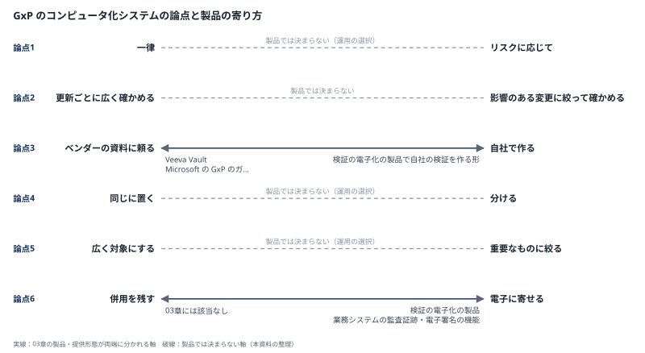

# 04 GxP のコンピュータ化システムの主要な論点

## 要旨

GxP のシステムを扱うときに出てくる軸は次の6つである（本資料の整理）。

1. 一律に確かめるか、リスクに応じて確かめるか
2. SaaS の更新に、どこまで追随して確かめるか
3. ベンダーの検証の資料に頼るか、自社で作るか
4. GxP と非 GxP を、同じシステム・環境に置くか、分けるか
5. 利用者が作るツール（表計算・ローコード）を、どこまで管理の対象にするか
6. 紙と電子の併用（ハイブリッド）を残すか、電子に寄せるか

*図1　GxP のコンピュータ化システムの論点と製品の寄り方（実線は03章の製品が両端に分かれる軸、破線は製品では決まらない軸。本資料の整理）*

## 論点1：一律に確かめるか、リスクに応じて確かめるか

| | 一律（従来の CSV の進め方） | リスクに応じて（CSA の考え方） |
|---|---|---|
| 得るもの | 判断の余地が少なく、説明しやすい | 品質に影響の大きい機能に、確かめる手間を集中できる |
| 失うもの | 影響の小さい機能にも多くの文書と試験がかかる | リスクの判断の根拠を自分で示す必要がある |

**製品・提供形態との対応**（→ 03章）：製品では決まらない（運用の選択）。検証の電子化の製品（Kneat Gx、ValGenesis、Veeva Validation Management）は、どちらの進め方にも使える

典型的な懸念：「検証の文書づくりが導入と同じくらい重い」「どこまで省いてよいか分からない」

FDA の CSA ガイダンスは医療機器の領域が対象で、医薬品の GMP でどこまで同じ考え方をとるかは組織ごとの判断になる（→ 01章）。一方、GAMP 5 第2版や Annex 11 の改訂案も、リスク管理をライフサイクル全体に適用する方向にある（本資料の整理）。

## 論点2：SaaS の更新に、どこまで追随して確かめるか

| | 更新ごとに広く確かめる | 影響のある変更に絞って確かめる |
|---|---|---|
| 得るもの | 見落としが少ない | 年に何回も来る更新に追いつける |
| 失うもの | 更新の頻度に検証が追いつかない | 影響の判断（ベンダーの影響評価の読み込み）が要になる |

**製品・提供形態との対応**（→ 03章）：更新の頻度は製品で決まる（Veeva Vault は年3回）。どこまで追随して確かめるかは運用の選択

典型的な懸念：「Veeva や Microsoft の更新が来るたびに再検証が必要か」

Veeva は、多くの顧客が自動で有効になる機能と、事前の環境で有効にした機能だけを評価していると説明している（→ 03章）。

## 論点3：ベンダーの検証の資料に頼るか、自社で作るか

| | ベンダーの資料に頼る | 自社で作る |
|---|---|---|
| 得るもの | 検証の期間と手間が小さい | 自社の用途に合った検証になる |
| 失うもの | 自社の用途と設定の差は残る。ベンダーの評価（監査など）が要る | 手間と費用が大きい |

ベンダーの資料は、ベンダーの要求に対する検証であり、自社の用途に対する検証の代わりにはならない（→ 03章）。

**製品・提供形態との対応**（→ 03章）

| | ベンダーの資料に頼るに寄るもの | 自社で作るに寄るもの |
|---|---|---|
| 製品・提供形態 | Veeva Vault（版ごとの回帰試験と資料）、Microsoft の GxP のガイドライン（Azure、Dynamics 365・Power Platform、Microsoft 365） | 検証の電子化の製品（Kneat Gx、ValGenesis、Veeva Validation Management）で自社の検証を作る形 |

## 論点4：GxP と非 GxP を、同じシステム・環境に置くか、分けるか

| | 同じに置く | 分ける |
|---|---|---|
| 得るもの | システムとライセンスが1つで済む。データを分けずに使える | GxP の管理（変更管理・検証）を必要な範囲に限れる |
| 失うもの | 非 GxP の変更にも GxP の管理がかかりうる | システム・環境・連携が増え、費用がかかる |

**製品・提供形態との対応**（→ 03章）：製品では決まらない（運用の選択）。分ける場合はインスタンス・環境の費用が積み上がる

典型的な懸念：「人事用と製造用の連携基盤を同じインスタンスにしてよいか」（→ integration 04章）

## 論点5：利用者が作るツールを、どこまで管理の対象にするか

| | 広く対象にする | 重要なものに絞る |
|---|---|---|
| 得るもの | GxP の計算や記録が、管理の外に残らない | 現場の工夫を止めない |
| 失うもの | 表計算やローコードのアプリまで検証の手間がかかる | 何が GxP かを見分ける仕組みが要る |

Annex 11 はツールの種類で例外を設けておらず、GMP の計算に使う表計算のファイルも一覧の対象になるとの解説がある（→ 02章）。ローコードでの市民開発も同じ論点を持つ（→ app-development）。

**製品・提供形態との対応**（→ 03章）：製品では決まらない（運用の選択）

## 論点6：紙と電子の併用を残すか、電子に寄せるか

| | 併用を残す（電子の記録を印刷して署名するなど） | 電子に寄せる（電子署名まで電子で完結） |
|---|---|---|
| 得るもの | 今の手順と設備のまま運用できる | 記録が1か所にまとまり、監査証跡で追える |
| 失うもの | 紙と電子のどちらが原本かの管理が要る。食い違いが起きやすい | 電子署名と保存の仕組みを整える必要がある |

Annex 11 の改訂案は、電子署名の節で紙と電子の併用の扱いにも触れている。

**製品・提供形態との対応**（→ 03章）

| | 併用を残す（電子の記録を印刷して署名するなど）に寄るもの | 電子に寄せる（電子署名まで電子で完結）に寄るもの |
|---|---|---|
| 製品・提供形態 | 03章には該当なし（紙との併用は運用で決まる） | 検証の電子化の製品（Kneat Gx、ValGenesis、Veeva Validation Management）、業務システムの監査証跡・電子署名の機能 |

---

**出典**（確認日：2026-11-14）

- 6つの軸と各表の内容は、01〜03章をもとにした本資料の整理
- Annex 11 の改訂案での電子署名と併用の扱い：ECA Academy — https://www.gmp-compliance.org/gmp-news/annex-11-draft-first-analysis
- Annex 11 の改訂案がリスク管理をライフサイクル全体に適用すること：PIC/S（2025-07-07）— https://picscheme.org/en/news/131/joint-stakeholders-consultation-on-the-revision-of-chapter-4
- Veeva の顧客の評価の範囲：Veeva — https://www.veeva.com/eu/wp-content/uploads/2022/03/Veeva-Vault-Validation-Datasheet-EU.pdf
- 各論点の「製品・提供形態との対応」は、03章の製品をもとにした本資料の整理
