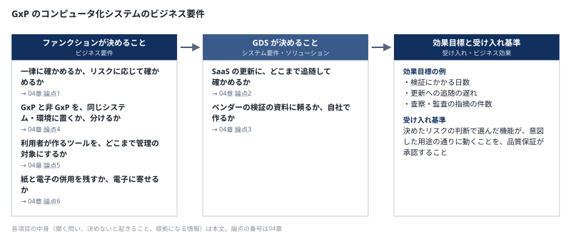

# 05 GxP のコンピュータ化システムのビジネス要件

## 要旨

GxP の検証の進め方を決める前に、ファンクション（品質保証と各業務の部門）には**どのシステム・機能が GxP の記録を扱うか**と、**どのリスクをどこまで受け入れるか**を決めてもらう。検証の責任は IT ではなく品質保証が持つ。

この章は、governance/budget-transfer の kickoff 資料（IT 予算移管の要点）にある役割分担を、この技術について具体化したものである。

*図1　GxP のコンピュータ化システムのビジネス要件（ファンクションが決めたビジネス要件をもとに GDS がシステム要件とソリューションを決め、効果目標と受け入れ基準で確かめる）*

## ファンクションが決めること（ビジネス要件）

### 一律に確かめるか、リスクに応じて確かめるか

- **決めること**：リスクの判断の基準（→ 04章 論点1）
- **聞く問い**：「品質・患者の安全・データの完全性への影響が大きい機能はどれか」
- **決めないと起きること**：すべての機能に同じ重さの検証がかかり、更新に追いつかない
- **根拠になる情報**：業務の手順、過去の逸脱と査察の指摘

### GxP と非 GxP を、同じシステム・環境に置くか、分けるか

- **決めること**：GxP の対象のシステム・環境の範囲（→ 04章 論点4）
- **聞く問い**：「このシステムで扱う記録のうち、GxP の対象はどれか」
- **決めないと起きること**：非 GxP の変更にも GxP の管理がかかる、または対象の漏れが査察で見つかる
- **根拠になる情報**：業務の手順、記録の一覧

### 利用者が作るツールを、どこまで管理の対象にするか

- **決めること**：利用者が作るツールの扱い（→ 04章 論点5）
- **聞く問い**：「表計算やローコードのアプリで、GxP の計算や記録をしているものはどれか」
- **決めないと起きること**：管理の外で GxP の記録が作られる
- **根拠になる情報**：部門のツールの棚卸し

### 紙と電子の併用を残すか、電子に寄せるか

- **決めること**：紙と電子の併用（→ 04章 論点6）
- **聞く問い**：「電子の記録を印刷して署名する運用を、いつまで続けるか」
- **決めないと起きること**：どちらが原本かの管理が要り、食い違いが起きる
- **根拠になる情報**：業務の手順、電子署名の準備

## GDS が決めること

- SaaS の更新に、どこまで追随して確かめるか（→ 04章 論点2）。影響の判断の結果は品質保証と合意する
- ベンダーの検証の資料に頼るか、自社で作るか（→ 04章 論点3）。ベンダーの評価（監査）は品質保証と合意する

## 効果目標と受け入れ基準

- **効果目標の例**：検証にかかる日数、更新への追随の遅れ、査察・監査の指摘の件数
- **受け入れ基準**：決めたリスクの判断で選んだ機能が、意図した用途の通りに動くことを、品質保証が承認すること

## 部門に閉じた案件として扱えないとき

- GxP の記録を扱うシステムは、どの部門の案件でも品質保証の承認が要る

境界の詳細（どのシステムが何を持つか）は [function-allocation](../../../cross-cutting/function-allocation/function-allocation.md) を参照。

---

**出典**（確認日：2026-11-15）

- 役割分担の原則と4つの場面：governance/budget-transfer の kickoff 資料（IT 予算移管の要点、2026-11-02 初版）
- 項目の立て方、問い、例は、04章の論点をもとにした本資料の整理
