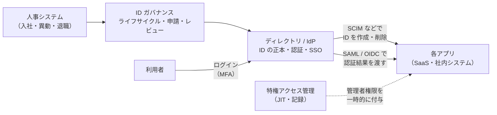

# 02 ID・アクセス管理の構造

## 要旨

IAM は、**人事の情報を起点に ID を作り（ガバナンス）、IdP で本人を確かめ（アクセス管理）、各アプリに ID と権限を配る（プロビジョニング）**流れでできている。影響の大きい特権 ID は、この流れとは別に、使うときだけ権限を与える形で守る。

## 全体の流れ

*図1　IAM の構成要素と流れ（本資料の整理）*

## ID のライフサイクル（入社・異動・退職）

ID の管理は、人の動きに合わせた3つの出来事で考える。英語では Joiner・Mover・Leaver（JML）と呼ぶ。

| 出来事 | 何が起きるか | 失敗したときの影響 |
|---|---|---|
| 入社（Joiner） | ID を作り、職務に必要な権限を与える | 初日から仕事ができない |
| 異動（Mover） | 新しい職務の権限を足し、前の職務の権限を外す | 前の部署の権限が残り、権限が積み上がる |
| 退職（Leaver） | アカウントを無効にし、権限とライセンスを外す | 退職者のアカウントが使える状態で残る |

例：Microsoft Entra ID Governance のライフサイクルワークフローは、入社・異動・退職の出来事ごとに、作業（ようこそメールの送信、グループへの追加、アカウントの無効化など）を、出来事の前・当日・後に予約して自動で実行する。

web-security 02章で触れた Colonial Pipeline の事例（使われなくなった VPN アカウントが無効化されずに残っていた）は、退職・不要時の処理が漏れた例でもある。

## 認証の強さを3つに分けて考える（NIST SP 800-63）

NIST SP 800-63 は、デジタル ID の確からしさを1つの段階で表すのをやめ、次の3つを**別々に**選ぶ考え方をとる。最新の 800-63-4（2025年）もこの3つを引き継いでいる。

| 指標 | 何の強さか | 対応する文書 |
|---|---|---|
| IAL（Identity Assurance Level） | 登録時の本人確認（身元確認）の強さ | SP 800-63A-4 |
| AAL（Authentication Assurance Level） | ログイン時の認証の強さ（パスワード、MFA など） | SP 800-63B-4 |
| FAL（Federation Assurance Level） | IdP から各アプリへ認証結果を渡すときの強さ | SP 800-63C-4 |

社員向けの IAM では、入社手続きで本人確認をするため IAL を IAM 側で意識することは少なく、主に AAL（どのアプリにどの強さの MFA を求めるか）を設計することになる（本資料の整理）。

## プロビジョニング（SCIM）

SCIM（System for Cross-domain Identity Management）は、ユーザーやグループの作成・変更・取得を行うための HTTP ベースのプロトコルで、企業からクラウドサービスへの ID の配布などを想定している。共通のスキーマと API を決めることで、アプリごとに個別の接続を作る手間と費用を減らすことが目的である。

- SSO（SAML・OIDC）は**ログインの時点**で認証結果を渡す仕組みで、アプリ側の ID の作成・削除はしない。
- SCIM は**ID そのもの**をアプリに作り、退職時に削除・無効化する。SSO だけでは、アプリ側に ID が残る。

## 特権 ID の管理

管理者権限は、奪われたときの影響が大きいため、通常の ID と分けて管理する。中心になる考え方は次のとおり（本資料の整理）。

- **常時付与しない（Just-in-Time）**：権限を使える資格（eligible）だけを与え、必要なときに申請・承認を経て、時間を区切って有効にする。例：Microsoft Entra Privileged Identity Management（PIM）。
- **認証情報を人に渡さない**：共有の管理者パスワードは保管庫（vault）に置き、PAM 製品が代理でログインする。
- **操作を記録する**：特権での操作は、後から追跡できるように記録する。

最小権限の原則そのもの（必要な権限だけを与える）は web-security 02章「セキュリティ設計の5原則」で扱う。

## 権限の見直し（アクセスレビュー）

付与した権限が今も必要かを、定期的に所有者や上長に確認させる仕組み。Gartner は、アクセス認証（attestation・review とも呼ぶ）とアクセス申請を、IGA の主要な機能に挙げている。異動の処理が漏れて積み上がった権限は、レビューで見つけて外す。

---

**出典**（確認日：2026-11-14）

- ライフサイクルワークフロー：Microsoft Learn「Governance deployment — employee lifecycle」— https://learn.microsoft.com/en-us/entra/architecture/governance-deployment-employee-lifecycle
- NIST SP 800-63-4 と IAL・AAL・FAL：NIST CSRC — https://csrc.nist.gov/pubs/sp/800/63/4/final 、Implementation Resources — https://pages.nist.gov/800-63-4-Implementation-Resources/ 、変更履歴 — https://pages.nist.gov/800-63-4/sp800-63/changelog
- SCIM の目的と範囲：IETF RFC 7644 — https://datatracker.ietf.org/doc/rfc7644/
- Microsoft Entra PIM：Microsoft Learn「Start using Privileged Identity Management」— https://learn.microsoft.com/entra/id-governance/privileged-identity-management/pim-getting-started
- IGA の主要機能：Gartner Peer Insights「Identity Governance and Administration」の機能一覧 — https://www.gartner.com/reviews/market/identity-governance-administration/vendor/imanami
- 図1、AAL を中心に設計するという整理、特権 ID 管理の3つの考え方は、上記をもとにした本資料の整理
