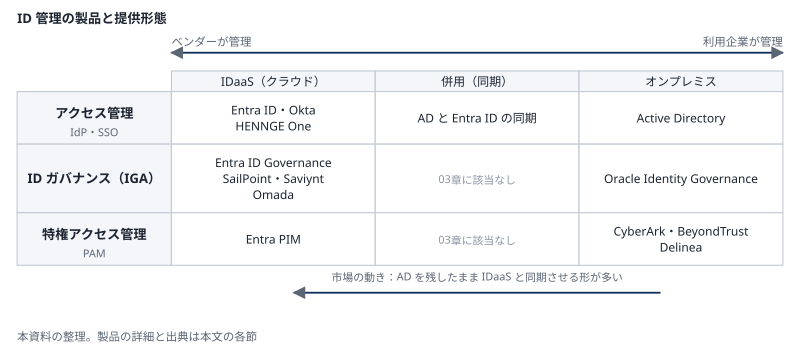

# 03 ID・アクセス管理の製品と提供形態

## 要旨

IAM の製品は、**アクセス管理（IdP・SSO）**、**ID ガバナンス（IGA）**、**特権アクセス管理（PAM）**の3つの市場に分かれる。IdP の製品が IGA や PAM の一部の機能を持つこともあり、どこまでを IdP の付属機能で済ませ、どこから専門製品を使うかが選択の軸になる（→ 04章）。

提供形態は、現在はクラウドで提供される IDaaS（Identity as a Service）が中心である。オンプレミスの Active Directory は、多くの組織で IDaaS と同期させて併用されている。

*図1　ID 管理の製品と提供形態（縦は製品の区分、横は提供形態。本資料の整理）*

## アクセス管理（IdP・SSO）

| | **Microsoft Entra ID** | **Okta Workforce Identity** | **Ping Identity** | **HENNGE One**（国内） |
|---|---|---|---|---|
| 提供元 | Microsoft | Okta | Ping Identity | HENNGE |
| 料金の考え方（2026年時点の公表値） | Entra ID Free は Microsoft 365・Azure などに含まれる。条件付きアクセスには P1 が必要で、P1 は Microsoft 365 E3・Business Premium に含まれる | ユーザー単位の月額（年契約）。Starter は $6、Essentials は $17 | 本資料では未調査 | 本資料では未調査 |
| 主な特徴 | Microsoft 365 自体が Entra ID を使う。場所・デバイスなどの条件で制御する条件付きアクセス。オンプレミスの AD と同期できる | 8,000 以上の事前構築済みのアプリ連携（Okta Integration Network） | ハイブリッド・マルチクラウドの大企業向けを打ち出している | Microsoft 365・Google Workspace・Box などへの SSO とアクセス制御。メール誤送信対策などと組み合わせた製品群として提供 |
| 補足 | 2023年に Azure AD から改称 | 2021年に Auth0 を買収（顧客向けは Auth0 → web-security 03章） | 本資料では未確認 | 販売代理店は、ITR の調査で国内 IDaaS 市場の売上シェア1位と紹介している |

Gartner の 2025年の Access Management の Magic Quadrant では、Microsoft・Okta・Ping Identity などがリーダーに位置付けられている（各社の発表による）。

## ID ガバナンス（IGA）

| 製品 | 提供元 | 補足 |
|---|---|---|
| Microsoft Entra ID Governance | Microsoft | ライフサイクルワークフロー、アクセスパッケージ（権限の申請単位）、アクセスレビュー、PIM を含む |
| SailPoint Identity Security Cloud | SailPoint | IGA の専門ベンダー |
| Saviynt Identity Cloud | Saviynt | IGA・アプリのアクセス・PAM をまとめて提供 |
| Oracle Identity Governance | Oracle | Oracle の IGA 製品。機能の違いは本資料では未確認 |
| Omada Identity | Omada | クラウドネイティブの IGA |

IdP に付属する IGA（Entra ID Governance など）は、その IdP につながるアプリには強いが、つながらないアプリ（古い社内システムなど）まで管理するには、専門の IGA 製品やコネクタが必要になる（本資料の整理）。

## 特権アクセス管理（PAM）

Gartner の Privileged Access Management の Magic Quadrant 2025年版（2025年10月13日）では、BeyondTrust・CyberArk・Delinea がそれぞれリーダーとされたと発表している。

| 製品群 | 提供元 | 補足 |
|---|---|---|
| CyberArk | CyberArk（2026年2月に Palo Alto Networks が買収） | 2025年版のリーダーで、ビジョンの完全性がもっとも高い位置（同社の発表）。買収後も単独の製品として提供を続けるとしている |
| BeyondTrust | BeyondTrust | 2025年版のリーダーで、実行能力がもっとも高い位置（同社の発表） |
| Delinea | Delinea（2021年4月に Thycotic と Centrify が統合） | 2025年版のリーダー（同社の発表） |
| Microsoft Entra PIM | Microsoft | Entra のロールと Azure のリソースに対する、時間を区切った権限付与。Entra ID P2 または Entra ID Governance のライセンスが必要 |

Entra PIM は「Entra と Azure の管理者権限」を対象にする。サーバーやデータベースの管理者パスワードの保管・代理ログイン・操作記録まで含む PAM 製品とは範囲が違う（本資料の整理）。

## 国内の製品

国内の IDaaS では、HENNGE One（上表）が Microsoft 365・Google Workspace などへの SSO とアクセス制御を、メールの誤送信対策などと合わせた製品群として出している。IGA・PAM の国内ベンダーの製品は、本資料では確認していない。

## 他の製品に付属する機能

| 付属先 | 付属する機能 | 専門製品との違い |
|---|---|---|
| Microsoft 365・Azure | Entra ID（Free は同梱、条件付きアクセスは P1 で Microsoft 365 E3 などに含まれる） | Microsoft 365 自体が Entra ID を使うため、IdP を別製品にしても Entra ID は残る |
| Entra ID P2・Entra ID Governance | ライフサイクルワークフロー、アクセスレビュー、PIM | その IdP につながるアプリには強いが、つながらない古い社内システムまで管理するには専門の IGA 製品が要る（上記、→ 04章） |

## 提供形態

| 形態 | ベンダーが管理するもの | 利用企業が管理するもの | 例 |
|---|---|---|---|
| IDaaS（クラウド） | 認証の基盤、可用性、更新 | 利用者と権限の設定、アプリとの連携、条件付きアクセスの方針 | Entra ID、Okta、HENNGE One |
| オンプレミス | ソフトウェアの提供と保守 | 上記に加えて、サーバ・冗長化・更新の適用 | Active Directory |
| 併用（同期） | IDaaS 側の基盤 | オンプレミスの AD と IDaaS の同期の仕組みと、どちらを正本にするかの設計 | AD と Entra ID の同期 |

多くの組織は、オンプレミスの AD を残したまま IDaaS と同期させて使っている（要旨）。どちらを ID の正本にするかは、人事システムとの関係で決まる（→ 05章、hcm 05章）。

## 市場の動き

| 時期 | できごと |
|---|---|
| 2021年 | Okta が Auth0 を買収した。Thycotic と Centrify が統合して Delinea になった（2021年4月） |
| 2023年7月 | Microsoft が Azure AD を Entra ID に改称した |
| 2025年10月 | Gartner の PAM の Magic Quadrant 2025年版が出た |
| 2026年2月11日 | Palo Alto Networks が CyberArk の買収を完了した。ネットワーク・セキュリティ運用と同じ会社で特権アクセスまで扱う形になる |

## 本資料でまだ扱っていないもの

- Ping Identity・HENNGE One の料金
- IGA・PAM の国内ベンダーの製品
- 顧客向けの ID（CIAM、→ web-security 03章）

---

**出典**（確認日：2026-11-14）

- Entra ID・Okta の料金と特徴：web-security 03章の出典（Microsoft Learn「Microsoft Entra licensing」、Okta「Plans & pricing」、Okta Integration Network）を引き継ぐ
- Entra ID への改称：Azure 更新情報（2023-07-11）— https://azure.microsoft.com/ja-jp/updates/azure-ad-is-becoming-microsoft-entra-id/
- Access Management の Magic Quadrant（2025）：Okta のプレスリリース（2025-11-18）— https://www.businesswire.com/news/home/20251118932159/en/ 、Ping Identity — https://www.pingidentity.com/en/resources/blog/post/gartner-magic-quadrant.html
- HENNGE One：HENNGE プレスリリース — https://hennge.com/global/info/press/20201105-jr-gl/ 、ソフトバンクの製品ページ（ITR の調査の紹介）— https://www.softbank.jp/business/service/security/hennge-one/
- IGA の製品：Gartner Peer Insights「Identity Governance and Administration」— https://gcom.pdo.aws.gartner.com/reviews/market/identity-governance-administration 、TechTarget「What is IGA」— https://www.techtarget.com/cybersecurity/definition/What-is-identity-governance-and-administration-IGA
- Entra ID Governance の構成：Microsoft Learn — https://learn.microsoft.com/en-us/entra/architecture/governance-deployment-employee-lifecycle
- PAM の Magic Quadrant（2025-10-13）：Gartner — https://www.gartner.com/en/documents/7051198 、CyberArk（2025-10-16）— https://www.cyberark.com/it/press/cyberark-named-a-leader-in-the-2025-gartner-magic-quadrant-for-privileged-access-management/ 、BeyondTrust（2025-10-17）— https://www.cybersecuritydive.com/press-release/20251017-beyondtrust-named-a-leader-in-2025-gartner-magic-quadranttm-for-privileged-1/ 、Delinea（2025-10-16、2021年4月の統合）— https://delinea.com/news/delinea-named-a-leader-in-2025-gartner-magic-quadrant-for-pam-for-seventh-consecutive-time
- Palo Alto Networks による CyberArk の買収の完了（2026-02-11）：Palo Alto Networks — https://paloaltonetworks.com/company/press/2026/palo-alto-networks-completes-acquisition-of-cyberark-to-secure-the-ai-era 、単独の製品として続けること：Technology Decisions（2026-02-13）— https://www.technologydecisions.com.au/content/security/news/palo-alto-completes-cyberark-acquisition-1542473032
- Entra PIM のライセンス：Microsoft Learn — https://learn.microsoft.com/entra/id-governance/privileged-identity-management/pim-getting-started
- 「本資料の整理」と書いた箇所は、上記をもとにした本資料の見解
- 提供形態の表と付属の機能の表は、上記の出典をもとにした本資料の整理
- 製品の区分は 2026-11 時点の各社の公表情報による。契約の判断の前には各社の最新の資料で確かめる
