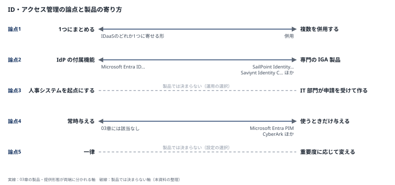

# 04 ID・アクセス管理の主要な論点

## 要旨

IAM を扱うときに出てくる軸は次の5つである（本資料の整理）。懸念や要望を聞いたときは、まずそれがどの軸の話かを特定する。

1. IdP を1つにまとめるか、複数を併用するか
2. ガバナンスを IdP の付属機能で済ませるか、専門の IGA 製品を使うか
3. ID の起点を人事システムに置くか、IT 部門の手作業に置くか
4. 特権を常時与えるか、使うときだけ与えるか
5. 認証の強さを一律にするか、アプリの重要度に応じて変えるか

*図1　ID・アクセス管理の論点と製品の寄り方（実線は03章の製品が両端に分かれる軸、破線は製品では決まらない軸。本資料の整理）*

## 論点1：IdP を1つにまとめるか、複数を併用するか

| | 1つにまとめる | 複数を併用する |
|---|---|---|
| 得るもの | MFA・条件付きアクセスの方針が1か所で決まる。退職時に止める場所が1つで済む | 既存の環境（オンプレミスの AD、製品ごとの認証）を作り直さずに済む |
| 失うもの | 移行の手間。その IdP が止まると全アプリに入れない | 方針がばらつく。退職時に止め忘れる場所が増える |

**製品・提供形態との対応**（→ 03章）

| | 1つにまとめるに寄るもの | 複数を併用するに寄るもの |
|---|---|---|
| 製品・提供形態 | IDaaS（Microsoft Entra ID、Okta Workforce Identity、Ping Identity、HENNGE One）のどれか1つに寄せる形 | 併用（オンプレミスの AD と IDaaS を同期させる形） |

典型的な懸念：「SaaS ごとに ID とパスワードがある」「退職者のアカウントが残っていた」

## 論点2：ガバナンスを IdP の付属機能で済ませるか、専門の IGA 製品を使うか

| | IdP の付属機能（例：Entra ID Governance） | 専門の IGA 製品 |
|---|---|---|
| 得るもの | 追加の製品と連携が要らない。IdP につながるアプリはすぐ管理できる | IdP につながらない古いシステムまで、同じ手順で管理できる。職務分掌の検査など機能が深い |
| 失うもの | IdP につながらないアプリは管理の外に残る | 製品と運用の費用。人事・IdP・各アプリとの接続を作る必要がある |

**製品・提供形態との対応**（→ 03章）

| | IdP の付属機能（例：Entra ID Governance）に寄るもの | 専門の IGA 製品に寄るもの |
|---|---|---|
| 製品・提供形態 | Microsoft Entra ID Governance。IdP と同じ製品群 | SailPoint Identity Security Cloud、Saviynt Identity Cloud、Oracle Identity Governance、Omada Identity |

典型的な懸念：「アクセスレビューが表計算で回っている」「監査で権限の棚卸しを求められた」

## 論点3：ID の起点を人事システムに置くか、IT 部門の手作業に置くか

| | 人事システムを起点にする | IT 部門が申請を受けて作る |
|---|---|---|
| 得るもの | 入社・異動・退職が漏れなく、すぐに反映される | 人事システムとの連携が要らない |
| 失うもの | 人事データの正確さ（所属・役職・退職日）に依存する。委託先など人事システムにいない人は別の手順が要る | 連絡が遅れたり漏れたりすると、権限が残る・足りない |

**製品・提供形態との対応**（→ 03章）：製品では決まらない（運用の選択）。人事を起点にする場合は、IGA の製品（Entra ID Governance のライフサイクルワークフローなど）が人事データを受け取る

典型的な懸念：「異動したのに前の部署の権限が残っている」「人事の発令とアカウントの反映がずれる」

## 論点4：特権を常時与えるか、使うときだけ与えるか

| | 常時与える | 使うときだけ与える（JIT） |
|---|---|---|
| 得るもの | 運用が簡単。緊急時にすぐ使える | 奪われても使える時間が短い。誰がいつ使ったかが残る |
| 失うもの | 奪われたときの被害が大きい | 申請・承認の手間。緊急時用の手順（非常用アカウント）を別に用意する必要がある |

**製品・提供形態との対応**（→ 03章）

| | 常時与えるに寄るもの | 使うときだけ与える（JIT）に寄るもの |
|---|---|---|
| 製品・提供形態 | 03章には該当なし（常時の権限は運用で決まる） | Microsoft Entra PIM、CyberArk、BeyondTrust、Delinea |

典型的な懸念：「管理者が多すぎる」「共有の管理者パスワードを誰が知っているか分からない」

## 論点5：認証の強さを一律にするか、アプリの重要度に応じて変えるか

| | 一律（全アプリに同じ MFA） | 重要度に応じて変える |
|---|---|---|
| 得るもの | 方針が単純で説明しやすい | 重要なアプリにはフィッシングに強い方式を求め、それ以外は利便性を優先できる |
| 失うもの | 重要なアプリには弱く、それ以外には過剰になりがち | アプリごとの重要度を決め、条件付きアクセスなどで方針を作り分ける手間 |

NIST SP 800-63 が IAL・AAL・FAL を別々に、リスクに応じて選ぶ考え方をとるのは、この論点に対応する（→ 02章）。

**製品・提供形態との対応**（→ 03章）：製品では決まらない（設定の選択）。重要度に応じて変えるには、条件付きアクセスの機能（Entra ID P1 以上など）が要る

---

**出典**（確認日：2026-11-14）

- 5つの軸と各表の「得るもの・失うもの」「典型的な懸念」は、01〜03章の内容をもとにした本資料の整理
- NIST SP 800-63-4 のリスクに応じた選択：NIST — https://pages.nist.gov/800-63-4/sp800-63/dirm
- 各論点の「製品・提供形態との対応」は、03章の製品をもとにした本資料の整理
