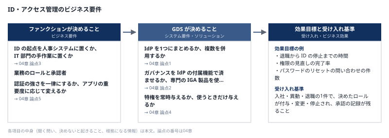

# 05 ID・アクセス管理のビジネス要件

## 要旨

ID・アクセス管理の製品の選択は GDS が決める。ファンクションに決めてもらうのは、**業務のロール（誰に何を許すか）**と、**人の情報の正本を誰が保つか**である。

この章は、governance/budget-transfer の kickoff 資料（IT 予算移管の要点）にある役割分担を、この技術について具体化したものである。

*図1　ID・アクセス管理のビジネス要件（ファンクションが決めたビジネス要件をもとに GDS がシステム要件とソリューションを決め、効果目標と受け入れ基準で確かめる）*

## ファンクションが決めること（ビジネス要件）

### ID の起点を人事システムに置くか、IT 部門の手作業に置くか

- **決めること**：人の情報の正本を保つ責任（→ 04章 論点3）
- **聞く問い**：「入社・異動・退職を、いつまでに人事システムに登録できるか。委託先の人は誰が登録するか」
- **決めないと起きること**：人事の登録が遅れ、退職者の ID が残る
- **根拠になる情報**：人事の登録の手順、委託先の人数

### 業務のロールと承認者

- **決めること**：アプリごとの業務のロール（承認権限など）と、付与を承認する人
- **聞く問い**：「この業務で、誰にどの権限を与えてよいか。それを承認するのは誰か」
- **決めないと起きること**：権限の申請・見直しが IT 部門の判断になり、業務に合わない
- **根拠になる情報**：業務の職務の分担、職務の分離の要件

### 認証の強さを一律にするか、アプリの重要度に応じて変えるか

- **決めること**：アプリの重要度（→ 04章 論点5）
- **聞く問い**：「このアプリの情報が漏れたとき、業務への影響はどの程度か」
- **決めないと起きること**：すべてのアプリに同じ認証をかけ、重要なアプリには弱く、他には過剰になる
- **根拠になる情報**：扱う情報の分類

## GDS が決めること

- IdP を1つにまとめるか、複数を併用するか（→ 04章 論点1）
- ガバナンスを IdP の付属機能で済ませるか、専門の IGA 製品を使うか（→ 04章 論点2）
- 特権を常時与えるか、使うときだけ与えるか（→ 04章 論点4）

## 効果目標と受け入れ基準

- **効果目標の例**：退職から ID の停止までの時間、権限の見直しの完了率、パスワードのリセットの問い合わせの件数
- **受け入れ基準**：入社・異動・退職の1件で、決めたロールが付与・変更・停止され、承認の記録が残ること

## 部門に閉じた案件として扱えないとき

- ID はすべてのアプリにかかるため、部門ごとに IdP を持たない
- GxP のシステムでは、個人ごとの ID と権限の見直しが要件になる

境界の詳細（どのシステムが何を持つか）は [function-allocation](../../../cross-cutting/function-allocation/function-allocation.md) を参照。

---

**出典**（確認日：2026-11-15）

- 役割分担の原則と4つの場面：governance/budget-transfer の kickoff 資料（IT 予算移管の要点、2026-11-02 初版）
- 項目の立て方、問い、例は、04章の論点をもとにした本資料の整理
