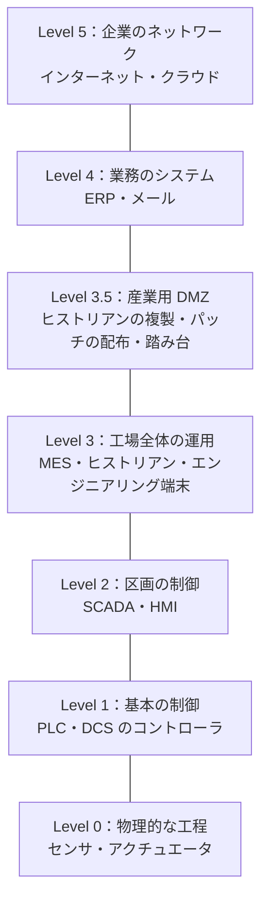

# 02 OT セキュリティの構造

## 要旨

OT セキュリティの骨格は、**ネットワークを階層とゾーンに分け、その間の通信を絞ること**である。階層の目安がパデューモデルで、IT と OT の間には**産業用 DMZ** を置く。IEC 62443 は、資産を**ゾーン**に、ゾーン間の通信路を**コンジット**にまとめ、ゾーンごとに守るべき強さ（**セキュリティレベル**）を決める。そのうえで、資産の把握、リモートアクセスの管理、パッチ（当てられなければ補償的な対策）、監視を組み合わせる。

## 構成要素

| 要素 | 役割 |
|---|---|
| 資産の一覧 | 守る対象（制御機器・端末・サーバ）と、そのつながりを把握する |
| ゾーン | 同じセキュリティ要求を持つ資産をまとめる |
| コンジット | ゾーン間の通信路。ここで通す通信を絞る |
| 産業用 DMZ | IT と OT の間の緩衝地帯。両者の通信をすべてここで受ける |
| リモートアクセスの経路 | 保守ベンダーなどが外から入る経路。承認と記録をかける |
| 監視のセンサー | 制御系の通信を受動的に見て、資産の把握と異常の検知を行う |

## 仕組み：パデューモデルと産業用 DMZ

*図1　パデューモデルの階層と産業用 DMZ（Trout、SentinelOne の解説をもとにした本資料の整理）*

- Level 0〜3 が OT、Level 4〜5 が IT にあたる。ISA-95 の階層（→ manufacturing 02章）とおおむね対応する。
- **産業用 DMZ（Level 3.5）**は、元のモデルにはなく、後から加えられた。IT と OT の間の通信はすべてここを通し、IT のシステムが OT に直接問い合わせない形にする。たとえば、ヒストリアンの複製を DMZ に置き、IT 側はそこからデータを読む。
- **限界**：クラウドへの接続や IIoT のゲートウェイは、階層を飛び越えて外とつながる。パデューモデルは考え方の枠組みとして使い、実際のデータの流れの把握で補う必要がある。NIST SP 800-82 Rev. 3 はゼロトラストの考え方も取り入れている。

## ゾーンとコンジット、セキュリティレベル

IEC 62443-3-2 は、リスク評価に基づいて、システムをゾーン（同じセキュリティ要求を持つ資産のまとまり）とコンジット（ゾーン間の通信路）に分けることを求める。ゾーンごとに目標のセキュリティレベル（SL）を決める。

| SL | 想定する攻撃者 |
|---|---|
| SL 1 | 偶然や不注意による違反 |
| SL 2 | 単純な手段・少ない資源・一般的な技能による意図的な攻撃 |
| SL 3 | 高度な手段・中程度の資源・制御系に固有の技能による意図的な攻撃 |
| SL 4 | 高度な手段・多くの資源・制御系に固有の技能と強い動機による意図的な攻撃 |

SL は組織の成熟度の点数ではなく、**そのゾーンが耐えるべき攻撃者の能力**で決まる。SL 2 が一般的な目標の基準とされる。

要求は7つの基本要件（識別と認証、使用の制御、システムの完全性、データの機密性、データの流れの制限、イベントへの適時の対応、資源の可用性）に整理されている。

## 立場ごとの役割（IEC 62443）

| 立場 | 主に参照する部 | 求められること |
|---|---|---|
| 資産の所有者（製造企業） | 2-1、3-2、3-3 | セキュリティの方針と体制、ゾーンとコンジットの設計、システムへの要求 |
| システムインテグレータ・保守事業者 | 2-4 | 導入・保守で守るべき要件 |
| 製品の提供者（機器メーカー） | 4-1、4-2 | 安全な開発の工程、部品の技術要件 |

## 主な対策

| 対策 | 内容 |
|---|---|
| 資産の把握 | どの機器が、どこで、何とつながっているかを一覧にする。止まると困る機器があるため、能動的なスキャンではなく、通信を受動的に見て把握するのが基本 |
| ネットワークの分離 | ゾーンを分け、ファイアウォールで許可した通信だけを通す。IT と OT の間は産業用 DMZ を通す |
| リモートアクセスの管理 | 保守ベンダーなどの外からの接続の経路を限り、接続の都度の承認と記録を行う |
| パッチと補償的な対策 | パッチは試験環境で影響を確かめてから、保守の時間帯に当てる。当てられない機器は、通信の許可リスト・実行できるプログラムの制限・受動的な監視・物理的な立ち入りの制限などで守る |
| 可搬媒体の管理 | USB メモリなどを通じた持ち込みを制限・検査する |
| バックアップ | PLC のプログラムや設定、HMI・サーバの構成を保存し、復元できるようにする |
| 監視と対応 | 制御系の通信の異常を検知し、対応の手順を決めておく（→ security-operations） |

---

**出典**（確認日：2026-11-14）

- パデューモデルの階層、産業用 DMZ の役割：SentinelOne — https://www.sentinelone.com/tw/cybersecurity-101/cybersecurity/what-is-the-purdue-model/ 、Trout — https://www.trout.software/glossary/purdue-model
- パデューモデルの限界：Seqred — https://seqred-website.pages.dev/en/blog/industrial-network-security-architecture/ 、Trout — https://www.trout.software/blog/purdue-model-limitations-and-alternatives-for-modern-ot
- NIST SP 800-82 Rev. 3 とゼロトラスト、補償的な対策：Security Scientist — https://www.securityscientist.net/blog/12-questions-and-answers-about-nist-sp-800-82/ 、https://answers.securityscientist.net/q/24320/how-should-you-handle-legacy-systems 、パッチの扱い：Claroty — https://claroty.com/blog/examining-nists-latest-revision-to-sp-800-82r3
- ゾーンとコンジット：IEC — https://syc-se.iec.ch/deliveries/cybersecurity-guidelines/security-standards-and-best-practices/iec-62443/
- セキュリティレベル：BD Emerson（2026-10）— https://www.bdemerson.com/article/iec-62443 、Trout — https://www.trout.software/resources/iec-62443 、SL 2 を基準とする見方：Opsio — https://opsiocloud.com/no/knowledge-base/what-is-iec-62443-standard/
- 7つの基本要件と立場ごとの役割：Encryption Consulting — https://www.encryptionconsulting.com/education-center/iec-62443/ 、SmartSuite — https://www.smartsuite.com/frameworks/iec-62443-series-security-for-industrial-automation-and-control-systems
- SL 3・SL 4 の説明、主な対策の表は、上記をもとにした本資料の整理
