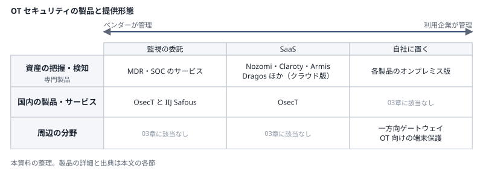

# 03 OT セキュリティの製品と提供形態

## 要旨

OT セキュリティの中心の製品分野は、制御系の通信を受動的に見て**資産を把握し、脅威を検知する**製品で、Gartner は「CPS 保護プラットフォーム」として2025年から Magic Quadrant を出している。2025〜2026年には、専業の大手が**制御機器メーカー（三菱電機）や IT 運用の基盤（ServiceNow）に買収される**動きが続いた。このほか、一方向の通信に限る装置、リモートアクセス、OT 向けの端末保護などの製品を組み合わせる。

*図1　OT セキュリティの製品と提供形態（縦は製品の区分、横は提供形態。本資料の整理）*

## 主要な製品

### CPS 保護プラットフォーム

Gartner は、産業用プロトコルや制御系の通信の知識を使って、本番の環境の CPS を見つけ、分類し、つながりを図にし、守る製品をこの分野と定義する。初回は2025年2月で、2回目は2026年3月3日に出た。

| 製品 | ベンダー | 2026年版の位置 | 特徴 |
|---|---|---|---|
| Nozomi Networks | Nozomi Networks（三菱電機の子会社） | リーダー | 三菱電機が買収を2026年1月28日に完了（約10億ドルと報じられた）。独立した子会社として、特定のメーカーに依らない方針を続けるとしている。製薬の上位10社のうち7社が顧客と同社は説明 |
| Claroty | Claroty | リーダー | SaaS の xDome と、自社に置く CTD の2つの形で提供 |
| Armis Centrix | Armis（ServiceNow の子会社） | リーダー | ServiceNow が約77.5億ドルでの買収を2026年4月20日に完了。IT・OT・IoT・医療機器などの資産をまたいで把握する |
| Dragos | Dragos | リーダー | OT のセキュリティの専業。機能の違いは本資料では未確認 |
| Forescout・Tenable・Fortinet | 各社 | チャレンジャー | IT のセキュリティの製品（ネットワークのアクセス制御、脆弱性管理、ファイアウォール）から OT に広げた各社 |
| Microsoft Defender for IoT | Microsoft | ニッチプレーヤー（2025年版はリーダー） | Microsoft の Defender の製品群の一部（→「他の製品に付属する機能」） |
| Cisco・Palo Alto Networks・Honeywell・TXOne Networks | 各社 | ニッチプレーヤー | Honeywell は制御機器のメーカー |
| Darktrace | Darktrace | ビジョナリー | 機能の違いは本資料では未確認 |

### そのほかの製品分野

| 分野 | 内容 |
|---|---|
| 一方向ゲートウェイ（データダイオード） | 物理的に一方向の通信だけを通す装置。OT から IT へのデータの送り出しだけを許す |
| セキュアリモートアクセス | 保守ベンダーなどの外からの接続を、承認・記録・時間の制限つきで提供する |
| OT 向けの端末保護 | 古い OS の端末でも動く、実行できるプログラムを制限する方式などの保護 |
| 次世代ファイアウォール（産業用プロトコル対応） | 制御系のプロトコルの中身を見て通信を制御する |
| 制御機器メーカーのセキュリティサービス | 機器のメーカーが、自社の機器の構成管理・パッチ・監視をまとめて提供する |

## 国内の製品

| 製品・サービス | 提供元 | 補足 |
|---|---|---|
| OsecT | NTT ドコモビジネス（旧 NTT コミュニケーションズ） | 制御系の通信を見て、資産の可視化と脅威の検知を行う国産の製品。2022年4月に提供を始め、設定済みのセンサーを追加で置く形で、月額6万円（税別）から。中小企業を中心に販売する |
| OsecT と IIJ Safous の組み合わせ | NTT ドコモビジネス、IIJ | 侵入の検知と、保守ベンダーなどのリモートアクセス（承認・パスワードの秘匿・操作の録画）を1つにまとめ、2025年9月に国内で販売を始めた。海外製品を個別に入れるより安く使えるとしている |
| 三菱電機の OT セキュリティ | 三菱電機（Nozomi Networks を傘下に持つ） | 三菱電機のネットワークセンサーと、NTT 側の分析サーバを組み合わせた IoT・OT 向けの製品を2024年5月に出した。工場向けの対策をワンストップで提供するとしている |

## 他の製品に付属する機能

| 付属先 | 付属する機能 | 補足 |
|---|---|---|
| Microsoft Defender | Defender for IoT（資産の把握と検知） | Microsoft の端末保護・SIEM と同じ製品群で扱える（→ security-operations 03章） |
| 制御機器メーカーのサービス | 自社の機器の構成管理・パッチ・監視 | メーカーに依らない監視の製品にするか、メーカーのものにするかは 04章 論点5 の軸である |
| ServiceNow | Armis Centrix（2026年に子会社化） | IT の運用の基盤（CMDB など）と、OT の資産の把握がつながる（→ it-operations） |

## 提供形態

| 形態 | ベンダーが管理するもの | 利用企業が管理するもの | 例 |
|---|---|---|---|
| 自社に置く | ソフトウェアの提供と保守 | センサーと管理サーバを工場の中で管理する。外とのつながりを持たない環境に向く | 各製品のオンプレミス版 |
| SaaS | 管理と分析の基盤（クラウド） | 工場に置くセンサー、工場からクラウドへの通信。複数の工場をまとめて見やすい | 各製品のクラウド版 |
| 監視の委託 | 監視と一次対応（外部の SOC） | 判断と対応の指示、設備を知る人との連携。夜間・休日も監視できる（→ security-operations） | MDR・SOC のサービス |

## 市場の動き

| 時期 | できごと |
|---|---|
| 2025年2月 | Gartner が CPS 保護プラットフォームの最初の Magic Quadrant を出した |
| 2025年6月 | NTT コミュニケーションズと IIJ が、OT 向けの侵入の検知とリモートアクセスを組み合わせた製品を発表した（9月に販売開始） |
| 2026年1月28日 | 三菱電機が Nozomi Networks の買収を完了した |
| 2026年3月3日 | Gartner が2回目の Magic Quadrant を出した |
| 2026年4月20日 | ServiceNow が Armis の買収を完了した |

## 本資料でまだ扱っていないもの

- 国内の SIer のサービスの全体像
- OT 向けの SOC のサービス
- 製品の料金の考え方

---

**出典**（確認日：2026-11-14）

- CPS 保護プラットフォームの定義と Magic Quadrant（2026-03-03）：Gartner — https://www.gartner.com/doc/7540249 、2026年版の各社の位置：Nozomi Networks — https://www.nozominetworks.com/gartner-magic-quadrant-cps-protection-platforms
- 2025年版（2025-02）のリーダー：Armis — https://armis.com/analyst-reports/armis-named-a-leader-in-the-2025-gartner-magic-quadrant-for-cps-protection-platforms
- 三菱電機による Nozomi Networks の買収：三菱電機（01net 転載）— https://www.01net.it/mitsubishi-electric-completes-full-acquisition-of-nozomi-networks/ 、Automation.com（2026-01-29）— https://www.automation.com/article/nozomi-networks-next-phase-growth-mitsubishi-electric-completes-acquisition 、金額：SecurityBrief Asia — https://securitybrief.asia/story/mitsubishi-electric-seals-usd-1bn-nozomi-networks-deal 、顧客の構成：IoT M2M Council — https://iotm2mcouncil.org/iot-library/news/iot-newsdesk/mitsubishi-completes-acquisition-of-nozomi-networks/
- ServiceNow による Armis の買収：ServiceNow（2026-04-20）— https://newsroom.servicenow.com/press-releases/details/2026/ServiceNow-completes-Armis-acquisition-closing-the-gap-between-asset-visibility-and-cyber-risk/
- Claroty の提供形態：Claroty（2025-02-18）— https://blog.claroty.com/press-releases/claroty-named-a-leader-in-2025-gartner-magic-quadrant-for-cps-protection-platforms
- そのほかの製品分野と提供形態の表は本資料の整理
- OsecT：IT Leaders（2022-04-25）— https://it.impress.co.jp/articles/-/23116 、OsecT と IIJ Safous：クラウド Watch（2025-06-06）— https://cloud.watch.impress.co.jp/docs/news/2020276.html 、MONOist（2025-06-18）— https://monoist.itmedia.co.jp/mn/spv/2506/18/news022.html
- 三菱電機と NTT コミュニケーションズの製品（2024-05-28）：MONOist — https://monoist.itmedia.co.jp/mn/spv/2406/13/news076.html 、三菱電機の OT セキュリティ：三菱電機 — https://www.mitsubishielectric.co.jp/medigital/feature/ot-security/
- 付属の機能の表は、上記の出典をもとにした本資料の整理
- 製品の区分は 2026-11 時点の各社の公表情報による。契約の判断の前には各社の最新の資料で確かめる
