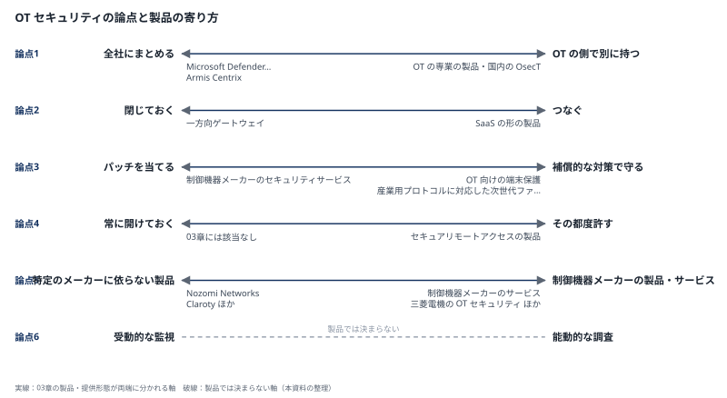

# 04 OT セキュリティの主要な論点

## 要旨

OT セキュリティを扱うときに出てくる軸は次の6つである（本資料の整理）。

1. 全社のセキュリティ運用にまとめるか、OT の側で別に持つか
2. OT のネットワークを閉じておくか、IT・クラウドとつなぐか
3. パッチを当てるか、補償的な対策で守るか
4. 保守ベンダーのリモートアクセスを常に開けておくか、その都度許すか
5. 監視の製品を、特定のメーカーに依らないものにするか、制御機器メーカーのものにするか
6. 資産を受動的な監視で把握するか、能動的に調べるか

*図1　OT セキュリティの論点と製品の寄り方（実線は03章の製品が両端に分かれる軸、破線は製品では決まらない軸。本資料の整理）*

## 論点1：全社のセキュリティ運用にまとめるか、OT の側で別に持つか

| | 全社にまとめる（IT のセキュリティ部門・SOC） | OT の側で別に持つ（生産技術・工場の IT） |
|---|---|---|
| 得るもの | 検知と対応の体制・製品・人を共有できる。IT から入った攻撃を一続きで追える | 設備と工程を知る人が判断できる。止めてよいかの判断が早い |
| 失うもの | 設備を知らない人が、止めてはいけない機器に手を出すおそれ | 体制が二重になる。IT 側との情報の共有が途切れやすい |

**製品・提供形態との対応**（→ 03章）

| | 全社にまとめる（IT のセキュリティ部門・SOC）に寄るもの | OT の側で別に持つ（生産技術・工場の IT）に寄るもの |
|---|---|---|
| 製品・提供形態 | Microsoft Defender for IoT（Defender・Sentinel と同じ製品群）、Armis Centrix（ServiceNow の基盤とつながる） | OT の専業の製品（Nozomi Networks、Claroty、Dragos）、国内の OsecT |

典型的な懸念：「工場のセキュリティは誰の責任か」「IT 部門は工場の設備に触ってよいのか」

管掌の区分の考え方は manufacturing 04章（論点4）にある。

## 論点2：OT のネットワークを閉じておくか、IT・クラウドとつなぐか

| | 閉じておく | つなぐ（IIoT・クラウドの分析・遠隔監視） |
|---|---|---|
| 得るもの | 外からの攻撃の経路が少ない | データを使った改善、遠隔での保守 |
| 失うもの | データの活用ができない。実際には USB や保守の回線などの例外の経路が残りがち | 経路が増え、階層を飛び越える接続が生まれる（→ 02章） |

閉じているつもりでも、IT 側の被害が受発注などを通じて生産を止めることがある（→ 01章の事例）。

**製品・提供形態との対応**（→ 03章）

| | 閉じておくに寄るもの | つなぐ（IIoT・クラウドの分析・遠隔監視）に寄るもの |
|---|---|---|
| 製品・提供形態 | 一方向ゲートウェイ（データダイオード） | SaaS の形の製品（Claroty xDome など）。工場からクラウドへの通信が前提になる |

## 論点3：パッチを当てるか、補償的な対策で守るか

| | パッチを当てる | 補償的な対策で守る |
|---|---|---|
| 得るもの | 脆弱性そのものをなくせる | 生産を止めずに済む。メーカーのサポートが切れた機器も守れる |
| 失うもの | 試験と停止の時間が要る。メーカーの動作保証が外れるおそれ | 脆弱性は残る。対策の維持の手間がかかる |

NIST SP 800-82 は、本来の対策がとれない場合の補償的な対策を認めている（→ 02章）。

**製品・提供形態との対応**（→ 03章）

| | パッチを当てるに寄るもの | 補償的な対策で守るに寄るもの |
|---|---|---|
| 製品・提供形態 | 制御機器メーカーのセキュリティサービス（自社の機器のパッチ） | OT 向けの端末保護、産業用プロトコルに対応した次世代ファイアウォール |

## 論点4：保守ベンダーのリモートアクセスを常に開けておくか、その都度許すか

| | 常に開けておく | その都度許す |
|---|---|---|
| 得るもの | 障害時にすぐ対応してもらえる | 侵入の経路を開ける時間が短い。誰がいつ入ったかが残る |
| 失うもの | 開けたままの経路が攻撃の入口になる | 承認の手間と、緊急時の遅れ |

**製品・提供形態との対応**（→ 03章）

| | 常に開けておくに寄るもの | その都度許すに寄るもの |
|---|---|---|
| 製品・提供形態 | 03章には該当なし（開けたままの回線） | セキュアリモートアクセスの製品（IIJ Safous と OsecT の組み合わせなど） |

典型的な懸念：「どの保守業者が、どの経路で工場に入れるのか、誰も把握していない」

## 論点5：監視の製品を、メーカーに依らないものにするか、制御機器メーカーのものにするか

| | 特定のメーカーに依らない製品 | 制御機器メーカーの製品・サービス |
|---|---|---|
| 得るもの | 複数のメーカーの機器が混在する工場を1つの製品で見られる | 自社の機器への深い対応。保守と一体で頼める |
| 失うもの | 機器ごとの深い対応はメーカーに及ばないことがある | 他のメーカーの機器が見えにくい。メーカーへの依存 |

専業の大手が制御機器メーカーや IT の基盤の会社に買収される動きがあり（→ 03章）、「中立」の前提が変わりうる（本資料の整理）。

**製品・提供形態との対応**（→ 03章）

| | 特定のメーカーに依らない製品に寄るもの | 制御機器メーカーの製品・サービスに寄るもの |
|---|---|---|
| 製品・提供形態 | Nozomi Networks、Claroty、Armis Centrix、Dragos、Forescout・Tenable・Fortinet、Microsoft Defender for IoT、OsecT | 制御機器メーカーのサービス、三菱電機の OT セキュリティ（Nozomi Networks を傘下に持つ）、Honeywell |

## 論点6：資産を受動的な監視で把握するか、能動的に調べるか

| | 受動的な監視（通信を見る） | 能動的な調査（機器に問い合わせる） |
|---|---|---|
| 得るもの | 機器に負荷をかけず、止めるおそれがない | 詳しい情報（版・設定）が取れる |
| 失うもの | 通信しない機器は見えない。詳しい版の情報が取れないことがある | 古い機器が問い合わせで止まるおそれ |

**製品・提供形態との対応**（→ 03章）：製品ごとに対応が違う。受動的な監視はどの製品も基本とし、能動的な調査の有無と方式は本資料では未確認

---

**出典**（確認日：2026-11-14）

- 6つの軸と各表の内容は、01〜03章と manufacturing 04・05章をもとにした本資料の整理
- 能動的なスキャンが古い機器を止めるおそれ：Security Scientist — https://answers.securityscientist.net/q/24320/how-should-you-handle-legacy-systems
- 各論点の「製品・提供形態との対応」は、03章の製品をもとにした本資料の整理
