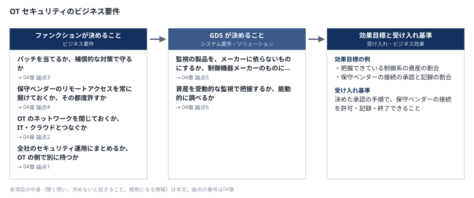

# 05 OT セキュリティのビジネス要件

## 要旨

OT セキュリティの対策を選ぶ前に、ファンクション（製造・保全）には**生産をどこまで止めてよいか**と、**保守ベンダーにいつ入らせるか**を決めてもらう。制御系では安全と生産の継続が最優先で、その判断は工場にしかできない。

この章は、governance/budget-transfer の kickoff 資料（IT 予算移管の要点）にある役割分担を、この技術について具体化したものである。

*図1　OT セキュリティのビジネス要件（ファンクションが決めたビジネス要件をもとに GDS がシステム要件とソリューションを決め、効果目標と受け入れ基準で確かめる）*

## ファンクションが決めること（ビジネス要件）

### パッチを当てるか、補償的な対策で守るか

- **決めること**：パッチのために止めてよい時間（→ 04章 論点3）
- **聞く問い**：「設備のパッチの適用のために、いつ・何時間なら止められるか」
- **決めないと起きること**：パッチを当てられないまま、補償的な対策も決まらない
- **根拠になる情報**：生産の計画、定期修理の時期

### 保守ベンダーのリモートアクセスを常に開けておくか、その都度許すか

- **決めること**：保守ベンダーのリモートアクセスの条件（→ 04章 論点4）
- **聞く問い**：「保守ベンダーが外から入る必要があるのは、どんなときか。誰が許可するか」
- **決めないと起きること**：開けたままの経路が攻撃の入口になる
- **根拠になる情報**：保守の契約、障害の頻度

### OT のネットワークを閉じておくか、IT・クラウドとつなぐか

- **決めること**：現場のデータを外で使う目的（→ 04章 論点2）
- **聞く問い**：「工場のデータをクラウドで何に使いたいか」
- **決めないと起きること**：目的のないまま現場をつなぎ、経路が増える
- **根拠になる情報**：使いたいデータ、設備の更新の予定

### 全社のセキュリティ運用にまとめるか、OT の側で別に持つか

- **決めること**：止めてよいかを判断する人（→ 04章 論点1）
- **聞く問い**：「攻撃が疑われたとき、設備を止めるかを判断するのは誰か」
- **決めないと起きること**：設備を知らない人が止めてはいけない機器に手を出す
- **根拠になる情報**：工場の体制、夜間の連絡

## GDS が決めること

- 監視の製品を、メーカーに依らないものにするか、制御機器メーカーのものにするか（→ 04章 論点5）
- 資産を受動的な監視で把握するか、能動的に調べるか（→ 04章 論点6）

## 効果目標と受け入れ基準

- **効果目標の例**：把握できている制御系の資産の割合、保守ベンダーの接続の承認と記録の割合
- **受け入れ基準**：決めた承認の手順で、保守ベンダーの接続を許可・記録・終了できること

## 部門に閉じた案件として扱えないとき

- 制御系の対策は全社のセキュリティ運用と連携するため、工場だけで閉じない
- 製造の記録に関わるため、GxP の要件がかかる

境界の詳細（どのシステムが何を持つか）は [function-allocation](../../../cross-cutting/function-allocation/function-allocation.md) を参照。

---

**出典**（確認日：2026-11-15）

- 役割分担の原則と4つの場面：governance/budget-transfer の kickoff 資料（IT 予算移管の要点、2026-11-02 初版）
- 項目の立て方、問い、例は、04章の論点をもとにした本資料の整理
