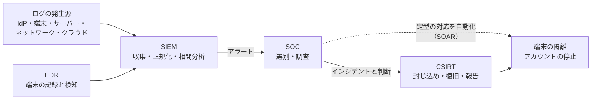

# 02 セキュリティ運用の構造

## 要旨

セキュリティ運用は、**ログと端末の記録を集めて異常を見つける仕組み（SIEM・EDR）**、**見つけたものを判断して手を打つ体制（SOC・CSIRT）**、**狙われる弱点を減らし続ける活動（脆弱性管理）**の3つでできている。仕組みは製品で買えるが、判断と対応は人と手順が担う。

## 検知と対応の流れ

*図1　検知から対応までの流れ（本資料の整理）*

## 検知の仕組み

| 仕組み | 何をするか | 補足 |
|---|---|---|
| SIEM（Security Information and Event Management） | さまざまな機器・システムのログを集め、正規化し、検知ルールで脅威を見つける。調査と対応を助け、法令・監査の報告にも使う | Gartner は SIEM を、オンプレミスとクラウドのセキュリティイベントを集めて分析する、設定可能な記録のシステムと定義している |
| EDR（Endpoint Detection and Response） | PC・サーバーの上の動き（プロセス、通信、ファイルの変更）を記録し、不審な動きを検知・調査し、端末の隔離などで対応する | 既知のマルウェアを防ぐ従来のウイルス対策（EPP）は、現在は EDR と同じ製品で提供されることが多い |
| XDR（Extended Detection and Response） | 端末に加え、ネットワーク・メール・クラウドなど複数の発生源のデータを集めて相関分析する | 定義はベンダーによって幅がある |
| SOAR（Security Orchestration, Automation and Response） | 定型の対応（端末の隔離、アカウントの停止、チケットの起票など）を手順として自動化する | SIEM の追加機能として提供されることが多い |

検知の質は、**どのログを集めるか**と**検知ルールを誰が作り、直し続けるか**で決まる。製品を入れただけでは、誤検知が多すぎて見落としが起きる（本資料の整理）。

## 体制：SOC・CSIRT・MDR

| 体制 | 役割（本資料の整理） |
|---|---|
| SOC（Security Operations Center） | 常時の監視。アラートを選別・調査し、インシデントかどうかを判断する |
| CSIRT（Computer Security Incident Response Team） | インシデントと判断されたものへの対応。封じ込め・復旧の指揮、経営・関係部署・外部（当局・取引先）との連絡 |
| MDR（Managed Detection and Response） | 外部の事業者が、検知の製品と分析者を合わせて提供するサービス。検知・調査に加えて、一定の対応まで行う |

MDR と従来の MSSP（セキュリティ機器の運用代行）の違いは、検知した後の調査と対応まで行うかどうかにある。MDR の事業者によって、どこまで対応するかの幅は大きい。

## インシデント対応（NIST SP 800-61 第3版）

第3版は、インシデント対応を CSF 2.0 の6つの機能に対応づけ、次の2つに分けて推奨事項を示している。

| 区分 | 含まれる CSF 2.0 の機能 | 内容 |
|---|---|---|
| 準備と教訓 | 統治・識別・防御 | 体制と手順の整備、資産とリスクの把握、事後の振り返りを次の改善につなげる |
| インシデント対応 | 検知・対応・復旧 | 見つける、分析する、封じ込める、元に戻す、報告する |

インシデント対応を「起きてから動く手順」ではなく、**普段のリスク管理の一部**として扱うことが、第3版の主な変更点である。

## 脆弱性管理

脆弱性管理は、次の循環を回し続ける活動である（本資料の整理）。

1. **資産を把握する**：何がどこにあるか（OS・ソフトウェアとそのバージョン）が分からなければ、脆弱性があるかも分からない。
2. **脆弱性を見つける**：スキャナーやベンダーの公表情報で、どの資産にどの脆弱性があるかを調べる。
3. **優先順位を付ける**：すべてをすぐには直せないため、直す順番を決める。
4. **直す・緩和する**：パッチの適用、設定の変更。直せない場合は、影響を抑える別の手段をとる。
5. **直ったことを確かめる**：再スキャンで確認する。

優先順位付けに使う主な情報は次のとおり。

| 情報 | 何を表すか | 注意点 |
|---|---|---|
| CVSS（Common Vulnerability Scoring System） | 脆弱性の深刻度。v4.0 では、基本・脅威・環境・補足の4つの評価グループに分かれ、どのグループを使ったかをスコア名で示す（CVSS-B、CVSS-BT など） | ベンダーや NVD が通常提供するのは基本スコア（CVSS-B）だけ。基本スコアだけでリスクを判断してはならないと、仕様自身が注意している |
| KEV（Known Exploited Vulnerabilities）カタログ | 米 CISA が公開する、実際に悪用が確認された脆弱性の一覧 | CISA は BOD 22-01 で、CVSS の点数だけに頼る方針から、悪用されている脆弱性を優先する方針に切り替えた |

---

**出典**（確認日：2026-11-14）

- SIEM の定義：Splunk による Gartner の定義の紹介 — https://www.splunk.com/goto/gartner_report 、Gartner Magic Quadrant for SIEM（2025）の抜粋 — https://secpost.ru/wp-content/uploads/2025/10/gartner-siem-mq-2025.pdf
- SOAR・UEBA が SIEM の追加機能として提供されること：Palo Alto Networks「What Are SIEM Tools?」— https://www.paloaltonetworks.com/cyberpedia/what-are-siem-tools
- EDR の定義：Fortra — https://www.fortra.com/resources/knowledge-base/endpoint-detection-and-response-edr
- 防御（EPP）と検知・対応（EDR）を1つのエージェントで提供する例：CrowdStrike（2025-07）— https://www.barchart.com/story/news/33470710/crowdstrike-named-a-leader-in-the-2025-gartner-magic-quadrant-for-endpoint-protection-platforms-for-sixth-consecutive-time
- XDR の定義の幅：Intel 471「XDR is the Rorschach Test of Cyber Security」— https://intel471.com/blog/xdr-is-the-rorschach-test-of-cyber-security
- MDR と MSSP の違い：TechTarget「What is managed detection and response (MDR)?」— https://www.techtarget.com/whatis/definition/managed-detection-and-response-MDR
- NIST SP 800-61r3 の構成：NIST CSRC — https://csrc.nist.gov/projects/incident-response 、SmartSuite による構成の解説 — https://www.smartsuite.com/frameworks/nist-sp-800-61-rev-3-incident-response-recommendations-considerations
- CVSS v4.0：@IT（2023-11-10）— https://atmarkit.itmedia.co.jp/ait/articles/2311/10/news048.html
- KEV と BOD 22-01：CISA ファクトシート — https://www.cisa.gov/sites/default/files/publications/Reducing_the_Significant_Risk_of_Known_Exploited_Vulnerabilities_211103.pdf
- 図1、SOC・CSIRT の役割の分け方、脆弱性管理の循環は、上記をもとにした本資料の整理
