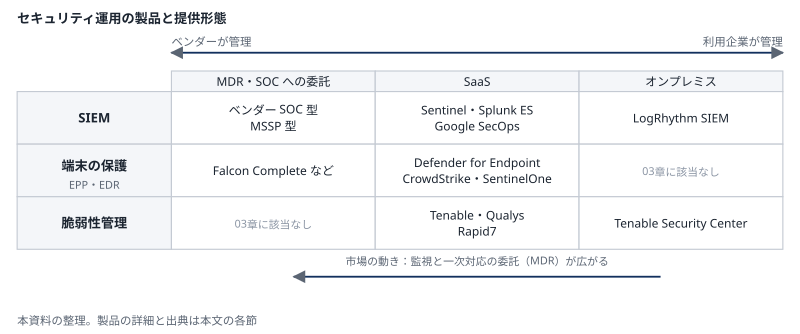

# 03 セキュリティ運用の製品と提供形態

## 要旨

セキュリティ運用の製品は、**SIEM**、**端末の保護（EPP・EDR）**、**脆弱性管理**の3つが中心である。どの市場でも、大手のベンダーが端末・ID・クラウド・SIEM を1つの基盤にまとめる方向にあり、単一ベンダーでそろえるか、専門製品を組み合わせるかが選択の軸になる（→ 04章）。

提供形態は SaaS が主流になっている。人の運用まで含めて外部に任せる場合は MDR（→ 02章）を使う。

*図1　セキュリティ運用の製品と提供形態（縦は製品の区分、横は提供形態。本資料の整理）*

## SIEM

| 製品 | 提供元 | 補足 |
|---|---|---|
| Microsoft Sentinel | Microsoft | Azure 上の SaaS としてだけ提供される |
| Splunk Enterprise Security | Cisco（Splunk） | Cisco が 2024年3月に Splunk の買収を完了（約280億ドル） |
| Google Security Operations | Google | SaaS。大規模な検索・分析を特徴とする |
| Exabeam | Exabeam | SaaS の新製品と、オンプレミスの LogRhythm SIEM（旧 LogRhythm）がある |
| FortiSIEM | Fortinet | クラウド・オンプレミス・SaaS で提供 |

料金の単位は製品によって違い、1日あたりの取り込み量（GB/日）、1秒あたりのイベント数（EPS）、利用者数、エージェント数などがある。集めるログの量が費用を左右する（→ 04章）。

以上は、Gartner の 2025年の SIEM の Magic Quadrant に載っている製品の一部である。

## 端末の保護（EPP・EDR）

Gartner の Endpoint Protection Platforms の Magic Quadrant（2026年版、報道による）では、CrowdStrike・Microsoft・Palo Alto Networks・SentinelOne・Sophos・TrendAI の6社がリーダーに位置付けられ、この顔ぶれは2023年から変わっていない。同じ報道によれば、CrowdStrike と Microsoft の2社で市場の約4割を占める。

### 各社の製品と、防御だけの段階・EDR を含む段階

どの製品も1つのエージェントで防御（EPP）と検知・対応（EDR）を提供するが、**ライセンスは「防御だけ」と「EDR を含む」の段階に分かれている**。製品名が同じでも、契約している段階によって EDR が使えないことがある。

| 製品 | 提供元 | 防御だけの段階 | EDR を含む段階 | 特徴 |
|---|---|---|---|---|
| Microsoft Defender for Endpoint | Microsoft | Plan 1（次世代のウイルス対策、攻撃対象の縮小、デバイス制御、Web 保護）。Microsoft 365 E3 に含まれる | Plan 2（EDR、自動調査と修復、脅威ハンティング、脆弱性管理）。Microsoft 365 E5・E5 Security に含まれる | Defender XDR の一部で、Sentinel・Entra と連携する |
| CrowdStrike Falcon | CrowdStrike | Falcon Go・Falcon Pro（Falcon Prevent：次世代のウイルス対策、デバイス制御、ファイアウォール管理） | Falcon Enterprise 以上（Falcon Insight XDR を含む）。Falcon Elite は ID の保護も含む | 機能をモジュールとして足す方式。脆弱性管理（Falcon Spotlight）、SIEM（Falcon Next-Gen SIEM）、MDR（Falcon Complete）もある |
| SentinelOne Singularity | SentinelOne | Singularity Core（AI による防御、自動の修復とロールバック） | Singularity Complete（Deep Visibility による端末の全記録、Storyline による関連付け、独自の検知ルール、標準14日の記録保持） | 中間に Singularity Control（デバイス制御など）がある。ランサムウェアで変更されたファイルを元に戻すロールバック（Windows） |
| Cortex XDR | Palo Alto Networks | Cortex XDR Prevent（端末の防御、デバイス制御、ディスク暗号化、ホストのファイアウォール） | Cortex XDR Pro per Endpoint（EDR のデータ収集）。Pro per GB でネットワークなど他の発生源のログも取り込む | 同社のファイアウォール製品との連携 |
| Sophos Endpoint（Intercept X） | Sophos | 本資料では段階の区分を未確認 | Sophos XDR、Sophos MDR | CryptoGuard：不正な暗号化を検知して止め、暗号化されたファイルを元に戻す。初期設定で推奨の防御が有効になっている |
| TrendAI Vision One | TrendAI（Trend Micro の法人事業。2026年3月に改称） | 本資料では段階の区分を未確認 | Vision One の XDR | 端末・ネットワーク・クラウド・脅威の検知を1つの基盤にまとめる。エージェントは従来の Apex One・Deep Security を引き継ぐ |

### 端末に深く入る製品の更新リスク

EDR は OS の深い部分（Windows ではカーネル）で動くため、製品側の更新の不具合が端末そのものを止めることがある。2024年7月19日、CrowdStrike が Windows 向けに配信した設定の更新（チャネルファイル 291）の論理エラーで、約1時間20分の配信の間に更新を受け取った端末が起動しなくなり、Microsoft の推計で約850万台の Windows 端末が影響を受けた。macOS と Linux は影響を受けなかった。

EDR の更新をどの順で配るか（一部の端末で先に試すか）は、セキュリティ運用とワークプレイスの間で決めておく事項になる（→ 05章、本資料の整理）。

## 脆弱性管理

Gartner は2025年に、脆弱性診断の Market Guide を、**Exposure Assessment Platforms（EAP）**の Magic Quadrant に置き換えた。EAP は、脆弱性に加え、設定の誤り、管理されていない資産、コンプライアンス上の不備などの「露出（エクスポージャー）」を見つけ、分析し、優先順位を付ける製品と定義されている。2025年11月の初版では、20社が評価され、Tenable・Qualys・Rapid7 の3社がリーダーとされた。

| 製品 | 提供元 | 構成 | 補足 |
|---|---|---|---|
| Tenable One / Tenable Vulnerability Management / Nessus | Tenable | Nessus（診断ツール）、Tenable Vulnerability Management（旧 Tenable.io、クラウドの脆弱性管理）、Tenable Security Center（オンプレミス）、Tenable One（ID・クラウド・OT まで含む露出管理） | 初版の EAP の Magic Quadrant で、両軸ともっとも高い位置 |
| Qualys VMDR | Qualys | VMDR を、Enterprise TruRisk Platform（露出管理の基盤）の中の中核の機能として提供 | 1つのエージェント（Cloud Agent）で資産の把握・脆弱性の診断・パッチ適用の支援を行う |
| Rapid7 InsightVM / Exposure Command | Rapid7 | InsightVM（脆弱性管理）を、Exposure Command（露出管理）の一部として販売 | InsightVM は1資産あたり月額 $1.62（500資産の場合）を公表している |

ほかに、Microsoft と CrowdStrike も EAP の Magic Quadrant で Challenger に位置付けられており、EDR 製品の一部として脆弱性管理を提供している（Defender for Endpoint Plan 2、Falcon Spotlight）。EDR の製品で脆弱性管理を兼ねるか、専門製品を使うかは、04章の論点3（1つのベンダーでそろえるか）に当たる。

## 国内の製品とサービス

| 製品・サービス | 提供元 | 補足 |
|---|---|---|
| TrendAI Vision One | TrendAI（トレンドマイクロの法人事業） | 端末の保護の Magic Quadrant のリーダー6社のうち、日本に本社を置く唯一の会社の製品（上表） |
| MDR・SOC のサービス | NTT ドコモビジネス、NTT データ、アクセンチュアなど | IDC の国内の MDR の評価（2025年11月）で、NTT ドコモビジネスがリーダーとされたと発表している。NTT データは Everest Group の MDR の評価（2025年）でリーダーとされた |

IDC Japan によると、国内の MDR は EDR の普及を機に2020年ごろから広がった。提供の形は、EDR のベンダーが自社の SOC で直接提供する形（ベンダー SOC 型）と、SIer・通信事業者などの MSSP が自社の SOC と EDR を組み合わせる形（MSSP 型）に分かれ、ベンダー SOC 型が増えて両者の競争が生じている。

## 他の製品に付属する機能

| 付属先 | 付属する機能 | 補足 |
|---|---|---|
| Microsoft 365 | Defender for Endpoint Plan 1（E3）、Plan 2（E5・E5 Security） | 契約しているライセンスによって EDR が使えるかが変わる（上表） |
| EDR の製品 | 脆弱性管理（Defender for Endpoint Plan 2、Falcon Spotlight） | 専門の製品にするかは 04章 論点3 の軸である |
| EDR のベンダーのサービス | MDR（Falcon Complete、Sophos MDR など） | 人の運用まで任せる場合（→ 02章） |

## 提供形態

| 形態 | ベンダーが管理するもの | 利用企業が管理するもの | 例 |
|---|---|---|---|
| SaaS | 基盤、検知のルールの更新、端末のエージェントの配信 | どのログを集めるか、検知の後の判断と対応、エージェントの更新の配り方 | Microsoft Sentinel、CrowdStrike Falcon |
| オンプレミス | ソフトウェアの提供と保守 | 上記に加えて、サーバ・ストレージ・更新の適用 | LogRhythm SIEM、Tenable Security Center |
| MDR・SOC への委託 | 監視・一次の分析・対応の実行（契約の範囲で） | 判断の基準、対応の最終的な判断、委託先との連絡の体制 | ベンダー SOC 型、MSSP 型 |

## 市場の動き

### 単一ベンダーにまとめる動き

- CrowdStrike は、端末・ID・クラウド・データ保護・SIEM を1つのエージェントと基盤で提供すると打ち出している。
- Microsoft は、SIEM（Sentinel）と ID（Entra ID）を同じ会社の製品として提供し、端末の保護の市場でもリーダーに位置付けられている。
- Cisco は Splunk の買収で、ネットワーク・セキュリティ・可観測性（オブザーバビリティ）をまとめる方針を示した。

## 本資料でまだ扱っていないもの

- SIEM・EDR の料金の比較（Rapid7 以外）
- 国内の MDR・SOC のサービスの料金と範囲の違い
- OT の SOC（→ ot-security）

---

**出典**（確認日：2026-11-14）

- SIEM の Magic Quadrant（2025-10-08）と各製品の提供形態・料金単位：Google Cloud ブログ（2025-10-15）— https://cloud.google.com/blog/products/identity-security/google-is-named-a-leader-in-the-2025-gartner-magic-quadrant-for-siem 、Splunk — https://www.splunk.com/goto/gartner_report 、Exabeam — https://www.exabeam.com/library/2018-gartner-siem-magic-quadrant/ 、Softprom（Fortinet ほか）— https://softprom.com/positions-of-google-crowdstrike-fortinet-and-rapid7-in-the-new-gartner-magic-quadrant-for-siem-2025-report
- Cisco による Splunk の買収：Cisco IR（2024-03-18）— https://investor.cisco.com/news/news-details/2024/Cisco-Completes-Acquisition-of-Splunk/
- EPP の Magic Quadrant（2025-07-14）：Gartner — https://www.gartner.com/en/documents/6718634 、2026年版のリーダーの顔ぶれと市場シェア：IT Channel Oxygen（2026-06-01）— https://itchanneloxygen.com/?p=20478
- CrowdStrike の単一エージェント：CrowdStrike（2025-07）— https://www.barchart.com/story/news/33470710/crowdstrike-named-a-leader-in-the-2025-gartner-magic-quadrant-for-endpoint-protection-platforms-for-sixth-consecutive-time
- Defender for Endpoint の Plan 1・Plan 2：Microsoft Tech Community（P1 の E3 への同梱）— https://techcommunity.microsoft.com/t5/microsoft-defender-for-endpoint/microsoft-defender-for-endpoint-plan-1-now-included-in-m365-e3/ba-p/3060639 、プランの機能の比較（Redress Compliance）— https://redresscompliance.com/microsoft-defender-for-endpoint-p1-vs-p2-2026
- CrowdStrike Falcon のバンドルとモジュール：CrowdStrike 製品ページ — https://crowdstrike.com/en-gb/products 、Dell サポート記事 — https://www.dell.com/support/kbdoc/en-in/000126839/what-is-crowdstrike
- SentinelOne Singularity：SentinelOne「Singularity Complete」— https://www.sentinelone.com/tw/platform/singularity-complete/ 、バンドルのデータシート — https://www.tucana.com/files/SentinelOne/SentinelOne_bundles-datasheet.pdf
- Cortex XDR のライセンス：Palo Alto Networks ドキュメント — https://docs-cortex.paloaltonetworks.com/r/Cortex-XDR/Cortex-XDR-3.x-Documentation/Understand-Cortex-XDR-license-plans 、Palo Alto Networks LIVEcommunity — https://live.paloaltonetworks.com/t5/cortex-xdr-discussions/cortex-xdr-what-is-the-difference-between-cortex-xdr-pro-and/td-p/571111 、Cynet の解説 — https://cynet.com/xdr-security/xdr-by-palo-alto-understanding-cortex-xdr
- Sophos Endpoint と CryptoGuard：Sophos 製品ページ — https://www.sophos.com/en-us/products/intercept-x 、https://sophos.com/en-us/digital/endpoint-experts
- TrendAI への改称と Vision One：villpress（Trend Micro の発表 2026-03-23 の紹介）— https://villpress.com/?p=9605 、Trend Micro サポート KA-0023250（エージェントの名称変更）— https://success.trendmicro.com/en-US/solution/KA-0023250 、SecurityBrief — https://securitybrief.co.nz/story/trend-micro-renames-enterprise-unit-trendai-globally
- CrowdStrike の障害（2024-07-19）：Computer Weekly — https://www.computerweekly.com/news/366598755/CrowdStrike-blames-outage-on-content-configuration-update 、TechTarget（Microsoft の推計）— https://www.techtarget.com/cybersecurity/news/366596532/Microsoft-Faulty-CrowdStrike-update-affected-85M-devices 、CIO（macOS・Linux は影響なし）— https://www.cio.com/article/3476789/crowdstrike-failure-what-you-need-to-know.html
- EAP の Magic Quadrant（2025-11-10）：Gartner — https://www.gartner.com/en/documents/7159430 、Market Guide からの置き換えと Tenable の位置 — https://www.scworld.com/resource/why-you-should-pick-a-leader-in-exposure-management
- Tenable・Qualys・Rapid7 の製品構成：Tenable — https://www.tenable.com/products 、Qualys — https://www.qualys.com/apps/vulnerability-management-detection-response/ 、Rapid7 の料金（資産ごとの月額）— https://www.rapid7.com/products/insightvm/pricing/ 、Rapid7 プレスリリース（2025-11-12）— https://www.barchart.com/story/news/36075802/rapid7-recognized-as-a-leader-in-the-2025-gartner-magic-quadrant-for-exposure-assessment-platforms
- Falcon Spotlight：Dell サポート記事 — https://www.dell.com/support/kbdoc/fr-lu/000126839/crowdstrike-nedir?lang=en
- 製品の段階の区分は 2026-11 時点の各社の公表情報と二次資料による。変更が多いため、契約の判断の前には各社の最新の資料で確かめる
- 国内の MDR の評価：NTT ドコモビジネス（2025-11-20）— https://www.ntt.com/about-us/press-releases/news/article/2025/1120.html 、NTT データ（2025-04-17）— https://www.nttdata.com/global/ja/news/topics/2025/041700 、提供の形の分類：IDC の国内 MDR の評価の抜粋（アクセンチュアが公開）— https://www.accenture.com/content/dam/accenture/final/accenture-com/document-4/Accenture-IDC-MarketScape-Japan-MDR-2025-Vendor-Assessment-V2.pdf 、IDC Japan（2025-02-05）— https://www.idc.com/?p=104272
- 付属の機能と提供形態の表は、上記の出典をもとにした本資料の整理
- トレンドマイクロの本社：トレンドマイクロ 会社概要 — https://www.trendmicro.com/ja_jp/about.html
