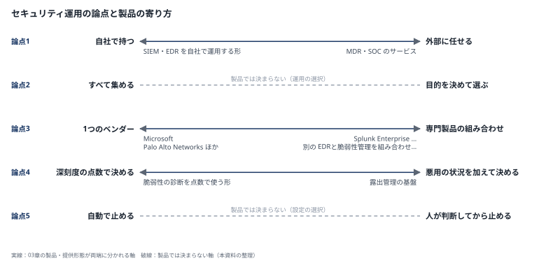

# 04 セキュリティ運用の主要な論点

## 要旨

セキュリティ運用を扱うときに出てくる軸は次の5つである（本資料の整理）。懸念や要望を聞いたときは、まずそれがどの軸の話かを特定する。

1. 監視と対応を自社で持つか、外部（MDR）に任せるか
2. ログをすべて集めるか、目的を決めて選ぶか
3. 1つのベンダーでそろえるか、専門製品を組み合わせるか
4. 脆弱性を深刻度の点数で直すか、悪用の状況で直すか
5. 自動で止めるか、人が判断してから止めるか

*図1　セキュリティ運用の論点と製品の寄り方（実線は03章の製品が両端に分かれる軸、破線は製品では決まらない軸。本資料の整理）*

## 論点1：監視と対応を自社で持つか、外部（MDR）に任せるか

| | 自社で持つ（内製 SOC） | 外部に任せる（MDR） |
|---|---|---|
| 得るもの | 自社の業務とシステムを知った上で判断できる。知見が社内に残る | 24時間の監視と分析者を、自社で採用・育成せずに確保できる |
| 失うもの | 24時間の要員と、検知ルールを直し続ける専門人材が必要 | 事業者によって、どこまで対応するかの幅が大きい。業務の文脈（このサーバーを止めてよいか）は自社が持ち続ける必要がある |

**製品・提供形態との対応**（→ 03章）

| | 自社で持つ（内製 SOC）に寄るもの | 外部に任せる（MDR）に寄るもの |
|---|---|---|
| 製品・提供形態 | SIEM・EDR を自社で運用する形（Microsoft Sentinel、Splunk Enterprise Security、Google Security Operations、Exabeam、FortiSIEM と各 EDR） | MDR・SOC のサービス（Falcon Complete、Sophos MDR、NTT ドコモビジネス・NTT データなど） |

典型的な懸念：「夜間・休日に誰がアラートを見るのか」「セキュリティの専門人材がいない」

外部に任せても、**インシデントと判断した後の意思決定（止めるか、誰に報告するか）は自社に残る**（本資料の整理）。

## 論点2：ログをすべて集めるか、目的を決めて選ぶか

| | すべて集める | 目的を決めて選ぶ |
|---|---|---|
| 得るもの | 後から調べたいときに、ログが残っている | 費用を抑えられる。検知ルールの対象がはっきりする |
| 失うもの | SIEM の費用は取り込み量などで決まることが多く、費用が膨らむ（→ 03章） | 集めていなかったログは、事後の調査で使えない |

**製品・提供形態との対応**（→ 03章）：製品では決まらない（運用の選択）。ただし取り込み量で課金する SIEM ほど、すべて集めたときの費用が大きくなる（→ 03章）

典型的な懸念：「SIEM の費用が想定より高い」「インシデントのときに必要なログがなかった」

## 論点3：1つのベンダーでそろえるか、専門製品を組み合わせるか

| | 1つのベンダー（XDR・統合基盤） | 専門製品の組み合わせ |
|---|---|---|
| 得るもの | 製品間の連携と相関分析が最初からできる。契約と窓口が1つ | 領域ごとに評価の高い製品を選べる。1社への依存を避けられる |
| 失うもの | そのベンダーへの依存が強まる。苦手な領域があっても入れ替えにくい | 製品間の連携（ログの形式、対応の自動化）を自分で作る必要がある |

**製品・提供形態との対応**（→ 03章）

| | 1つのベンダー（XDR・統合基盤）に寄るもの | 専門製品の組み合わせに寄るもの |
|---|---|---|
| 製品・提供形態 | Microsoft（Defender と Sentinel）、Palo Alto Networks（Cortex XDR）、TrendAI Vision One。端末・SIEM・XDR を同じベンダーで持つ | Splunk Enterprise Security・Google Security Operations・Exabeam に、別の EDR（CrowdStrike Falcon、SentinelOne）と脆弱性管理（Tenable、Qualys、Rapid7）を組み合わせる形 |

典型的な懸念：「製品が多すぎて画面を行き来している」「ライセンスにすでに含まれているものを使えばよいのでは」

## 論点4：脆弱性を深刻度の点数で直すか、悪用の状況で直すか

| | 深刻度の点数（CVSS の基本スコア）で決める | 悪用の状況（KEV など）を加えて決める |
|---|---|---|
| 得るもの | 基準が単純で、すぐに使える | 実際に狙われているものから直せる |
| 失うもの | 高い点数の脆弱性が多すぎて、すべてを急いで直すことになる。点数が低くても悪用されているものを後回しにしうる | 悪用の情報を追い続ける必要がある。自社の資産の重要度（環境評価）も加えると、さらに手間がかかる |

CVSS v4.0 の仕様は、基本スコアだけでリスクを判断しないよう注意しており、米 CISA も BOD 22-01 で、点数だけに頼る方針から悪用されている脆弱性を優先する方針に切り替えた（→ 02章）。

**製品・提供形態との対応**（→ 03章）

| | 深刻度の点数（CVSS の基本スコア）で決めるに寄るもの | 悪用の状況（KEV など）を加えて決めるに寄るもの |
|---|---|---|
| 製品・提供形態 | 脆弱性の診断（Nessus、InsightVM）を点数で使う形 | 露出管理の基盤（Tenable One、Qualys Enterprise TruRisk Platform、Rapid7 Exposure Command）。悪用の状況を加えて優先度をつける |

典型的な懸念：「パッチが追いつかない」「どれから直すべきか決められない」

## 論点5：自動で止めるか、人が判断してから止めるか

| | 自動で止める（SOAR・EDR の自動隔離） | 人が判断してから止める |
|---|---|---|
| 得るもの | 被害の広がりが速いランサムウェアなどに間に合う | 誤検知で業務を止めない |
| 失うもの | 誤検知で業務に必要な端末やアカウントを止めるおそれ | 判断を待つ間に被害が広がる |

**製品・提供形態との対応**（→ 03章）：製品では決まらない（設定の選択）。EDR・SOAR の自動隔離は、どの製品も設定で有効・無効を選べる

典型的な懸念：「夜中に自動で止められたら困る」「止めるのが遅れて被害が広がった」

どの対象を自動で止めてよいかを、業務の重要度に応じて事前に決めておく（本資料の整理）。

---

**出典**（確認日：2026-11-14）

- 5つの軸と各表の「得るもの・失うもの」「典型的な懸念」は、01〜03章の内容をもとにした本資料の整理
- MDR の対応範囲の幅：TechTarget — https://www.techtarget.com/whatis/definition/managed-detection-and-response-MDR
- SIEM の料金単位：Gartner Magic Quadrant for SIEM（2025）の抜粋 — https://secpost.ru/wp-content/uploads/2025/10/gartner-siem-mq-2025.pdf
- CVSS v4.0 の注意事項：@IT — https://atmarkit.itmedia.co.jp/ait/articles/2311/10/news048.html
- BOD 22-01 の方針転換：CISA ファクトシート — https://www.cisa.gov/sites/default/files/publications/Reducing_the_Significant_Risk_of_Known_Exploited_Vulnerabilities_211103.pdf
- 各論点の「製品・提供形態との対応」は、03章の製品をもとにした本資料の整理
