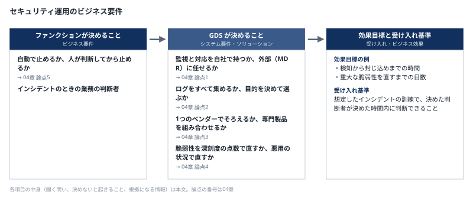

# 05 セキュリティ運用のビジネス要件

## 要旨

セキュリティ運用の製品と体制は GDS が決める。ファンクションに決めてもらうのは、**攻撃を止めるために、どのシステム・端末を止めてよいか**と、**止めたときに誰が業務の判断をするか**である。

この章は、governance/budget-transfer の kickoff 資料（IT 予算移管の要点）にある役割分担を、この技術について具体化したものである。

*図1　セキュリティ運用のビジネス要件（ファンクションが決めたビジネス要件をもとに GDS がシステム要件とソリューションを決め、効果目標と受け入れ基準で確かめる）*

## ファンクションが決めること（ビジネス要件）

### 自動で止めるか、人が判断してから止めるか

- **決めること**：自動で止めてよい範囲（→ 04章 論点5）
- **聞く問い**：「攻撃が疑われたとき、このシステム・端末を確認なしに止めてよいか」
- **決めないと起きること**：止めてはいけない端末を自動で隔離して業務が止まる、または判断を待つ間に被害が広がる
- **根拠になる情報**：業務の重要度、止まったときの損失

### インシデントのときの業務の判断者

- **決めること**：攻撃を受けたときに、業務を止めるか続けるかを判断する人
- **聞く問い**：「夜間・休日に、業務を止めるかを判断できるのは誰か」
- **決めないと起きること**：判断者が決まっておらず、対応が遅れる
- **根拠になる情報**：業務の責任者、連絡の体制

## GDS が決めること

- 監視と対応を自社で持つか、外部（MDR）に任せるか（→ 04章 論点1）
- ログをすべて集めるか、目的を決めて選ぶか（→ 04章 論点2）
- 1つのベンダーでそろえるか、専門製品を組み合わせるか（→ 04章 論点3）
- 脆弱性を深刻度の点数で直すか、悪用の状況で直すか（→ 04章 論点4）

## 効果目標と受け入れ基準

- **効果目標の例**：検知から封じ込めまでの時間、重大な脆弱性を直すまでの日数
- **受け入れ基準**：想定したインシデントの訓練で、決めた判断者が決めた時間内に判断できること

## 部門に閉じた案件として扱えないとき

- EDR・SIEM は全社の仕組みのため、部門ごとに持たない
- 制御系の機器を止めるかは ot-security と製造の部門が判断する

境界の詳細（どのシステムが何を持つか）は [function-allocation](../../../cross-cutting/function-allocation/function-allocation.md) を参照。

---

**出典**（確認日：2026-11-15）

- 役割分担の原則と4つの場面：governance/budget-transfer の kickoff 資料（IT 予算移管の要点、2026-11-02 初版）
- 項目の立て方、問い、例は、04章の論点をもとにした本資料の整理
