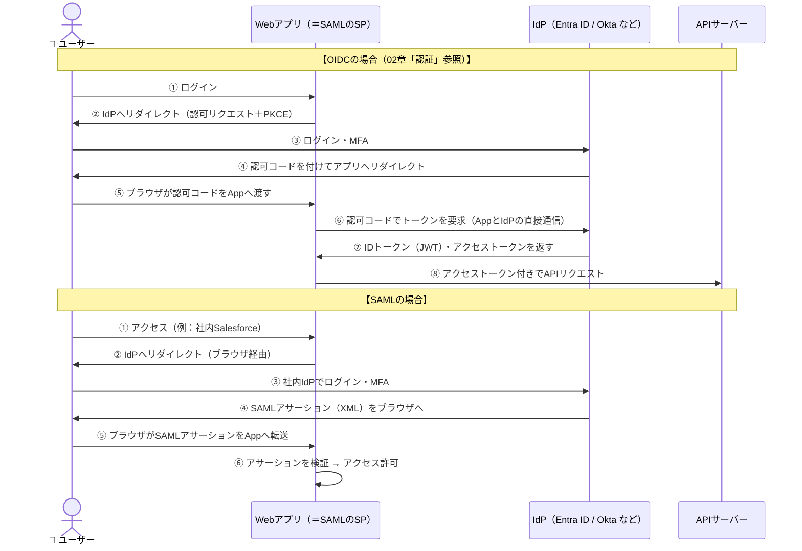
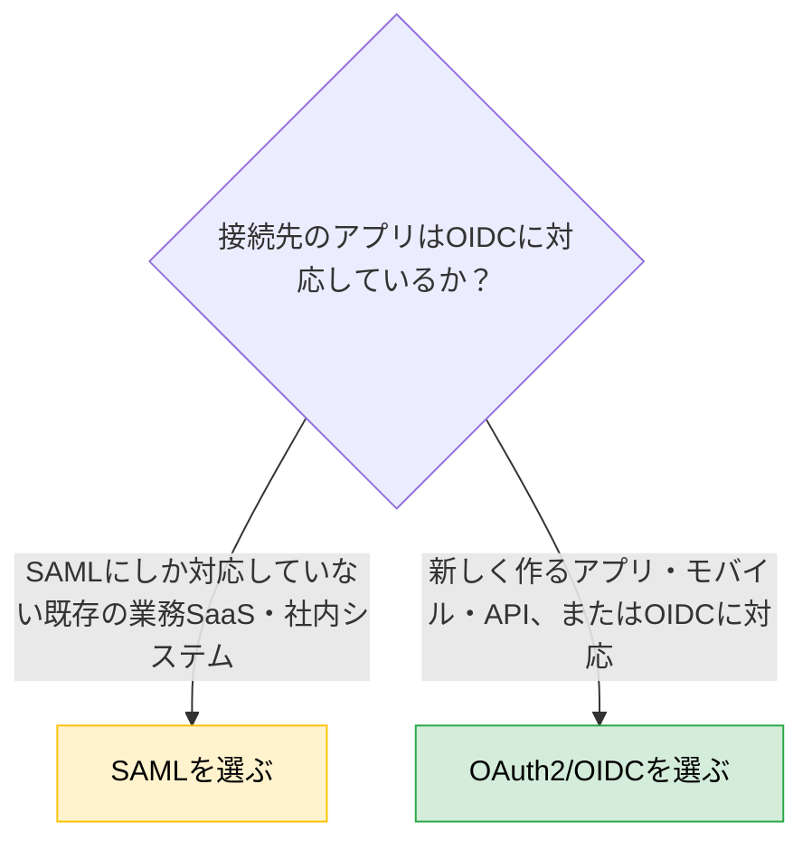

# 付録A　SAML（Security Assertion Markup Language）とは ― OAuth2/OIDCとの比較

> **参照元**：[02章](../chapters/02_structure.md)「認証」

## OAuth2/OIDCとの違い

現代のWebアプリでよく使われるOAuth2/OIDCと混同されやすいですが、生まれた背景と得意な用途が異なります。

| | **SAML** | **OAuth2 / OIDC** |
|---|---|---|
| **登場年** | 2002年 | 2012年（OAuth2）/ 2014年（OIDC）|
| **主な用途** | 企業の社内システム間SSO | WebアプリやAPIの認証・認可 |
| **データ形式** | XML | JSON / JWT |
| **得意な環境** | オンプレミス・レガシーな企業システム | モバイル・クラウドネイティブアプリ |
| **設定の複雑さ** | 高い（メタデータの交換、署名用のX.509証明書の更新が必要）| 比較的シンプル（IdPの設定情報と公開鍵を自動で取得できる）|
| **向いているもの** | SAMLに対応した既存の業務SaaS・社内システムとのSSO | 新しく作るWebアプリ・モバイルアプリ・API、Google・GitHubなどでのログイン |

---

## 認証フローの比較（OIDC vs SAML）

OIDCと登場人物を揃えて比較します。最大の違いは「Webアプリが最終的にJWTを受け取るか、SAMLアサーション（XML）を受け取るか」と「その受け取り方」です。

> OIDC（認可コードフロー）では、ブラウザが中継するのは短時間しか使えない認可コードだけで、トークン本体はWebアプリがIdPから直接受け取ります。SAML（HTTP POSTバインディング）では、署名されたアサーションそのものをブラウザが中継します。そのためSAMLは、WebアプリからIdPへ直接通信できない構成でも動きます。

## いつSAMLを選ぶべきか

主要なIdP（Entra ID、Oktaなど）はSAMLとOIDCの両方に対応しているため、IdPの選択とプロトコルの選択は別に考えてよい（IdPの選び方は03章）。

SAMLは「古い規格だから使わない」ではなく、**エンタープライズの既存システムとのSSO統合では今も現役の標準規格**です。新規開発ではOIDCを選びつつ、既存の社内システム連携が必要な場面でSAMLを併用する構成が、実務ではよく見られます。

---

**出典**（確認日：2026-11-14）

- SAML 2.0：OASIS Security Services (SAML) TC — https://www.oasis-open.org/committees/security/ （SAML 1.0 は2002年、SAML 2.0 は2005年）
- OAuth 2.0：RFC 6749（2012年）— https://datatracker.ietf.org/doc/html/rfc6749 、PKCE：RFC 7636 — https://datatracker.ietf.org/doc/html/rfc7636
- OpenID Connect Core 1.0（2014年）— https://openid.net/specs/openid-connect-core-1_0.html
- 認証フローの説明は、上記の仕様に基づく本資料の整理
