# 02 Webアプリケーションセキュリティの構造

## 要旨

セキュリティは、5つの設計原則（最小権限・多層防御・フェイルセキュア・セキュアデフォルト・オープン設計）を土台に、レイヤード構造・ゼロトラスト・WAF と TLS・ネットワーク分離を組み合わせたアーキテクチャとして組み立てます。1回のアクセスは、TLS による暗号化と通信相手の確認、認証（あなたは誰か）、認可（何をしてよいか）という関門を順に通ります。

## セキュリティ設計の5原則

「安全なシステム」は後付けの対策だけでは実現できません。設計の段階から組み込むべき考え方が5つあります。

### 最小権限（Least Privilege）

#### 考え方
ユーザーやシステムには、**その業務に必要な最小限の権限だけを与える**という原則です。「使わないかもしれないから念のため広めに」は禁物です。

#### 具体例
```
❌ 悪い例: アプリがデータベースに接続する際、管理者権限を使う
           → アプリが乗っ取られると、DB全体を削除・改ざん可能

✅ 良い例: アプリに「読み取り専用」権限だけを付与する
           → 乗っ取られても、データを盗まれる被害にとどまる
```

#### 守らなかった実例
2017年のEquifax情報漏洩では、最初に侵入されたシステムが、動作に必要なのは3つのデータベースだけなのに、40以上のデータベースにアクセスできる状態でした。攻撃者はそこから社内の複数のシステムへ侵入を広げ、約1億4,800万人分の個人情報が流出しました。

---

### 多層防御（Defense in Depth）

#### 考え方
セキュリティを「一枚の壁」で守ろうとするのではなく、**複数の独立した防御層を重ねる**という原則です。1層が突破されることを前提に設計します。

#### 具体例
```
攻撃者
  ↓
【第1層】 WAF（不正リクエストをブロック）
  ↓ 突破されたとしても…
【第2層】 アプリの入力検証（不正データを拒否）
  ↓ 突破されたとしても…
【第3層】 DBのアクセス制御（権限外の操作を拒否）
  ↓ 突破されたとしても…
【第4層】 ログ・監視（異常を検知してアラート）
```

#### 守らなかった実例
2021年のColonial Pipeline攻撃では、使われなくなったのに無効化されていなかったVPNアカウントのパスワードが漏れており、多要素認証（MFA）もなかったため、パスワード1つで社内ネットワークに侵入されました。守りがパスワードという1層しかなかった例です。同社は被害の拡大を防ぐためにパイプラインを約6日間止め、米国東海岸の燃料供給が混乱しました。

---

### フェイルセキュア（Fail Secure）

#### 考え方
エラーや予期しない障害が発生したとき、**「失敗した場合は拒否する」をデフォルトにする**という原則です。また、エラーメッセージに内部情報を含めないことも重要です。

#### 具体例
```
❌ 悪い例（失敗時に情報を漏らす）
   ログイン失敗 → 「そのメールアドレスは登録されていません」
                    ↑ 攻撃者が「有効なアカウント」を特定するヒントになる

✅ 良い例（失敗時に何も教えない）
   ログイン失敗 → 「メールアドレスまたはパスワードが正しくありません」
                    ↑ 有効かどうかを判断できない

❌ 悪い例（エラーに内部情報を含める）
   エラー発生 → スタックトレース（エラーの詳細）をそのままブラウザに表示
                 ↑ SQLのテーブル名・コードの構造が攻撃者に筒抜け
```

---

### セキュアデフォルト（Secure Defaults）

#### 考え方
システムの初期設定を「最も安全な状態」にしておくという原則です。**セキュリティを有効にするために設定変更が必要、ではなく、無効にするために設定変更が必要**という設計にします。

#### 具体例
```
❌ 悪い例: デフォルトでHTTP（暗号化なし）で動作する
           → 設定を知らない管理者が放置すると、通信が丸見えになる

✅ 良い例: 最初からHTTPSで動作し、HSTSを有効にしておく
           → 管理者が何もしなくても、暗号化された通信が使われる
```

#### 守らなかった実例
2016年のMiraiボットネットは、工場出荷時のユーザー名とパスワード（60組あまり）のままインターネットにつながっていたカメラやルーターなどのIoT機器を乗っ取り、数十万台規模に広がりました。乗っ取った機器から大規模なDDoS攻撃を行い、DNS事業者Dynへの攻撃では多くの大手Webサービスが一時的に使えなくなりました。

---

### オープン設計（Open Design）

#### 考え方
「仕組みを秘密にすることでセキュリティを保つ」という設計に頼らないという原則です。**暗号化アルゴリズムなどは公開・検証済みの標準規格を使う**ことで、より堅牢な安全性を実現します。

#### 具体例
```
❌ 悪い例: 自社オリジナルの暗号方式を使う
           → 公開検証を経ていないため、見落とした欠陥を突かれやすい
           → 設計者が退職・情報漏洩すると全て無効化される

✅ 良い例: OpenSSL、OAuth2などの公開・標準化された仕組みを使う
           → 世界中の専門家が検証・改善し続けているため、信頼性が高い
```

---

### まとめ

| 原則 | 一言で言うと | 守らないとどうなるか |
|------|------------|-------------------|
| 最小権限 | 必要なものだけ渡す | 侵害が全体に波及する |
| 多層防御 | 一枚の壁に頼らない | 1箇所の突破で全滅する |
| フェイルセキュア | 失敗時は閉じる | エラーが攻撃の手がかりになる |
| セキュアデフォルト | 最初から安全にしておく | 設定ミスが即脆弱性になる |
| オープン設計 | 秘密主義に頼らない | 独自実装が簡単に破られる |

これら5つの原則は独立したものではなく、組み合わせて実践することで初めて「設計レベルで安全なシステム」が実現します。

## セキュアアーキテクチャ設計

### レイヤード構造

フロントエンド・バックエンド・データ・インフラを論理的・物理的に分離します。1つの層が侵害されても、他の層への影響を最小限に抑えることが目的です。各層ではそれぞれ独立した認証・検証を行います。

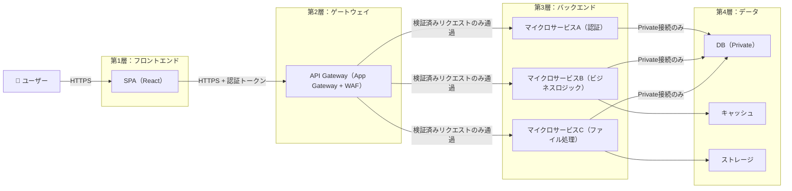

> 各層の間に検証ポイントを設けることで、1層突破が即全体の崩壊につながらない構造を実現します。

---

### ゼロトラストモデル

「社内ネットワークだから安全」「認証済みだから信頼する」という前提を排除し、**すべての通信を毎回検証する**モデルです。
内部サービス間の通信であっても例外はありません。

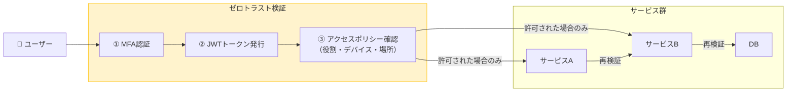

> サービスAが侵害されても、そこからDBへ直接アクセスすることはできません。横方向への侵害拡大（ラテラルムーブメント）を防ぎます。

---

### 通信保護とWAF

外部からの通信はすべてWAFで検査し、内部通信はTLS暗号化を徹底します。WAFは中身を検査するため、TLSを終端（復号）した後のリクエストを検査します（WAF自身がTLSを終端する製品も多い）。公開するエンドポイントを最小限に絞ることも重要です。

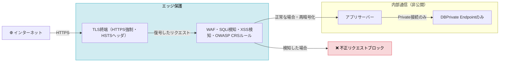

---

### ネットワーク分離とセグメンテーション

ネットワークをサブネット（区画）に分割し、区画間の通信を厳密に制御します。侵害が発生した場合でも、該当区画だけを隔離することで被害を封じ込めます。

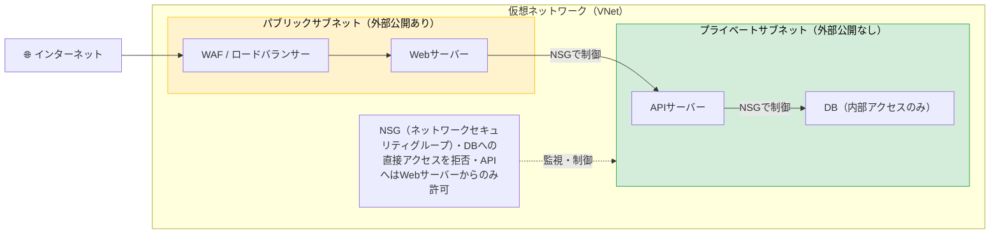

---

### 一般構成 vs セキュア構成の比較

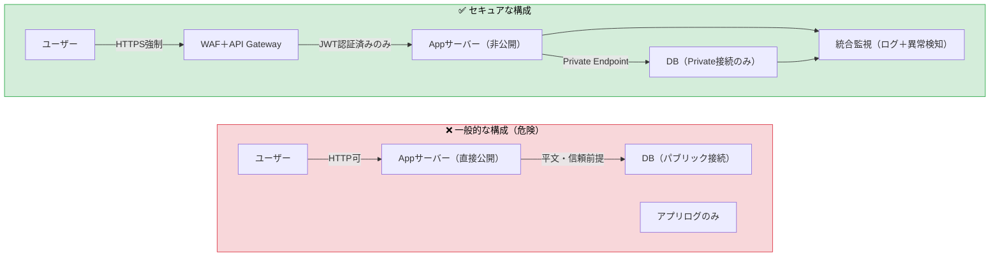

---

### まとめ

これら4つの設計アプローチは、それぞれ独立して機能しますが、組み合わせることで真に堅牢なアーキテクチャになります。

| 設計アプローチ | 守るもの | 侵害時の効果 |
|--------------|---------|------------|
| レイヤード構造 | 層をまたいだ侵害拡大 | 被害を1層内に封じ込める |
| ゼロトラスト | 横方向への侵害拡大 | サービス間の不正移動を防ぐ |
| WAF・TLS | 外部からの攻撃通信 | 既知の攻撃パターンを入口で遮断 |
| ネットワーク分離 | 区画をまたいだアクセス | 侵害区画だけを即座に隔離できる |

## 全体像：1回のアクセスで何が起きているか

以下で扱う概念（ハンドシェイク・証明書・認証・認可）は、それぞれ独立したトピックではなく、**1回のアクセスの中で順番に積み重なる関門**です。まず全体の流れを把握してから、各関門の詳細に入ります。

---

### 4つの関門と役割

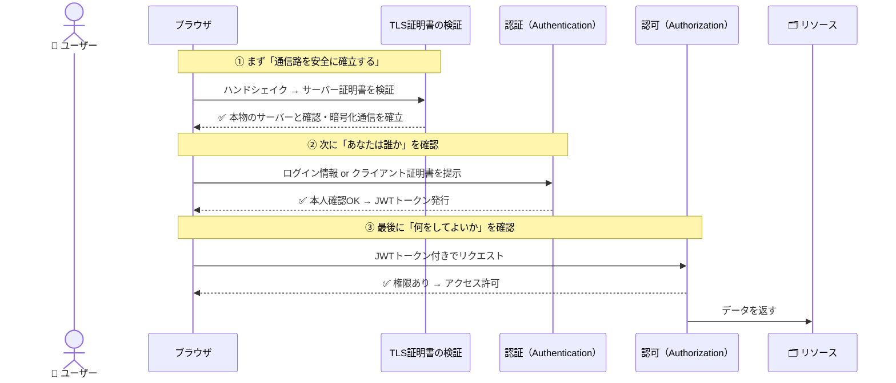

| 関門 | 問い | 使う技術 | 突破されると |
|------|------|---------|------------|
| **① ハンドシェイク・TLS** | 通信相手は本物か？通信路は安全か？ | TLS証明書（CA発行） | 通信内容が盗まれる・偽サイトに誘導される |
| **② 認証** | あなたは誰か？ | パスワード・MFA・クライアント証明書 | 不正ログインが成立する |
| **③ 認可** | 何をしてよいか？ | RBAC・ABAC・JWT | 権限外のデータにアクセスされる |

---

### 積み重なる防御の構造

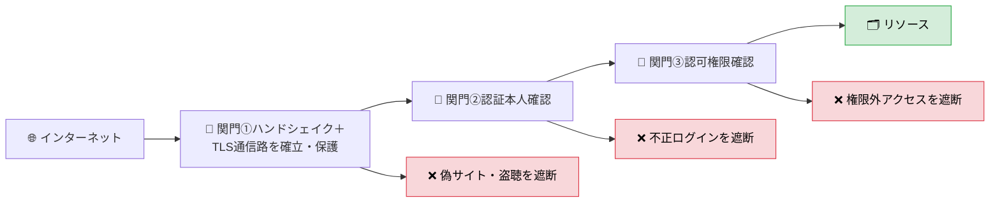

> どれか一つが欠けても安全な通信は成立しません。以降の章ではこの順番に沿って各関門を掘り下げます。

## ハンドシェイクとTLS暗号化

### ハンドシェイクとは

「ハンドシェイク（握手）」とは、**実際のデータ通信を始める前に、双方が「安全に話せる状態か」を確認し合う準備手続き**のことです。

人間に例えると、電話をかけたときに「もしもし、聞こえますか？」「聞こえます、どうぞ」とやり取りしてから本題に入るのと同じです。

ハンドシェイクは認証・認可よりも**さらに手前の「土台」**にあたります。この土台があって初めて、認証情報（パスワードやトークン）を安全にやり取りできます。逆に言えば、**ハンドシェイクが成立しない＝そもそも安全に通信できない**状態です。

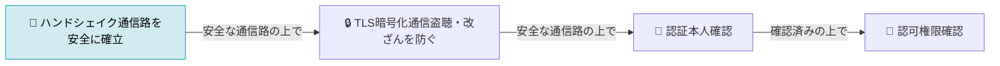

---

### TLSハンドシェイクの流れ

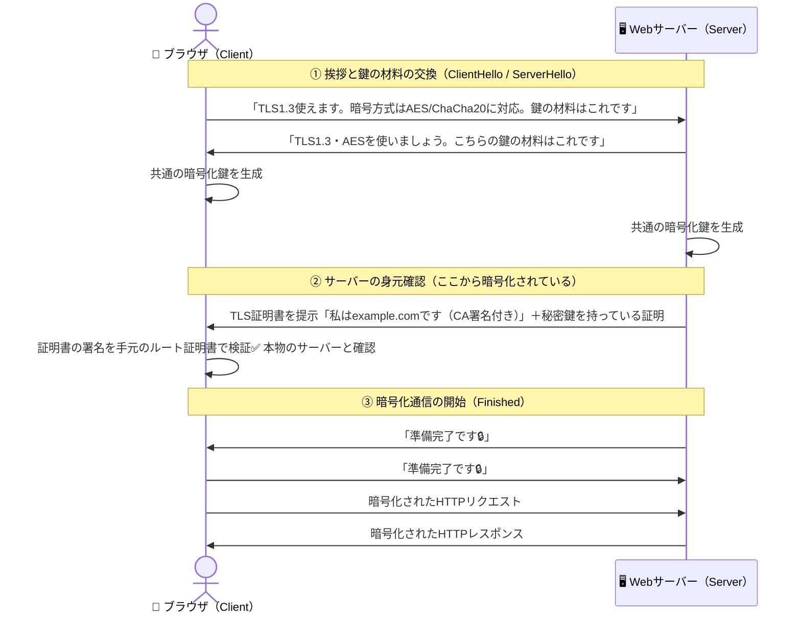

TLS 1.3 では、最初の往復で鍵の材料を交換するため、証明書のやり取りから先はすでに暗号化されています（TLS 1.2 では、証明書を受け取った後に鍵を交換していました）。

### まとめ

| | **内容** | **もし省略すると** |
|---|---|---|
| **ハンドシェイク** | 通信相手の確認・暗号化方式の合意・鍵の共有 | 偽サーバーと通信・通信内容が丸見え |
| **TLS暗号化** | ハンドシェイクで決めた鍵で通信を暗号化 | パスワードや個人情報が盗まれる |

## 証明書の基礎：公開鍵暗号の仕組み

証明書を理解するには、まず前提となる「公開鍵暗号」を押さえる必要があります。

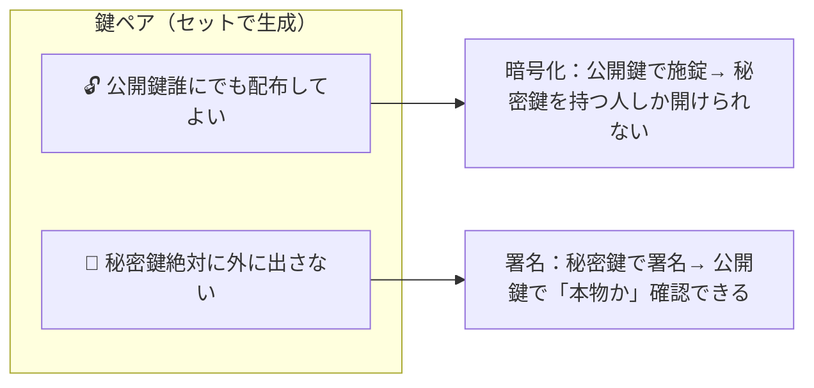

証明書とは「**この公開鍵は確かに本物です**」と第三者機関（CA）が保証した文書です。

---

### TLS/SSL証明書（HTTPS通信の基盤）

#### 何のためにある？

ブラウザが「今通信している相手は本物のサーバーか」を確認するための仕組みです。これがないと、偽サイトへの誘導（中間者攻撃）を検知できません。

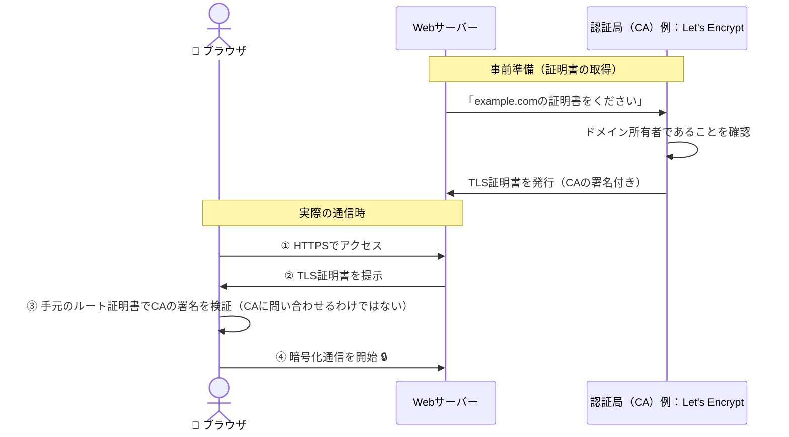

> ブラウザは、OSやブラウザに組み込まれたルート証明書を使って、署名を手元で検証します。CAの情報を参照するのは、失効の確認（CRL・OCSP）を行う場合などに限られます。

#### 証明書の種類

| 種類 | 検証レベル | 取得難易度 | 向いている用途 |
|------|----------|----------|--------------|
| **DV（ドメイン認証）** | ドメイン所有のみ確認 | 簡単・無料（Let's Encrypt）| 個人サイト・開発環境 |
| **OV（組織認証）** | 組織の実在を確認 | 中程度 | 企業サイト・業務システム |
| **EV（拡張認証）** | 組織を厳格に審査 | 高い・有償 | 金融・ECなど信頼性が重要なサービス（主要ブラウザは2019年ごろからアドレスバーでのEV表示をやめており、利用者から見た違いは小さい） |

#### 有効期限と失効の注意点

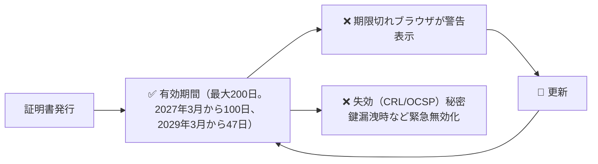

> 証明書の期限切れはサービス停止に直結します。公開証明書の最大有効期間は、CA/Browser Forum の決定（Ballot SC-081v3）により、398日から2026年3月に200日、2027年3月に100日、2029年3月に47日へと段階的に短くなります。手作業での更新は現実的でなくなるため、ACMEなどによる自動更新を前提にし、期限監視も設定しましょう。

---

### クライアント証明書（デバイス・ユーザー認証）

#### 何のためにある？

TLS証明書が「サーバーの身元証明」であるのに対し、クライアント証明書は**「接続してきた端末・ユーザーの身元証明」**です。パスワードを使わずに、デバイス自体を認証できます。

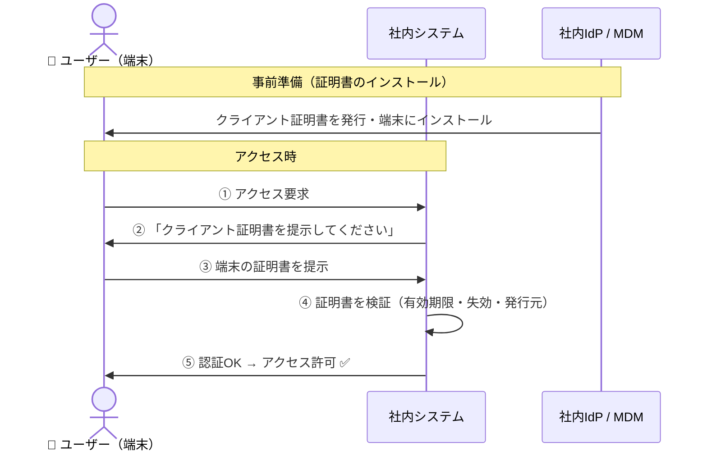

#### パスワード認証との比較

| | **パスワード認証** | **クライアント証明書認証** |
|---|---|---|
| **盗難リスク** | フィッシングで盗まれる | 秘密鍵をTPMなどに取り出せない形で保存すれば、盗難は困難（取り出し可能な形で保存すると、コピーされうる） |
| **フィッシング耐性** | 低い | 高い（秘密鍵は送信されず、署名はその接続にしか使えないため、偽サイトが受け取っても使い回せない） |
| **管理コスト** | 低い | 高い（証明書の発行・失効管理が必要） |
| **ユーザー体験** | パスワード入力が必要 | 透過的（意識せずに認証される） |
| **向いている場面** | 一般ユーザー向けサービス | 社内システム・ゼロトラスト環境 |

#### ゼロトラストにおける役割

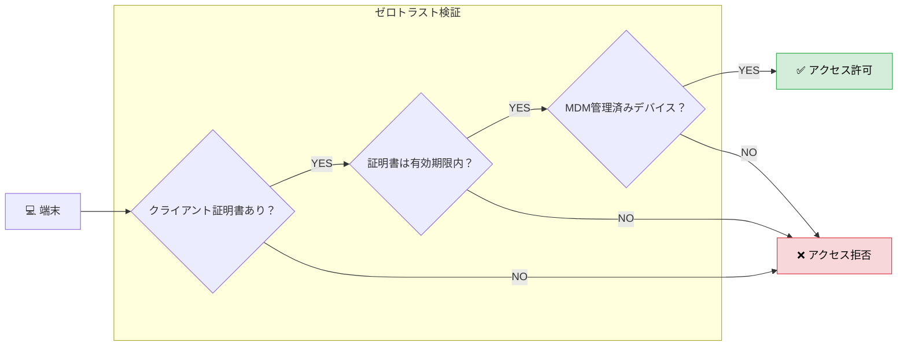

#### まとめ：2つの証明書の役割の違い

| | **TLS/SSL証明書** | **クライアント証明書** |
|---|---|---|
| **誰の証明？** | サーバー | 端末・ユーザー |
| **誰が検証？** | ブラウザ | サーバー |
| **主な目的** | 通信の暗号化・サーバー正当性確認 | デバイス認証・不正端末の排除 |
| **失効時の影響** | ブラウザ警告・サービス停止 | その端末のアクセスが即遮断 |

---

### クライアント証明書は認証を兼ねる

ここが混乱しやすいポイントです。TLS証明書は常に「通信路の保護」ですが、クライアント証明書は**認証のステップを担う**こともできます。

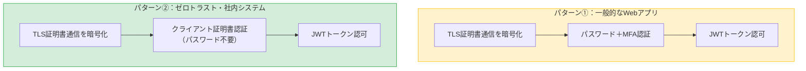

## 認証

### 認証とは？

「あなたは誰ですか？」を確認するステップです。本人確認に成功するとトークン（JWT）が発行され、次の関門である認可（次節）へと引き渡されます。

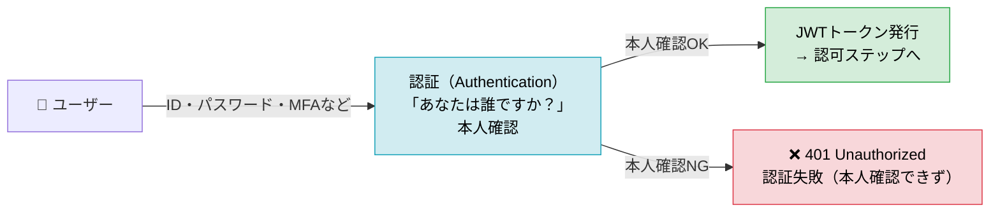

### 認証設計：自前管理をやめてIdPに委譲する（OAuth2/OIDC）

#### 考え方
パスワードの保管・MFAの実装・ブルートフォース対策などを自前で実装するのは、コストが高く脆弱性を生みやすいです。OAuth2/OpenID Connect（OIDC）を基盤に、実績あるIdP（Identity Provider）に認証を委譲するのが現代のベストプラクティスです。

> SAMLを使った認証フローについては[付録A](../appendix/A_saml-vs-oidc.md)で同じ登場人物を使って比較しています。

> 委譲先となる社員向けの IdP そのもの（ID のライフサイクル、MFA の方針、特権 ID の管理）は [identity](../../identity/README.md) で、認証ログの監視と不審なログインへの対応は [security-operations](../../security-operations/README.md) で扱います。

#### 認証フロー（OAuth2/OIDC）

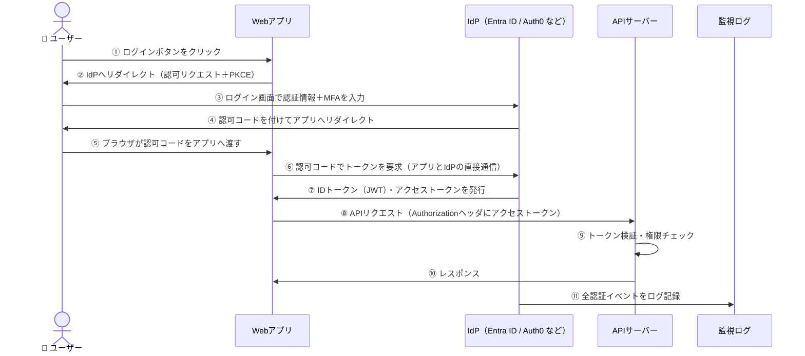

> これは OAuth2 の「認可コードフロー＋PKCE」で、Webアプリ・モバイルアプリの標準的な方式です。ブラウザが中継するのは短時間しか使えない認可コードだけで、トークン本体はアプリがIdPから直接受け取ります。IDトークンはJWT形式と決まっていますが、アクセストークンの形式はIdPによって異なります（JWTの場合が多い）。

#### 自前実装 vs IdP委譲の比較

| 項目 | 自前認証 | IdP委譲（推奨） |
|------|---------|--------------|
| MFA対応 | 自分で実装が必要 | 標準サポート |
| ブルートフォース対策 | 自分で実装が必要 | IdP側で自動対処 |
| ログ・監視 | 自前で構築 | 統合監視に直結 |
| 侵害時の対応 | セッションやトークンの無効化を自前で実装 | IdP側でセッション・リフレッシュトークンを一括失効できる（発行済みのアクセストークンは、有効期限まで使える場合がある） |

### まとめ

| 設計ポイント | やること | やってはいけないこと |
|------------|---------|-----------------|
| 認証方式 | IdP（OAuth2/OIDC）に委譲 | パスワードを自前で保管・管理 |
| MFA | 原則すべての利用者に必須化（可能ならフィッシング耐性のある方式） | パスワードのみで認証を完結させる |
| 監視 | 全認証イベントをログに記録 | エラー時だけログを取る |

## 認可

### 認可とは？

「何をしてよいですか？」を確認するステップです。前節の認証でトークンが発行された後、APIリクエストのたびにサーバー側でこのトークンを検証し、要求された操作の権限があるかを確認します。

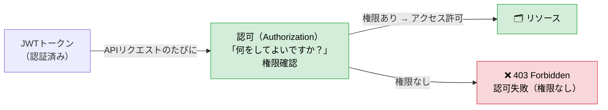

---

### 認可設計：「何ができるか」はサーバー側で必ず確認する

#### 考え方
認可（権限チェック）はサーバー側で行うことが絶対条件です。フロントエンドだけで「管理者メニューを非表示にする」といった制御は、開発者ツールで簡単に書き換えられてしまいます。

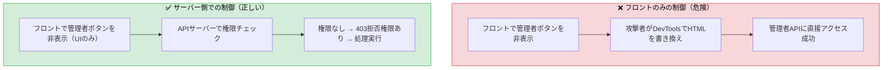

#### RBACとABACの使い分け

| | RBAC（ロールベース） | ABAC（属性ベース） |
|---|---|---|
| **制御の基準** | ユーザーの「役割」で判断 | 役割に加え、場所・時間・デバイスなど複数の「属性」で判断 |
| **具体例** | `admin`は全操作可、`user`は閲覧のみ | 日本国内・社内デバイス・営業時間内の場合のみ承認 |
| **✅ Pros** | シンプルで管理しやすい／導入コストが低い／監査しやすい | きめ細かい制御が可能／条件の組み合わせで柔軟に対応できる |
| **❌ Cons** | 条件が複雑になるとロールが爆発的に増える／状況に応じた動的制御が苦手 | 設計・管理が複雑／条件が増えるほどデバッグが難しくなる |
| **向いている場面** | 社内システム・管理画面など役割が明確なシステム | グローバルサービス・ゼロトラスト環境など状況に応じた制御が必要なシステム |

一般的には**まずRBACで設計し、より細かい制御が必要な箇所にABACを組み合わせる**のが現実的なアプローチです。

---

### まとめ

| 設計ポイント | やること | やってはいけないこと |
|------------|---------|-----------------|
| 認可の実施場所 | サーバー側でロール・属性を検証 | フロントエンドの表示制御だけに頼る |
| ロール設計 | まずRBACで設計し、必要に応じてABACを追加 | 最初からABACで複雑に設計しすぎる |
| 監視 | APIリクエストごとに権限チェック結果をログに記録 | エラー時だけログを取る |

---

**出典**（確認日：2026-11-14）

- Equifax：米下院 監視・政府改革委員会「The Equifax Data Breach」（2018-12）— https://oversight.house.gov/wp-content/uploads/2018/12/Equifax-Report.pdf 。40以上のデータベースにアクセスできた点は Crowell & Moring による同報告書の要約 — https://crowell.com/en/insights/client-alerts/lessons-from-the-house-report-on-the-equifax-breach-tRBKUpg6sU8gxxy6uRxaKo
- Colonial Pipeline：同社CEOの米上院での証言（2021-06-08）の報道 — https://amp.insurancejournal.com/news/national/2021/06/09/617870.htm 、Mandiant による侵入経路の説明の報道 — https://www.bangordailynews.com/2021/06/05/nation/hackers-breached-colonial-pipeline-using-compromised-password/
- Mirai：Antonakakis ほか「Understanding the Mirai Botnet」（USENIX Security 2017）— https://zakird.com/papers/mirai.pdf
- 証明書の最大有効期間：CA/Browser Forum Ballot SC-081v3（2025-04 可決）。要点は DNSimple の解説 — https://support.dnsimple.com/articles/announcement-ssl-certificate-validity-changes/
- TLS 1.3 のハンドシェイク：RFC 8446 — https://datatracker.ietf.org/doc/html/rfc8446
- 認可コードフローと PKCE：RFC 6749、RFC 7636、OpenID Connect Core 1.0（付録Aの出典を参照）
- 設計の5原則、アーキテクチャ、RBAC/ABAC：一般的な考え方をまとめた本資料の整理
