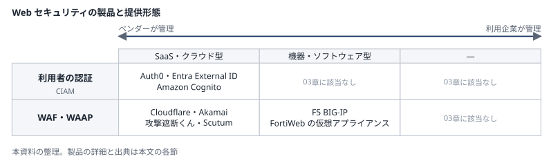

# 03 Webアプリケーションセキュリティの製品と提供形態

## 要旨

製品は、**アプリ利用者向けの IDaaS（CIAM：Customer Identity and Access Management）**、**WAF・WAAP**（Web アプリケーションと API の防御）、**TLS の証明書**の3つに分かれる。アプリの認証を自前で管理せず IdP に委譲する場合（→ 02章「認証」）、アプリの利用者（顧客・取引先）向けには、アプリに組み込む前提の CIAM を使うのが主な選択肢である。社員向けの IdP（Microsoft Entra ID、Okta Workforce Identity など）は、組織共通の基盤として identity の 03章で扱う。WAF は、Forrester の2025年の評価で Akamai・Cloudflare・Imperva がリーダーとされ、国内ではクラウド型の攻撃遮断くん・Scutum が広く使われている。市場の大きな動きは、公開の TLS 証明書の有効期間が2026年3月から段階的に短くなり、2029年3月に47日になることである。提供形態の主流は、どの分野も事業者が運用する SaaS（クラウド型）である。

*図1　Web セキュリティの製品と提供形態（縦は製品の区分、横は提供形態。本資料の整理）*

## アプリ利用者向けの IDaaS（CIAM）

専用の CIAM の Magic Quadrant を Gartner は出していない。Gartner の Access Management の Magic Quadrant（2025年11月）は CIAM の用途も含めて評価し、Okta・Microsoft・Ping Identity・IBM・Transmit Security をリーダーとした（→ identity 03章）。KuppingerCole の CIAM の Leadership Compass 2026年版では、Ping Identity が総合のリーダーとされた（同社の発表）。

| | **Auth0** | **Amazon Cognito** | **Firebase Authentication** |
|---|---|---|---|
| **提供元** | Okta（2021年に買収）| AWS | Google |
| **主な用途** | アプリ利用者向け（B2C/B2B SaaS）| アプリ利用者向け（B2C）| モバイル・Webアプリ向け（B2C）|
| **料金の考え方**（2026年時点の公表値） | Free プランは 25,000 MAU まで（2024年9月に 7,500 から拡大）。以降は MAU の帯ごとの料金 | 無料枠は月 10,000 MAU（2024年11月22日以前に作成したユーザープールは 50,000 MAU）| メール・ソーシャル・匿名のサインインは 50,000 MAU まで無料 |
| **主な特徴** | 開発者向けの SDK と API。ソーシャルログイン、パスワードレス認証 | AWS のサービスと統合できる。外部の SAML・OIDC の IdP とフェデレーションできる | SAML・汎用 OIDC・MFA・監査ログ・マルチテナントは、Identity Platform へのアップグレードで使える |

上の3つのほかに、大企業向けの CIAM として次の製品がある。

| 製品 | 提供元 | 補足 |
|---|---|---|
| Microsoft Entra External ID | Microsoft | 社員向けの Entra ID と同じ基盤で、顧客・取引先の ID を扱う |
| Ping Identity（旧 ForgeRock を含む） | Ping Identity | 2023年8月に ForgeRock の買収を完了した。KuppingerCole の2026年版で総合のリーダー |

課金は、どの製品も**月間のアクティブな利用者の数（MAU）**の帯ごとの料金が基本である。

---

### 選び方のポイント

アプリの環境と用途を軸に選ぶのが合理的です（以下は本資料の整理）。

- **AWS環境でコストを抑えたい** → Cognito
- **開発者がゼロから認証を作りたい / B2B SaaS で企業ごとの IdP と連携したい** → Auth0
- **スモールスタートで素早く実装したい** → Firebase Authentication
- **社員がアプリを使う** → アプリ専用の IDaaS ではなく、社員向けの IdP に認証を委ねる（→ identity 03章）

> いずれのサービスもOAuth2/OIDCに準拠しており、後から乗り換えること自体は技術的に可能です。ただし移行コストは発生するため、最初の選定が重要です。

## WAF・WAAP

WAF（Web Application Firewall）は、Web アプリケーションへの攻撃の通信を手前で止める。最近は API の保護・ボット対策・DDoS 対策と一体の **WAAP**（Web Application and API Protection）として提供されることが多い（→ 02章「通信保護とWAF」）。Forrester の Web Application Firewall Solutions の評価（2025年第1四半期）は10社を22の基準で評価し、Akamai・Cloudflare・Imperva をリーダーとした。Gartner は Cloud WAAP について Market Guide を出している。

| 製品 | 提供元 | 補足 |
|---|---|---|
| App & API Protector | Akamai | CDN と一体で、WAF・ボット対策・API の保護・DDoS 対策を1つの製品で提供。Forrester の2025年の評価でリーダー |
| Cloudflare WAF | Cloudflare | CDN と一体の WAF。Forrester の2025年の評価でリーダー |
| Imperva | Imperva | クラウドとオンプレミスの両方の形がある。Forrester の2025年の評価でリーダー |
| F5 Distributed Cloud WAAP | F5 | 機器（BIG-IP）の WAF と SaaS の WAAP の両方を持つ。Forrester の2025年の評価で Strong Performer |
| FortiWeb | Fortinet | 仮想アプライアンス・コンテナ・SaaS で提供。Forrester の2025年の評価で Contender |

課金は、守るサイト（FQDN）の数、通信量、要求の数などの組み合わせが多い（本資料の整理）。

## TLS の証明書

公開の TLS 証明書は、認証局（CA）が発行する。DigiCert・Sectigo などの海外の認証局が大手である。2025年4月11日、ブラウザーと認証局の業界団体 CA/Browser Forum が Ballot SC-081v3 を可決し、公開の TLS 証明書の最長の有効期間を次のとおり短くすることを決めた。

| 発行日 | 最長の有効期間 | 1年あたりの更新の回数（目安） |
|---|---|---|
| 2026年3月14日まで | 398日 | 約1回 |
| 2026年3月15日から | 200日 | 約2回 |
| 2027年3月15日から | 100日 | 約4回 |
| 2029年3月15日から | 47日 | 約8回 |

人の手で証明書を更新し続けることは現実的でなくなり、**更新の自動化**（ACME などの仕組みや、証明書の管理の製品）が前提になる（→ 04章、本資料の整理）。

## 国内の製品

| 製品 | 提供元 | 補足 |
|---|---|---|
| 攻撃遮断くん | サイバーセキュリティクラウド | クラウド型 WAF。富士キメラ総研の調査で、国内のクラウド型 WAF 市場の売上シェアが3年連続1位（2022〜2024年度、同社の発表）。ボット・DDoS 対策のプランもある |
| Scutum | セキュアスカイ・テクノロジー | 国産のクラウド型 WAF。独自の AI 型の検知エンジンを持つ |

国内の CIAM・認証局の製品は、本資料ではまだ扱っていない。

## 他の製品に付属する機能

| 付属する先 | 機能 | 補足（本資料の整理） |
|---|---|---|
| AWS・Azure・Google Cloud | AWS WAF、Azure の Web Application Firewall、Google Cloud Armor | クラウドの負荷分散・CDN に付けて使う。クラウドの利用料の中で課金される |
| AWS・Azure | Amazon Cognito、Microsoft Entra External ID | 上の CIAM の表を参照 |
| CDN の契約 | WAF・DDoS 対策 | Akamai・Cloudflare は CDN と WAF を一体で提供する |

## 提供形態

| 形態 | ベンダーが管理するもの | 利用企業が管理するもの | 例 |
|---|---|---|---|
| SaaS（CIAM） | 認証の基盤、利用者のデータの保管、更新 | アプリとの接続（OIDC・SAML）、ログインの画面と手順、利用者の属性、権限の設計 | Auth0、Amazon Cognito、Firebase Authentication |
| クラウド型 WAF・WAAP | 防御の基盤、検知のルールの更新 | 守るサイトの登録、例外の設定、検知のログの確認 | 攻撃遮断くん、Scutum、Cloudflare WAF |
| 機器・ソフトウェア型の WAF | 製品の提供と、ルールの更新の提供 | 上記に加えて、機器・サーバの運用 | F5 BIG-IP、FortiWeb の仮想アプライアンス |
| 証明書の発行 | 発行と失効の仕組み | 証明書の申請・設置・更新、秘密鍵の管理 | DigiCert、Sectigo |

## 市場の動き

| 時期 | できごと |
|---|---|
| 2021年 | Okta が Auth0 を買収した |
| 2023年8月 | Ping Identity が ForgeRock の買収を完了した |
| 2024年9月 | Auth0 が Free プランの上限を 7,500 MAU から 25,000 MAU に広げた |
| 2024年11月22日 | Amazon Cognito の無料枠が、この日より後に作るユーザープールでは月 10,000 MAU になった |
| 2025年3月20日 | Forrester が Web Application Firewall Solutions の評価（2025年第1四半期）を出した |
| 2025年4月11日 | CA/Browser Forum が、TLS 証明書の有効期間を47日まで短くする Ballot SC-081v3 を可決した |
| 2025年11月 | Gartner が Access Management の Magic Quadrant を出した |
| 2026年3月15日 | 公開の TLS 証明書の最長の有効期間が200日になった |

## 本資料でまだ扱っていないもの

- 国内の CIAM の製品と、国内の認証局
- 証明書の管理の製品（CLM）
- アプリの脆弱性の検査（SAST・DAST）の製品（→ app-development 03章でも未扱い）
- 各 WAF の価格の水準

---

**出典**（確認日：2026-11-14）

- Auth0 の Free プラン：Auth0 ブログ「Auth0 plans got an upgrade」（2024-09-24）— https://auth0.com/blog/auth0-plans-got-an-upgrade
- Amazon Cognito の料金と無料枠：AWS「Amazon Cognito pricing」— https://aws.amazon.com/cognito/pricing/
- Firebase Authentication と Identity Platform：Firebase ドキュメント — https://firebase.google.com/docs/auth 、無料枠の解説 — https://blog.logto.io/ja/firebase-authentication-pricing
- 社員向けの IdP（Entra ID・Okta）の料金と特徴の出典は、identity 03章に移した
- 「選び方のポイント」は、上記をもとにした本資料の整理
- Gartner の Access Management の Magic Quadrant（2025年11月）と KuppingerCole の CIAM の評価：Deepak Gupta（2026）— https://guptadeepak.com/top-5-enterprise-ciam-platforms-in-depth-comparison/ 、Ping Identity（2026年版の総合のリーダー）— https://hub.pingidentity.com/resources/kuppingercole-leadership-compass-ciam
- Forrester の WAF の評価（2025年第1四半期、10社・22の基準）：Akamai（2025-03-20）— https://www.akamai.com/newsroom/press-release/akamai-named-a-web-application-firewall-leader 、Cloudflare（2025-03-20）— https://blog.cloudflare.com/th-th/cloudflare-named-leader-waf-forrester-2025 、Imperva・F5・Fortinet の位置と各製品の構成：Security Boulevard（2026-06）— https://securityboulevard.com/2026/06/best-waap-solutions-for-enterprise-application-security-how-to-choose-the-right-platform-in-2026/
- TLS 証明書の有効期間の短縮：Sectigo（2025-04-11 の可決）— https://sectigostore.com/blog/47-day-ssl-certificate-validity/ 、The SSL Store（日程と更新の回数）— https://thesslstore.com/blog/47-day-ssl-certificate-validity-by-2029
- 攻撃遮断くん：サイバーセキュリティクラウドのニュースリリース（2025-10-29）— https://www.bridge-salon.jp/upload/tekiji_pdf/T~~44930~000000~1402~0~20251029~1100~20251029581010G.pdf 、BOXIL — https://boxil.jp/service/526/
- Scutum：ASPIC — https://www.aspicjapan.org/asu/service/114041
- 課金の単位の一般化、付属する機能の表、提供形態の表、更新の自動化が前提になる点は本資料の整理
- 製品の区分は 2026-11 時点の各社の公表情報による。契約の判断の前には各社の最新の資料で確かめる
