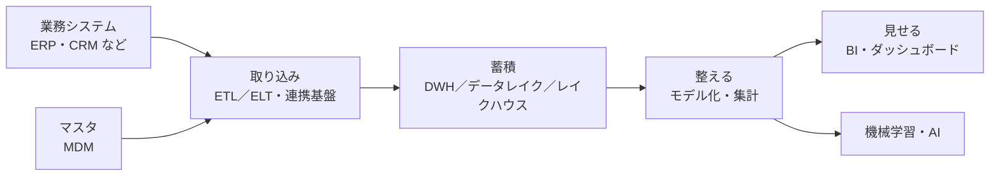

# 02 分析基盤の構造

## 要旨

分析基盤は、**取り込む → 蓄積する → 整える → 見せる**の流れでできている。DWH 中心の構成から、データレイクと DWH の二層の構成を経て、1つの保管場所に寄せるレイクハウスの構成が広がった。

## 全体の流れ

*図1 分析基盤のデータの流れ（本資料の整理）*

## 構成の移り変わり

レイクハウスの論文は、分析基盤の構成を次のように整理している。

| 世代 | 構成 | 特徴 |
|---|---|---|
| 第1世代 | DWH | 業務システムから DWH に集め、書き込む時点で形を決める（schema-on-write）。計算と保管が一体の機器で、ピークに合わせて買う必要があった。動画・文書などは扱いにくい |
| 第2世代 | データレイク ＋ DWH の二層 | 元のデータを安価な保管場所（S3 など）に置き、その一部を DWH にもう一度取り込む。データの二重持ちと、DWH 側のデータの古さが課題になった |
| レイクハウス | データレイクの上に DWH の機能 | オープンな形式（Parquet など）の上に、トランザクション・版管理・索引を載せる。BI と機械学習が同じデータを直接読む |

## オープンテーブルフォーマット

レイクハウスを支えるのが、ファイルの上に表の管理情報を載せる形式である。

| 形式 | 生まれたところ | 補足 |
|---|---|---|
| Apache Hudi | Uber（2016年に開発、2017年に公開） | 更新・削除と差分の取り込みに強い |
| Apache Iceberg | Netflix（2017年に開発が始まり、翌年 Apache 財団に寄贈） | 多くの処理エンジンから読める |
| Delta Lake | Databricks（2019年に公開、Linux Foundation で管理） | Spark と結びつきが強い |

## データモデル

| 考え方 | 内容 |
|---|---|
| Inmon（トップダウン） | まず全社で正規化した DWH を作り、そこからデータマートを作る。「唯一の正しい数字」を重んじる |
| Kimball（ボトムアップ） | 業務プロセスごとに次元モデルのデータマートを作り、共通のディメンションでつなぐ |
| Data Vault | Dan Linstedt が2000年に公開した手法。源泉の変化に強く、履歴と追跡を重んじる |

## メダリオンアーキテクチャ

Databricks が勧めるレイヤーの分け方である（必須ではないとされる）。

| 層 | 内容 |
|---|---|
| Bronze | 取り込んだままの元のデータ |
| Silver | 整えて検証したデータ |
| Gold | 次元モデル化・集計した、業務で使うデータ |

---

**出典**（確認日：2026-11-14）

- 構成の移り変わり：Armbrust ほか（CIDR 2021）— https://vldb.org/cidrdb/2021/lakehouse-a-new-generation-of-open-platforms-that-unify-data-warehousing-and-advanced-analytics.html
- オープンテーブルフォーマット：Apache Hudi — https://hudi.apache.org/blog/2026/07/14/what-is-an-open-table-format 、IBM（Iceberg）— https://www.ibm.com/think/topics/apache-iceberg 、Hudi の公開年：HackerNoon — https://sia.hackernoon.com/the-data-table-format-wars
- データモデル：Bill Inmon — https://williaminmon.substack.com/p/a-tale-of-two-architectures-kimball 、Data Vault：CIO Wiki — https://cio-wiki.com/wiki/Data_Warehouse
- メダリオン：Databricks — https://docs.databricks.com/aws/en/lakehouse/medallion.html
- 図1 は本資料の整理
