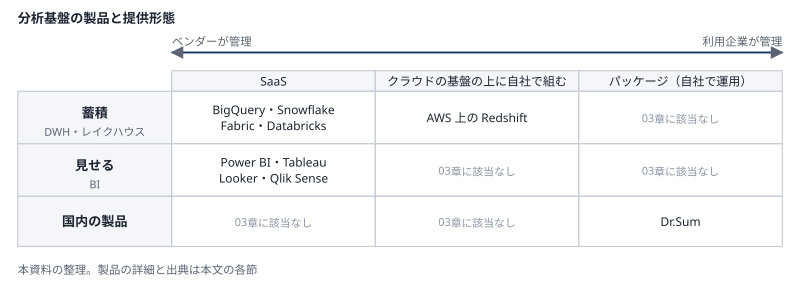

# 03 分析基盤の製品と提供形態

## 要旨

分析基盤の製品は、**蓄積（DWH・レイクハウス）**と**見せる（BI）**に分かれる。大手クラウドの3社（AWS・Microsoft・Google）は両方をそろえ、Databricks・Snowflake は蓄積を、Tableau・Qlik などは BI を中心にする。

*図1　分析基盤の製品と提供形態（縦は製品の区分、横は提供形態。本資料の整理）*

## 蓄積（DWH・レイクハウス）

Gartner は DWH を、クラウドのデータベース管理システム（Cloud DBMS）の市場の中で評価している。2025年版（2025年11月18日、20社）でリーダーとされたことを各社が発表しているのは、AWS、Google、Databricks、IBM である。

| 製品 | 提供元 | 補足 |
|---|---|---|
| Amazon Redshift ほか | AWS | 2025年版で「実行能力」がもっとも高い位置（同社の発表） |
| BigQuery | Google | 2025年版で「ビジョンの完全性」がもっとも高い位置（同社の発表）。BI の Looker とあわせて提供 |
| Databricks Data Intelligence Platform | Databricks | レイクハウスの提唱元。Delta Lake、カタログの Unity Catalog |
| Microsoft Fabric | Microsoft | 2023年11月15日に一般提供。データを OneLake に Delta Parquet 形式で置き、Power BI を含む各機能が同じデータを読む。他のデータベースを OneLake に複製し続ける Mirroring がある |
| Snowflake | Snowflake | DWH を中心にした SaaS。2025年版での位置は本資料では未確認 |
| watsonx.data ほか | IBM | 2025年版のリーダー（同社の発表）。機能の違いは本資料では未確認 |

Teradata は2025年版でビジョナリーとされた（同社の発表）。Microsoft・Snowflake・Oracle の2025年版での位置は、本資料では提供元の発表を確認していない。

## 見せる（BI）

Gartner の Analytics and BI Platforms の2025年版（2025年6月16日、20社）のリーダーは次の6社である。

| 製品 | 提供元 |
|---|---|
| Power BI | Microsoft（同社によれば18年連続のリーダー） |
| Tableau | Salesforce |
| Looker | Google |
| Qlik Sense | Qlik |
| Oracle Analytics Cloud | Oracle |
| ThoughtSpot | ThoughtSpot |

ビジョナリーには SAP、IBM、SAS などが入っている。

2026年版（2026年6月29日）では、Tableau（14年連続）と Qlik（16年連続）がリーダーとされたと発表している。Microsoft と AWS もリーダーとされ、Databricks が初めて評価に入りビジョナリーとされた（パートナー企業の解説による）。

## 国内の製品

| 製品 | 提供元 | 補足 |
|---|---|---|
| MotionBoard | ウイングアーク1st | 20年以上の歴史を持つ BI。3,900社以上の導入で、現場の業務に使うオペレーショナル BI の国内市場でトップシェアとしている。2025年12月の新版は生成 AI でダッシュボードを作る機能を持ち、10ユーザーで6万円（税別）から |
| Dr.Sum | ウイングアーク1st | 集計に特化したデータベースで、Web や Excel から集計する。MotionBoard と合わせた導入は累計1万1,600社以上 |

## 他の製品に付属する機能

| 付属先 | 付属する機能 | 補足 |
|---|---|---|
| Microsoft 365・Fabric | Power BI | Fabric の各機能が OneLake の同じデータを読む（上表） |
| Google Cloud | Looker | BigQuery とあわせて提供 |
| 業務アプリ | 各アプリの組み込みの分析（ERP・CRM のレポート） | アプリの中のデータに限られる。全社の分析は分析基盤で行う（→ 05章） |

## 提供形態

| 形態 | ベンダーが管理するもの | 利用企業が管理するもの | 例 |
|---|---|---|---|
| SaaS（クラウドの DWH・レイクハウス） | 基盤、性能の拡張、更新 | データのモデル、取り込みの仕組み、権限、使った量（費用） | BigQuery、Snowflake、Fabric |
| クラウドの基盤の上に自社で組む | 基盤のサービス | 上記に加えて、構成と運用 | AWS 上の Redshift と周辺のサービス |
| パッケージ（自社で運用） | ソフトウェアの提供と保守 | 上記に加えて、サーバ・更新の適用 | Dr.Sum のオンプレミス版 |

クラウドの分析基盤は、使った量（処理・保存）で費用が決まる製品が多く、費用の管理が運用の一部になる（本資料の整理、→ infrastructure 02章「費用の管理」）。

## 市場の動き

| 時期 | できごと |
|---|---|
| 2023年11月15日 | Microsoft Fabric が一般提供された |
| 2025年11月18日 | Gartner の Cloud DBMS の Magic Quadrant 2025年版が出た |
| 2026年6月29日 | Gartner の ABI の Magic Quadrant 2026年版が出た。AI のエージェントによる分析が前提とされるようになった（パートナー企業の解説による） |

## 本資料でまだ扱っていないもの

- 各製品の料金体系（従量課金、容量の予約）
- 国内での導入の全体像
- ETL／ELT の専用ツール（dbt、Fivetran など）の整理

---

**出典**（確認日：2026-11-14）

- Cloud DBMS の Magic Quadrant 2025：Gartner — https://www.gartner.com/en/documents/7195930 、AWS — https://aws.amazon.com/blogs/database/aws-positioned-highest-in-execution-in-the-latest-gartner-magic-quadrant-for-cloud-database-management-systems 、Google — https://cloud.google.com/blog/products/data-analytics/a-leader-in-2025-gartner-magic-quadrant-for-cdbms 、Databricks — https://www.databricks.com/blog/databricks-named-leader-2025-gartner-magic-quadrant-cloud-database-management-systems 、IBM — https://www.ibm.com/forms/mkt-54156 、Teradata — https://www.teradata.com/Resources/Analyst-Reports/Gartner-Magic-Quadrant-for-Cloud-Database-Management-Systems
- Microsoft Fabric：Microsoft（2023-11-15）— https://microsoft.com/microsoft-fabric/blog/2023/11/15/prepare-your-data-for-ai-innovation-with-microsoft-fabric-now-generally-available/ 、Microsoft Tech Community — https://techcommunity.microsoft.com/t5/ai-ai-platform-blog/driving-ai-innovation-across-digital-landscapes-azure-ai-and/ba-p/3978686
- ABI の Magic Quadrant 2025：CX Today — https://www.cxtoday.com/customer-data-platform/gartner-magic-quadrant-for-analytics-and-business-intelligence-abi-platforms-2025-the-rundown/ 、Google — https://cloud.google.com/blog/products/data-analytics/looker-gartner-analytics-and-business-intelligence-platforms-mq 、Microsoft — https://community.fabric.microsoft.com/t5/Power-BI-Updates-Blog/forward/ba-p/5174132
- ABI の Magic Quadrant 2026年版（2026-06-29）：Tableau — https://www.tableau.com/reports/gartner 、Qlik — https://www.qlik.com/us/news/company/press-room/press-releases/qlik-named-a-leader-for-the-16th-consecutive-year-in-2026-gartner-magic-quadrant-for-analytics-and-business-intelligence-platforms 、Microsoft・AWS・Databricks の位置と市場の変化：Concord（パートナー企業の解説）— https://www.concordusa.com/blog/what-gartners-2026-magic-quadrant-for-abi-tells-us-about-the-tools-we-work-in-every-day
- MotionBoard：ASCII（2025-10-20）— https://ascii.jp/elem/000/004/331/4331259/ 、Dr.Sum と累計の導入数：IT Leaders — https://it.impress.co.jp/articles/-/29193 、日立ソリューションズ — https://www.hitachi-solutions.co.jp/drsum-motionboard/
- 付属の機能と提供形態の表は本資料の整理
- 製品の区分は 2026-11 時点の各社の公表情報による。契約の判断の前には各社の最新の資料で確かめる
