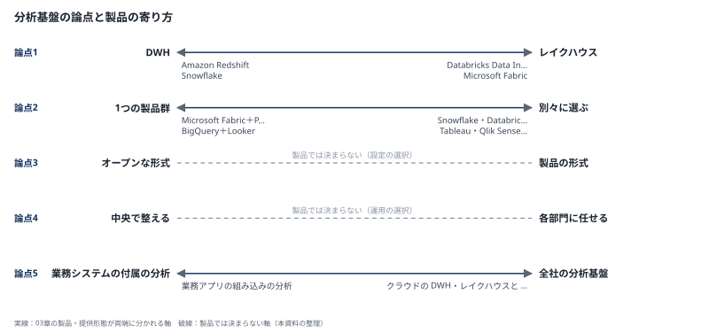

# 04 分析基盤の主要な論点

## 要旨

分析基盤を扱うときに出てくる軸は次の5つである（本資料の整理）。

1. DWH に寄せるか、レイクハウスに寄せるか
2. 1つの製品群でそろえるか、蓄積と BI を別々に選ぶか
3. オープンな形式で持つか、製品の形式に任せるか
4. 中央で整えるか、各部門に任せるか
5. 業務システムの付属の分析で済ませるか、全社の分析基盤に集めるか

*図1　分析基盤の論点と製品の寄り方（実線は03章の製品が両端に分かれる軸、破線は製品では決まらない軸。本資料の整理）*

## 論点1：DWH に寄せるか、レイクハウスに寄せるか

| | DWH | レイクハウス |
|---|---|---|
| 得るもの | SQL と BI に向く。運用が単純 | 文書・画像・機械学習まで同じデータで扱える。二重持ちが減る |
| 失うもの | 構造のないデータと機械学習は別の場所が要る | 設計・運用の自由度が高い分、整え方を自分で決める必要がある |

現在は主要な製品がどちらの機能も備えつつあり、境目は薄れている（本資料の整理）。

**製品・提供形態との対応**（→ 03章）

| | DWHに寄るもの | レイクハウスに寄るもの |
|---|---|---|
| 製品・提供形態 | Amazon Redshift、Snowflake（DWH を中心にした SaaS） | Databricks Data Intelligence Platform、Microsoft Fabric（OneLake）。BigQuery・watsonx.data もレイクハウスの機能を持つ |

## 論点2：1つの製品群でそろえるか、別々に選ぶか

| | 1つの製品群（例：Microsoft Fabric＋Power BI） | 別々に選ぶ（例：Snowflake＋Tableau） |
|---|---|---|
| 得るもの | 権限・課金・運用を一元化できる。データの複製が減る | 各層で最適な製品を選べる。乗り換えやすい |
| 失うもの | 提供元への依存。苦手な機能も同じ製品で使うことになる | 製品間の連携と権限の管理を自分で持つ |

**製品・提供形態との対応**（→ 03章）

| | 1つの製品群（例：Microsoft Fabric＋Power BI）に寄るもの | 別々に選ぶ（例：Snowflake＋Tableau）に寄るもの |
|---|---|---|
| 製品・提供形態 | Microsoft Fabric＋Power BI、BigQuery＋Looker（Google Cloud） | Snowflake・Databricks に、Tableau・Qlik Sense・ThoughtSpot などの BI を組み合わせる形 |

## 論点3：オープンな形式で持つか、製品の形式に任せるか

| | オープンな形式（Iceberg、Delta Lake） | 製品の形式 |
|---|---|---|
| 得るもの | 複数の処理エンジンから読める。将来の乗り換えに強い | 製品の性能と機能をそのまま使える |
| 失うもの | 管理情報（カタログ）の置き場所を決める必要がある | データを取り出すときに書き出しが要る |

**製品・提供形態との対応**（→ 03章）：製品では決まらない（設定の選択）。オープンな形式（Iceberg・Delta Lake）は、03章の主要な製品の多くが読み書きできる

## 論点4：中央で整えるか、各部門に任せるか

| | 中央で整える | 各部門に任せる（セルフサービス） |
|---|---|---|
| 得るもの | 数字の定義がそろう（「唯一の正しい数字」） | 早く、現場に合った分析ができる |
| 失うもの | 中央の部門が待ち行列になる | 同じ指標が部門ごとに違う数字になる |

**製品・提供形態との対応**（→ 03章）：製品では決まらない（運用の選択）。どの BI もセルフサービスの分析と、中央で定義した指標の両方を持てる

典型的な懸念：「会議で部門ごとに売上の数字が違う」。指標の定義を1か所で管理する層（セマンティックレイヤー）を置く考え方がある（本資料の整理）。

## 論点5：業務システムの付属の分析で済ませるか、全社の分析基盤に集めるか

| | 業務システムの付属の分析 | 全社の分析基盤 |
|---|---|---|
| 得るもの | 追加の構築が要らない。その業務の中ではすぐ使える | 複数の業務をまたいだ分析ができる |
| 失うもの | 他の業務のデータと組み合わせられない | 取り込みとモデル化の手間。マスタの品質に左右される（→ master-data） |

**製品・提供形態との対応**（→ 03章）

| | 業務システムの付属の分析に寄るもの | 全社の分析基盤に寄るもの |
|---|---|---|
| 製品・提供形態 | 業務アプリの組み込みの分析（ERP・CRM のレポート） | クラウドの DWH・レイクハウス（Redshift、BigQuery、Databricks、Fabric、Snowflake）と BI |

---

**出典**（確認日：2026-11-14）

- 5つの軸と各表の内容は、01〜03章をもとにした本資料の整理
- 各論点の「製品・提供形態との対応」は、03章の製品をもとにした本資料の整理
