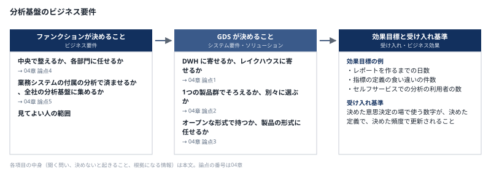

# 05 分析基盤のビジネス要件

## 要旨

分析基盤の製品を選ぶ前に、ファンクションには**どの意思決定に、どの数字を、誰の定義で使うか**を決めてもらう。指標の定義は業務の側にしか決められない。

この章は、governance/budget-transfer の kickoff 資料（IT 予算移管の要点）にある役割分担を、この技術について具体化したものである。

*図1　分析基盤のビジネス要件（ファンクションが決めたビジネス要件をもとに GDS がシステム要件とソリューションを決め、効果目標と受け入れ基準で確かめる）*

## ファンクションが決めること（ビジネス要件）

### 中央で整えるか、各部門に任せるか

- **決めること**：指標の定義を誰が持つか（→ 04章 論点4）
- **聞く問い**：「売上・在庫などの指標の定義を、部門の間でそろえる必要があるか。定義の責任者は誰か」
- **決めないと起きること**：同じ指標が部門ごとに違う数字になり、会議で数字の突き合わせから始まる
- **根拠になる情報**：経営会議の資料、部門ごとの定義の違い

### 業務システムの付属の分析で済ませるか、全社の分析基盤に集めるか

- **決めること**：業務をまたいだ分析の必要（→ 04章 論点5）
- **聞く問い**：「どの業務のデータを組み合わせて、何を判断したいか」
- **決めないと起きること**：目的のないまま全社の基盤にデータを集め、使われない
- **根拠になる情報**：判断したいこと、組み合わせたいデータ

### 見てよい人の範囲

- **決めること**：データの種類ごとに、見てよい人の範囲（行・列の単位の権限の元）
- **聞く問い**：「このデータを、どの部門・役職まで見せてよいか」
- **決めないと起きること**：権限の設計が後回しになり、個人情報や機密の数字が広く見える
- **根拠になる情報**：データの分類、社内の規程

## GDS が決めること

- DWH に寄せるか、レイクハウスに寄せるか（→ 04章 論点1）
- 1つの製品群でそろえるか、別々に選ぶか（→ 04章 論点2）
- オープンな形式で持つか、製品の形式に任せるか（→ 04章 論点3）

## 効果目標と受け入れ基準

- **効果目標の例**：レポートを作るまでの日数、指標の定義の食い違いの件数、セルフサービスでの分析の利用者の数
- **受け入れ基準**：決めた意思決定の場で使う数字が、決めた定義で、決めた頻度で更新されること

## 部門に閉じた案件として扱えないとき

- 複数の業務システムからデータを取り込むため、データ連携が必ず生じる
- 人事・顧客のデータを扱うと個人情報になる

境界の詳細（どのシステムが何を持つか）は [function-allocation](../../../cross-cutting/function-allocation/function-allocation.md) を参照。

---

**出典**（確認日：2026-11-15）

- 役割分担の原則と4つの場面：governance/budget-transfer の kickoff 資料（IT 予算移管の要点、2026-11-02 初版）
- 項目の立て方、問い、例は、04章の論点をもとにした本資料の整理
