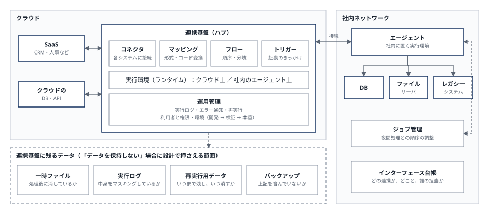

# 02 データ連携の構造

## 要旨

連携基盤は「接続（コネクタ）・変換（マッピング）・制御（フロー）・実行環境・運用管理」で構成される。クラウドの連携基盤が社内システムとつながるときは、社内に置いた**エージェント**を経由する。連携基盤は、意図しなくても一時ファイルやログにデータを残すことがあるため、「データを保持しない」場合はその範囲まで設計する。

*図1　連携基盤の構成要素と、社内・クラウドをまたぐ構成（本資料の整理）*

## 構成要素

| 要素 | 役割 |
|---|---|
| コネクタ | 各システムや形式（ファイル、DB、REST API、SFTP、SaaS）に接続する |
| マッピング（変換） | データ形式の変換、コードの読み替え、項目の対応づけ |
| フロー（制御） | 処理の順序、分岐、繰り返し、エラー時の動きを定義する |
| トリガー | 処理を起動するきっかけ（スケジュール、ファイルの到着、イベント、APIの呼び出し） |
| 実行環境（ランタイム） | フローを実際に動かす場所。クラウド上と、社内のエージェント上がある |
| 運用管理 | 実行ログ、エラー通知、再実行、利用者と権限、環境（開発・検証・本番）の管理 |

## ハブ型の仕組み

- 各システムは、ハブ（連携基盤）とだけつながる。
- 送り元のデータ形式と送り先のデータ形式の違いは、ハブのマッピングが吸収する。
- あるシステムを入れ替えたときは、そのシステムとハブの間のコネクタとマッピングだけを作り直す。ほかのシステムには影響しない。

## 社内とクラウドをまたぐ仕組み

- クラウドの連携基盤から社内のシステム（DB、ファイルサーバ、レガシーシステム）へ直接はつなげないため、社内ネットワークに**エージェント**を置き、エージェント経由で接続する。
- 製品によっては、**管理する場所（どこで設定・監視するか）と、実行する場所（どこでデータが流れるか）を分けられる**。管理は1か所に集約し、実行は各地域や各ネットワークの中で行う、という構成ができる。

## 連携基盤に残るデータ

連携基盤はデータを中継するだけのつもりでも、次の場所にデータが残ることがある。個人情報や規制対象のデータを流す場合は、これらを設計で押さえる。

| 残る場所 | 押さえること |
|---|---|
| 処理途中の一時ファイル | 処理が終わったら消しているか |
| 実行ログ | データの中身が出力されていないか（マスキングしているか） |
| エラー時の再実行用データ | いつまで残し、いつ消すか |
| バックアップ | 上記のデータがバックアップに含まれていないか |

## 運用の仕組み

- **環境**：開発 → 検証 → 本番の環境を分け、変更をその順で反映する。
- **インスタンス**：同じ製品でも、用途ごとに環境（インスタンス）を分けられる。分け方は 04章「主要な論点」の論点4を参照。
- **インターフェース台帳**：どの連携が、どのシステムとどのシステムの間にあり、誰が担当するかを一覧で管理する。台帳がないと、止めてよいか分からない連携が残り続け、古いシステムを停止できなくなる。
- **ジョブ管理との連携**：社内のジョブ管理ツールと連携して、ほかの夜間処理と順序をそろえることがある（例：セゾンテクノロジーは HULFT Square と JP1 のジョブ管理を連携するソリューションを提供している）。

---

**出典**（確認日：2026-11-14）

- HULFT Square の運用管理機能（環境設定、ユーザー管理、ジョブ設定、監視）：IT Leaders — https://it.impress.co.jp/articles/-/25812
- HULFT Square と JP1 のジョブ管理連携（2026-03-09）：クラウド Watch 関連記事一覧 — https://cloud.watch.impress.co.jp/img/clw/docs/1564/529/html/07_o.jpg.html
- ログに機微なデータを出力しない（マスキングする）点：OWASP「Logging Cheat Sheet」— https://cheatsheetseries.owasp.org/cheatsheets/Logging_Cheat_Sheet.html
- 一時ファイル・再実行データ・バックアップの扱い、構成要素・ハブ型・エージェントの説明は、一般的な設計上の注意をまとめた本資料の整理
- 図1は、本章の内容をもとにした本資料の整理
