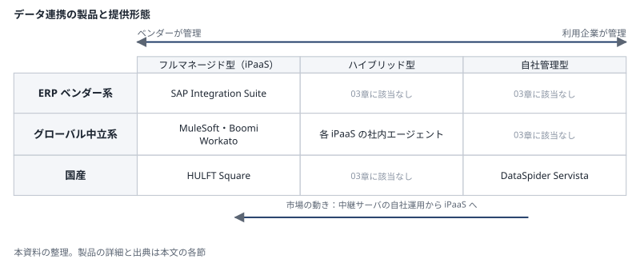

# 03 データ連携の製品と提供形態

## 要旨

連携基盤の製品は、**ERPベンダー系・グローバルの中立系・国産**の3系統に分かれる。ERPベンダー系は自社ERPとの連携に強い一方、ERPの選択と結びつく。提供形態は、ベンダーが基盤を運用するフルマネージド型と、自社のサーバ（クラウド上を含む）で動かす自社管理型があり、その中間に「管理はクラウド、実行は社内」という形もある。

*図1　データ連携の製品と提供形態（縦は製品の区分、横は提供形態。本資料の整理）*

## 主要な製品

Gartner の iPaaS の Magic Quadrant 2025年版（2025年5月19日）は16社を評価した。Boomi・Informatica・Microsoft・SAP・Workato が、それぞれリーダーとされたと発表している。Workato はビジョンの完全性がもっとも高い位置、Boomi は11回連続のリーダーとしている。

| 系統 | 製品 | ベンダー | 特徴 |
|---|---|---|---|
| ERPベンダー系 | SAP Integration Suite | SAP | SAP BTP 上の連携サービス。SAP製品との連携用の事前定義済みコンテンツが多い。イベント連携（Event Mesh）を含む |
| | Azure Integration Services | Microsoft | Azure 上の連携サービス群。ワークフローの Logic Apps、メッセージングの Service Bus、イベント配信の Event Grid、API 管理の API Management、処理を書く Azure Functions などからなる |
| グローバル中立系 | MuleSoft、Boomi、Workato、Informatica など | 各社 | 特定の ERP に依存せず、多様な SaaS とつなげる。MuleSoft（2018年）と Informatica（2025年）は Salesforce が買収している |
| 国産 | HULFT Square／DataSpider（Servista・Cloud） | セゾンテクノロジー | ファイル転送の HULFT と、データ連携の DataSpider の系譜。社内システム・ファイル連携に強く、ノーコードで設計できる。詳細は [付録A](../appendix/A_saison-technology-products.md) |
| | ASTERIA Warp | アステリア | ノーコードの連携ツール。国内 EAI/ESB 市場の出荷数量シェアで首位（テクノ・システム・リサーチ調べ）。導入社数は1万社超（2023年8月時点） |

国産製品は、国内のサポートと技術者を確保しやすい。

## 国内の製品

国産の製品は、上表の HULFT Square・DataSpider（セゾンテクノロジー）と ASTERIA Warp（アステリア）である。ASTERIA Warp は国内の EAI/ESB 市場の出荷数量シェアで首位、HULFT はファイル転送で国内に広く使われ、国内のサポートと技術者を確保しやすい。グローバルの iPaaS の Magic Quadrant には国産製品は入っていない（本資料の整理）。

## 他の製品に付属する機能

| 付属先 | 付属する機能 | 補足 |
|---|---|---|
| SAP BTP | SAP Integration Suite | SAP 製品との事前定義の連携。ERP の選択と結びつく（→ 04章 論点2） |
| Microsoft Azure | Logic Apps・Service Bus・Event Grid・API Management・Functions・Data Factory | Azure の契約の中で使える連携のサービス群 |
| Salesforce | MuleSoft、Informatica | Salesforce が買収した連携とデータ管理の製品 |
| 業務アプリ | 各アプリの API・コネクタ | 個別につなぐ場合の手段（→ 04章 論点1） |

## 提供形態

| 形態 | ベンダーが管理するもの | 利用企業が管理するもの | 例 |
|---|---|---|---|
| フルマネージド型（iPaaS） | 基盤・更新・監視 | フローの作成と保守。運用の負担が小さいが、環境の中身や更新時期は制御できない | HULFT Square、Workato |
| 自社管理型 | ソフトウェアの提供と保守 | 自社のサーバやクラウド（IaaS）上での導入と運用。環境を制御できるが、運用の要員と費用が必要 | DataSpider Servista をサーバに導入する形 |
| ハイブリッド型 | 管理の基盤（クラウド） | 社内で実行するエージェント。社内のデータを社外に出さずに管理だけを集約できる（製品により可否が異なる） | 各 iPaaS の社内エージェント |

「中継サーバを構築する」と「iPaaS を使う」は同じではない。前者は自社管理型、後者はフルマネージド型を指すことが多い。どちらを指しているかで、環境の制御、運用体制、障害時の責任が変わる（→ 04章「主要な論点」の論点3）。

## 費用の目安

- HULFT Square：最安料金 月額48万円〜（2026年8月時点の紹介記事）。販売代理店経由の Basic プランは年額288万円（税別）から（2024年1月時点）。
- 費用はプラン、接続先、処理量、インスタンス数で変わる。インスタンスを分けると費用が積み上がる場合がある。

## 市場の動き

| 時期 | できごと |
|---|---|
| 2018年 | Salesforce が MuleSoft を買収した |
| 2025年5月 | Gartner が iPaaS の Magic Quadrant 2025年版を出した。Boomi は Rivery（データ連携）を統合し、TIBCO の API 管理（旧 Mashery）を取得したとしている |
| 2025年11月18日 | Salesforce が Informatica の買収を完了した（→ master-data 03章） |

## 本資料でまだ扱っていないもの

- HULFT Square 以外の製品の料金
- API 管理の専用製品
- 国内製品とグローバル製品の機能の比較

---

**出典**（確認日：2026-11-14）

- ASCII, いま本当に使えるSaaS 100選【情シス・セキュリティ編】（2026-08-26） — https://weekly.ascii.jp/elem/000/004/429/4429456/2/
- クラウド Watch, アシスト、セゾン情報システムのiPaaS「HULFT Square」を提供（2024-01-10） — https://cloud.watch.impress.co.jp/docs/news/1559757.html
- SAP, SAP Integration Suite can help optimize your SAP S/4HANA connectivity — https://www.sap.com/events/2026-06-17-online-integration-suite-can-help-optimize-your-s4hana-connectivity.html
- SAP, Salesforce order-to-cash integration content（Event Mesh） — https://www.sap.com/netherlands/products/technology-platform/partners/rojo-consultancy-bv-salesforce-order-to-cash-integration-content-for-sap-s4hana-sap-erp.html
- Azure Integration Services の構成：Microsoft Learn「Integration architecture design」— https://learn.microsoft.com/en-us/azure/architecture/integration/integration-start-here
- Informatica の買収（2025年）：TechRadar — https://www.techradar.com/pro/salesforce-snaps-up-informatica-in-usd8bn-deal-to-boost-ai-tools 、MuleSoft の買収（2018年）：Digit — https://www.digit.fyi/salesforce-completes-8-billion-acquisition-of-informatica/
- ASTERIA Warp：アステリア プレスリリース（2023-08-09）— https://www.zaikei.co.jp/releases/2150064/ 、同（2022-11-30）— https://www.asteria.com/jp/wp-content/files_mf/1669775592pr221130_01.pdf
- iPaaS の Magic Quadrant 2025年版（2025-05-19）：Informatica（評価16社）— https://www.silicon.co.uk/press-release/informatica-named-a-leader-in-the-2025-gartner-magic-quadrant-for-ipaas 、Boomi（11回連続、Rivery・Mashery）— https://www.silicon.co.uk/press-release/boomi-recognized-as-a-leader-for-the-11th-time-in-the-2025-gartner-magic-quadrant-for-integration-platform-as-a-service 、https://boomi.com/?p=36462 、Microsoft — https://azure.microsoft.com/en-us/blog/?p=40947 、SAP — https://news.sap.com/2025/05/five-time-leader-gartner-magic-quadrant-ipaas-sap-integration-suite 、Workato — https://www.silicon.co.uk/press-release/workato-named-a-leader-in-the-2025-gartner-magic-quadrant-for-ipaas
- 国産製品が Magic Quadrant に入っていない点、付属の機能の表は本資料の整理
- 製品の区分は 2026-11 時点の各社の公表情報による。契約の判断の前には各社の最新の資料で確かめる
