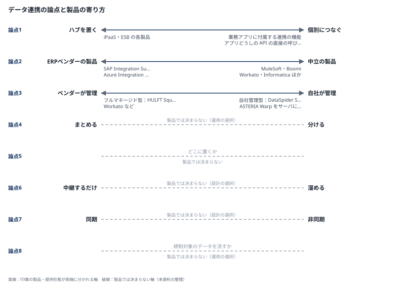

# 04 データ連携の主要な論点

## 要旨

データ連携を扱うときに必ず出てくる軸は次の8つである。懸念や要望を聞いたときは、まずそれがどの軸の話かを特定する。

1. ハブを置くか、個別につなぐか
2. ERPベンダーの製品か、中立の製品か
3. ベンダーが管理するか、自社が管理するか
4. 1つのインスタンスにまとめるか、分けるか
5. どこに置くか（地域）
6. データを中継するだけか、溜めるか
7. 即時に連携するか（同期）、まとめて連携するか（非同期）
8. 規制対象のデータを流すか

*図1　データ連携の論点と製品の寄り方（実線は03章の製品が両端に分かれる軸、破線は製品では決まらない軸。本資料の整理）*

## 論点1：ハブを置くか、個別につなぐか

| | ハブを置く | 個別につなぐ |
|---|---|---|
| 得るもの | システムの入れ替えの影響を接続部分に閉じ込められる。連携の全体が見える | 初期の費用が小さい。少数の連携なら簡単 |
| 失うもの | 基盤の費用と運用の体制が必要。ハブが止まるとすべての連携が止まる（単一障害点） | 連携が増えると管理できなくなる。システムの入れ替えのたびに、つながる相手すべてに手が入る |

**製品・提供形態との対応**（→ 03章）

| | ハブを置くに寄るもの | 個別につなぐに寄るもの |
|---|---|---|
| 製品・提供形態 | iPaaS・ESB の各製品（SAP Integration Suite、Azure Integration Services、MuleSoft、Boomi、Workato、Informatica、HULFT Square・DataSpider、ASTERIA Warp） | 業務アプリに付属する連携の機能、アプリどうしの API の直接の呼び出し |

典型的な懸念：「どこで何がつながっているか分からない」「古いシステムを止められない」「ERPを替えると周りが全部作り直しになる」

## 論点2：ERPベンダーの製品か、中立の製品か

| | ERPベンダーの製品 | 中立の製品 |
|---|---|---|
| 得るもの | 自社ERPとの事前定義済みの連携が使える。ERPと一体でサポートを受けられる | ERPの選択に縛られない。ERPを入れ替えても連携基盤は残せる |
| 失うもの | ERPを替えると連携基盤も替えることになりやすい。ベンダーへの依存が深まる | ERPとの連携を自分で作る部分が増える |

**製品・提供形態との対応**（→ 03章）

| | ERPベンダーの製品に寄るもの | 中立の製品に寄るもの |
|---|---|---|
| 製品・提供形態 | SAP Integration Suite（SAP BTP）、Azure Integration Services。自社の ERP との事前定義の連携がある | MuleSoft、Boomi、Workato、Informatica、HULFT Square・DataSpider、ASTERIA Warp。特定の ERP に依存しない。MuleSoft と Informatica は Salesforce の傘下になった |

典型的な懸念：「ERPがまだ決まっていない」「ベンダーへの依存を増やしたくない」

## 論点3：ベンダーが管理するか、自社が管理するか

| | ベンダーが管理（フルマネージド型） | 自社が管理（サーバに導入） |
|---|---|---|
| 得るもの | 基盤の運用・更新・監視を任せられる | 環境、更新時期、構成を自社で制御できる |
| 失うもの | 環境の中身や更新時期を制御できない。障害時の補償は一般にサービスクレジットまで | 基盤の運用要員と費用が必要 |

**製品・提供形態との対応**（→ 03章）

| | ベンダーが管理（フルマネージド型）に寄るもの | 自社が管理（サーバに導入）に寄るもの |
|---|---|---|
| 製品・提供形態 | フルマネージド型（iPaaS）：HULFT Square、Workato など | 自社管理型：DataSpider Servista、ASTERIA Warp をサーバに導入する形。ハイブリッド型（社内のエージェントで実行）はその中間 |

典型的な懸念：「中身がブラックボックス」「事業継続をベンダーに委ねたくない」

## 論点4：1つのインスタンスにまとめるか、分けるか

| | まとめる | 分ける（用途・規制・地域ごと） |
|---|---|---|
| 得るもの | 費用と運用の手間が小さい | 障害の影響範囲が小さい。規制対象の範囲を限定できる。アクセス権を分けやすい。地域ごとに保守の時間帯を設定できる |
| 失うもの | 1つの変更や障害がすべてに及ぶ。規制対象（バリデーション）の範囲が環境全体に広がる | 費用が積み上がる場合がある。ルールがばらつくおそれがある |

分ける場合も、**製品とルール（命名、ログ、エラー処理、台帳、開発→検証→本番の流れ）は1つにそろえ、分けるのは環境だけ**にするのが定石である。

**製品・提供形態との対応**（→ 03章）：製品では決まらない（運用の選択）。ただしインスタンスを分けると費用が積み上がる製品がある（→ 03章「費用の目安」）

典型的な懸念：「人事データと製造データを同じ環境に置いてよいか」「人事側の小さな変更でGxPの手続きが必要になる」

## 論点5：どこに置くか（地域）

連携先のシステムが複数の地域にある場合、連携基盤の置き場所で次の4点が変わる。

| 観点 | 中身 |
|---|---|
| 法規制 | 個人データを域外へ移すと規制の対象になる（欧州の GDPR など）。GDPR で問題になるのは**通信の経路ではなく、データをどこで保存・処理し、誰がどこからアクセスできるか**である。第三国からのリモートアクセスは、画面表示だけでも移転とみなされる |
| 性能 | 地域をまたぐ通信は遅延が大きい。同じ地域の中の連携を、別の地域のハブ経由にすると、データが地球を往復する |
| 保守の時間帯 | 世界で1つにすると、どこかの地域が必ず業務時間中になり、止めて保守できる時間がなくなる |
| 運用 | 1つなら管理が楽。地域ごとに置くと運用の負担が増える |

配置は、インターフェースごとに「どこのシステムからどこのシステムへ流れるか」を一覧にすると決まる。地域の中で完結する連携が大半なら地域ごと、地域をまたぐ連携が中心なら集約型が向く。管理は1か所・実行は各地域、という構成をとれる製品もある。

**通信経路について**：クラウドベンダーは、通信ごとの物理的な経路を開示しない。代わりに「自社網の中にとどまる」「データセンター間は暗号化する」といった保証を開示する（例：Microsoft は、データセンター間の通信は自社のグローバルネットワーク内を通り、公衆インターネットを通らないとしている）。この保証が及ぶのは同じベンダーの網の中だけで、ベンダーをまたぐ区間を守るのは通信の暗号化（TLS）である。

**製品・提供形態との対応**（→ 03章）：製品で選べる範囲が変わる。iPaaS は提供される地域（リージョン）の中から選ぶ。自社管理型は自社の環境の置き場所で決まる

典型的な懸念：「欧州のデータを日本で処理してよいか」「通信がどこを通るのか分からない」

## 論点6：データを中継するだけか、溜めるか

| | 中継するだけ | 溜める（ステージング・データハブ） |
|---|---|---|
| 得るもの | 個人情報や規制対象のデータを持たずに済む。正本が二重にならない | 送り先が止まっていても受け取っておける。送り元と送り先のタイミングを切り離せる |
| 失うもの | 送り先が止まると連携も止まる | 溜めたデータの保護・保存期間・アクセス権の管理が必要。どちらが正本かを決めておかないと混乱する |

「保持しない」を選んだ場合も、一時ファイル・ログ・再実行用データ・バックアップに残らないことまで設計する（→ 02章「構造」）。

**製品・提供形態との対応**（→ 03章）：製品では決まらない（設計の選択）。どの製品も中継と一時的な保存の両方を設計できる

典型的な懸念：「人事情報を中継サーバに残したくない」「データハブとマスタのどちらが正か分からない」

## 論点7：即時に連携するか（同期）、まとめて連携するか（非同期）

| | 同期（API） | 非同期（バッチ、イベント、キュー） |
|---|---|---|
| 得るもの | 結果がすぐ分かる。即時性が必要な業務に向く | 相手が止まっていても処理を続けられる。大量データに向く |
| 失うもの | 相手が止まると自分の処理も止まる。システム同士の結びつきが強くなる | 反映に時間差が出る。順序や重複の扱いを設計する必要がある |

**製品・提供形態との対応**（→ 03章）：製品では決まらない（設計の選択）。03章の製品の多くは API・バッチ・イベントの連携をすべて持つ（例：SAP Integration Suite の Event Mesh、Azure の Service Bus・Event Grid）

典型的な懸念：「受注をすぐ出荷側に反映したい」「相手のシステムの障害に巻き込まれたくない」

## 論点8：規制対象のデータを流すか

- GxP の対象となるデータを流す連携は、コンピュータ化システムバリデーションの対象になる。EU GMP Annex 11 は、他のシステムと電子的にデータを交換するシステムに、データの正確で安全な入力・処理のための組み込みのチェックを求めている。
- 連携の変更のたびに、変更管理と影響評価が必要になる。監査証跡を製品の機能でどこまで支えられるかが論点になる。
- 規制対象の連携と、そうでない連携を同じ環境に置くと、規制の手続きが対象外の連携にも及ぶ（→ 論点4）。

**製品・提供形態との対応**（→ 03章）：製品では決まらない（運用の選択）。規制対象の連携は、どの製品でもバリデーションと変更管理の対象になる（→ gxp-compliance 03章）

典型的な懸念：「連携の修正のたびにバリデーションが必要になる」

---

**出典**（確認日：2026-11-14）

- Microsoft Learn, Microsoft global network — https://learn.microsoft.com/azure/networking/microsoft-global-network
- Microsoft, Define network encryption requirements（データセンター間の MACsec 暗号化） — https://docs.microsoft.com/lt-lt/azure/cloud-adoption-framework/ready/azure-best-practices/define-network-encryption-requirements
- JD Supra, Updated EU Data Transfers Guidance（EDPB Guidelines 05/2021、リモートアクセスの扱い） — https://jdsupra.com/legalnews/updated-eu-data-transfers-guidance-8758106/
- activeMind.legal, EDPB defines third country transfers — https://www.activemind.legal/guides/edpb-third-country-transfers/
- Goodwin, EDPB Defines a "Transfer" Under the GDPR — https://www.goodwinlaw.com/en/insights/blogs/2021/12/edpb-defines-a-transfer-under-the-gdpr
- EU GMP Annex 11（Computerised Systems）— https://health.ec.europa.eu/system/files/2016-11/annex11_01-2011_en_0.pdf
- 法的な判断は法務・DPO に確認すること。論点1・3・4・6・7 の軸と典型的な懸念は、一般的な設計上の論点をまとめた本資料の整理
- 各論点の「製品・提供形態との対応」は、03章の製品をもとにした本資料の整理
