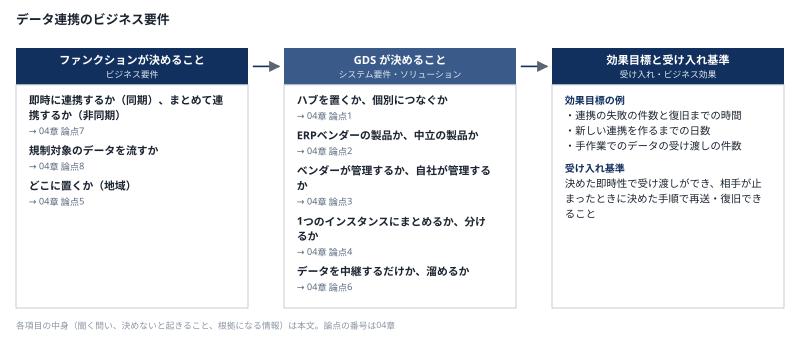

# 05 データ連携のビジネス要件

## 要旨

連携の製品を選ぶ前に、ファンクションには**どのデータを、どれだけ速く、どこまで確実に届ける必要があるか**を決めてもらう。製品と方式は GDS が決めるが、即時性と規制対象かどうかは業務でしか決まらない。

この章は、governance/budget-transfer の kickoff 資料（IT 予算移管の要点）にある役割分担を、この技術について具体化したものである。

*図1　データ連携のビジネス要件（ファンクションが決めたビジネス要件をもとに GDS がシステム要件とソリューションを決め、効果目標と受け入れ基準で確かめる）*

## ファンクションが決めること（ビジネス要件）

### 即時に連携するか（同期）、まとめて連携するか（非同期）

- **決めること**：受け渡しの即時性（→ 04章 論点7）
- **聞く問い**：「相手のシステムに反映されるまで、何分・何時間待てるか。待てない業務はどれか」
- **決めないと起きること**：すべてを即時の連携で作り、相手が止まると自分も止まる構成が増える
- **根拠になる情報**：業務の締めの時刻、受け渡しの量と頻度

### 規制対象のデータを流すか

- **決めること**：規制対象のデータを流すか（→ 04章 論点8）
- **聞く問い**：「流すデータのうち、GMP・GCP の記録になるものはどれか」
- **決めないと起きること**：規制対象の連携が分からないまま作り、後から検証と変更管理が要るとわかる
- **根拠になる情報**：品質保証部門の判断、データの一覧

### どこに置くか（地域）

- **決めること**：データの置き場所の制約（→ 04章 論点5）
- **聞く問い**：「国外にデータを出してよいか。出してはいけない国・データはあるか」
- **決めないと起きること**：連携基盤の置き場所の制約が後から見つかり、作り直しになる
- **根拠になる情報**：取引のある国の規制、個人情報の有無

## GDS が決めること

- ハブを置くか、個別につなぐか（→ 04章 論点1）
- ERPベンダーの製品か、中立の製品か（→ 04章 論点2）
- ベンダーが管理するか、自社が管理するか（→ 04章 論点3）
- 1つのインスタンスにまとめるか、分けるか（→ 04章 論点4）
- データを中継するだけか、溜めるか（→ 04章 論点6）

## 効果目標と受け入れ基準

- **効果目標の例**：連携の失敗の件数と復旧までの時間、新しい連携を作るまでの日数、手作業でのデータの受け渡しの件数
- **受け入れ基準**：決めた即時性で受け渡しができ、相手が止まったときに決めた手順で再送・復旧できること

## 部門に閉じた案件として扱えないとき

- 連携は2つ以上のシステムにまたがるため、1つの部門に閉じない
- 規制対象のデータを流す連携は GxP の対象になる
- 人事・顧客の情報を流す連携は個人情報を扱う

境界の詳細（どのシステムが何を持つか）は [function-allocation](../../../cross-cutting/function-allocation/function-allocation.md) を参照。

---

**出典**（確認日：2026-11-15）

- 役割分担の原則と4つの場面：governance/budget-transfer の kickoff 資料（IT 予算移管の要点、2026-11-02 初版）
- 項目の立て方、問い、例は、04章の論点をもとにした本資料の整理
