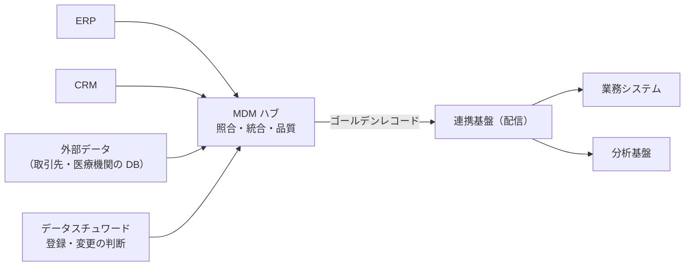

# 02 マスタデータ管理の構造

## 要旨

MDM は、**マスタの項目ごとに正本と責任者を決める（ガバナンス）**、**複数のシステムの記録を突き合わせる（照合・統合）**、**決まった正本を各システムに配る（配信）**の3つでできている。どこで登録し、どこに正本を置くかの組み合わせが**実装スタイル**で、4つの型に分けて考えるのが一般的である。

## 全体の流れ

*図1　MDM の構成（本資料の整理）*

## 実装スタイル（4つの型）

| スタイル | どこで登録するか | 正本はどこか | 特徴 |
|---|---|---|---|
| レジストリ | 各源泉のシステム | 各源泉のシステム | ハブは記録を突き合わせて対応づけるだけで、上書きも配信もしない。もっとも軽い |
| 統合（コンソリデーション） | 各源泉のシステム | 源泉（ハブは参照用のゴールデンレコードを持つ） | ハブにゴールデンレコードを作り、報告・参照に使う。人が確認する工程が加わる |
| 共存（コエグジスタンス） | 源泉とハブの両方 | ハブのゴールデンレコードを源泉に書き戻す | 統合の型に、源泉への書き戻しを加える。双方向の同期が必要 |
| 集中（セントラライズド、トランザクション） | ハブだけ | ハブ | ハブが唯一の正本。他のシステムはハブから受け取るだけ。もっとも強い統制 |

一般に、組織とデータの環境が複雑になるにつれて、レジストリ → 統合 → 共存 → 集中と、より強い型へ移っていく。領域（顧客・品目など）ごとに違う型を使うことも多い。

## 照合と統合

複数のシステムに同じ取引先や顧客が別々に登録されていると、「同じものか」を判定して1つにまとめる必要がある（本資料の整理）。

| 工程 | 内容 |
|---|---|
| 標準化 | 表記の揺れ（全角・半角、略称、住所の書き方）をそろえる |
| 照合（マッチング） | 名称・住所・識別番号などから、同じ実体かを判定する |
| 統合（サバイバーシップ） | 重複した記録のうち、どの項目の値を残すかの規則を決めてまとめる |
| 外部データとの突き合わせ | 公的な識別番号や外部の DB（医療機関・医師の DB など）を基準にする |

医療機関・医師のマスタでは、国内の製薬企業がアルトマークの MDB などの外部 DB を基準にする例がある（→ veeva-platform 付録B）。

## ガバナンス：誰が何を決めるか

MDM は IT だけの取り組みでは成り立たず、経営層の後ろ盾と、業務部門・IT・ベンダーなどの関係者の協力が必要とされる。マスタの管理の主導権は業務部門に持たせ、IT は支える側に回るのがよいとされる。

決めておくこと（本資料の整理）：

- **項目ごとの正本（SoR）**：たとえば、品目コードは ERP、医療機関の名称は外部 DB、といった項目単位の取り決め。
- **登録・変更の権限と承認の流れ**：誰が新しい取引先を登録できるか、変更に誰の承認が要るか。
- **品質の基準と監視**：必須項目、重複の許容、定期的な点検。

---

**出典**（確認日：2026-11-14）

- 実装スタイル：Stibo Systems — https://blog.stibosystems.com/4-common-master-data-management-implementation-styles 、Datamation（2023-08）— https://www.datamation.com/big-data/master-data-management-implementation-styles/ 、Pimcore — https://pimcore.com/en/mdm-implementation-styles 、Veridion（集中型でハブが SoR になること）— https://veridion.com/?p=30041 、Centric（領域ごとに型を変えること）— https://www.centricdxb.com/insights/mdm-implementation-styles
- 経営層の後ろ盾と関係者の協力：Pimcore — https://pimcore.com/en/resources/blog/master-data-management-essentials-you-can-t-afford-to-get-wrong_a54096 、業務部門に主導させること：CIO.com（Profisee 転載）— https://profisee.com/press-release/what-is-master-data-management-ensuring-a-single-source-of-truth-2/
- 図1、照合と統合の工程、ガバナンスで決めることは本資料の整理
