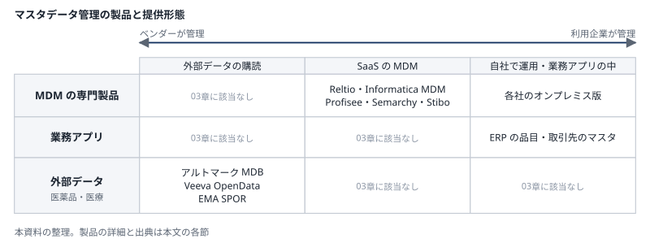

# 03 マスタデータ管理の製品と提供形態

## 要旨

MDM の製品は、**MDM の専門製品**、**ERP などの業務アプリに付属するマスタ管理**、**特定の領域（医療機関・医師など）の外部データサービス**の3つに分かれる。近年は、MDM がデータ連携・データ品質・ガバナンスと一体の「データ管理基盤」として提供される方向にある。

*図1　マスタデータ管理の製品と提供形態（縦は製品の区分、横は提供形態。本資料の整理）*

## MDM の専門製品

Gartner は2022年に MDM の Magic Quadrant をやめると発表したが、2026年4月に再び出した。2026年版では20社が評価され、次の5社がリーダーとされた。

| 製品 | 提供元 | 補足 |
|---|---|---|
| Informatica MDM | Salesforce（Informatica） | Salesforce が2025年11月18日に Informatica の買収を完了（約80億ドル）。データカタログ・連携・品質・メタデータ管理とともに提供 |
| Reltio | Reltio | クラウドネイティブの MDM。2026年版で「ビジョンの完全性」がもっとも高い位置（同社の発表） |
| Profisee | Profisee | Microsoft のエコシステムとの連携と、AI のエージェント・MCP サーバでマスタを AI の道具に渡すことを打ち出す（同社の発表） |
| Semarchy Data Platform（xDM） | Semarchy | MDM・データガバナンス・データの統合をまとめた基盤（同社の発表） |
| Stibo Systems | Stibo Systems | MDM の独立系で最大の提供者と自称。顧客・製品・仕入先・拠点などを扱う |

評価の対象には、SAP・IBM・Ataccama・Boomi・Syndigo なども含まれる。

Gartner は、MDM の機能が、データ連携・品質・ガバナンスと一体になった広いデータ管理基盤に取り込まれつつあると指摘している。

## 国内の製品

国内ベンダーの MDM の専門製品は、本資料では確認していない。2026年版の Magic Quadrant の評価の対象にも、日本のベンダーは入っていない（評価の対象の一覧による）。医療機関・医師のデータ（アルトマーク MDB）は、日本固有の外部データとして下記に挙げる。

## 業務アプリに付属するマスタ管理

ERP などの業務アプリも、自分の範囲のマスタ（品目・取引先など）を持ち、その登録・承認の機能を備える。SAP も MDM の Magic Quadrant の評価対象に入っている。どこまでを業務アプリのマスタ管理で済ませ、どこから専門の MDM を使うかは 04章の論点になる（本資料の整理）。

## 外部データサービス（医薬品・医療）

| サービス | 内容 | 関連 |
|---|---|---|
| アルトマーク MDB | 国内の医療機関・医師のデータベース | veeva-platform 付録B |
| Veeva OpenData | Veeva の顧客（医療機関・医療従事者）のデータ | veeva-platform 付録H |
| EMA SPOR | 欧州の医薬品の物質・製品・組織・参照データのサービス | 01章 |

## 提供形態

| 形態 | ベンダーが管理するもの | 利用企業が管理するもの | 例 |
|---|---|---|---|
| SaaS の MDM | 基盤、照合（マッチング）の機能、更新 | データのモデル、照合と統合のルール、データの責任者（スチュワード）の体制 | Reltio、Informatica MDM の SaaS 版 |
| 自社で運用する MDM | ソフトウェアの提供と保守 | 上記に加えて、サーバ・データベース・更新の適用 | 各社のオンプレミス版 |
| 業務アプリの中のマスタ管理 | 業務アプリの機能として | 登録・承認の流れ、他システムへの配り方 | ERP の品目・取引先のマスタ |
| 外部データの購読 | データの整備と更新 | 自社のマスタとの突き合わせ（識別子の対応づけ） | アルトマーク MDB、Veeva OpenData |

どの形態でも、データの責任者を誰にするかは製品では決まらない（本資料の整理、→ 04章）。

## 市場の動き

| 時期 | できごと |
|---|---|
| 2022年 | Gartner が MDM の Magic Quadrant をやめると発表した |
| 2025年11月18日 | Salesforce が Informatica の買収を完了した（約80億ドル） |
| 2026年4月6日 | Gartner が MDM の Magic Quadrant を再び出した（2026年版） |

## 本資料でまだ扱っていないもの

- 各 MDM 製品の機能と得意な領域の違い
- 製品情報管理（PIM）と MDM の違い
- 各製品の料金

---

**出典**（確認日：2026-11-14）

- MDM の Magic Quadrant（2026-04-06）の再開と評価対象：Profisee — https://profisee.com/resources/2026-gartner-magic-quadrant-for-master-data-management-solutions/ 、Gartner — https://www.gartner.com/en/documents/7683461 、評価の対象の一覧：Profisee — https://profisee.com/?p=21422 、リーダー各社：Profisee（2026-04-06）— https://profisee.com/press-release/profisee-named-a-leader-in-the-2026-gartner-magic-quadrant-for-master-data-management-solutions/ 、Semarchy — https://semarchy.com/press-releases/semarchy-named-a-leader-in-the-2026-gartner-magic-quadrant-for-master-data-management/ 、Stibo Systems（2026-04-09）— https://www.stibosystems.com/press-releases/stibo-systems-named-a-leader-in-gartner-magic-quadrant-for-master-data-management-solutions
- Salesforce による Informatica の買収：Salesforce（2025-11-18）— https://www.salesforce.com/news/press-releases/2025/11/18/salesforce-completes-acquisition-of-informatica/ 、金額：Pulse 2.0 — https://pulse2.com/salesforce-completes-8-billion-acquisition-of-informatica-to-accelerate-agentic-ai-data-platform/amp/
- Reltio：Reltio — https://www.reltio.com/?p=23942 、https://www.reltio.com/?p=27221
- Stibo Systems：プレスリリース（2026-04-09）— https://www.stibosystems.com/press-releases/stibo-systems-named-a-leader-in-gartner-magic-quadrant-for-master-data-management-solutions
- Semarchy xDM：CIO.com — https://www.cio.com/article/191827/what-is-master-data-management-ensuring-a-single-source-of-truth.html
- 外部データサービス：veeva-platform 付録B・H の出典を参照。EMA SPOR：EMA — https://www.ema.europa.eu/en/human-regulatory/overview/data-medicines-iso-idmp-standards
- Profisee の AI の機能：Profisee — https://profisee.com/?p=25647
- 提供形態の表は本資料の整理
- 製品の区分は 2026-11 時点の各社の公表情報による。契約の判断の前には各社の最新の資料で確かめる
