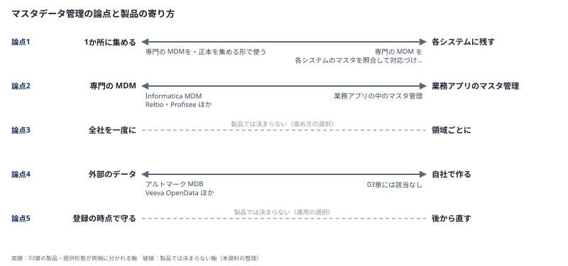

# 04 マスタデータ管理の主要な論点

## 要旨

MDM を扱うときに出てくる軸は次の5つである（本資料の整理）。

1. 正本を1か所に集めるか、各システムに残して対応づけるか
2. 専門の MDM を入れるか、業務アプリのマスタ管理で済ませるか
3. 全社のマスタを一度に扱うか、領域ごとに始めるか
4. 外部のデータを基準にするか、自社で作るか
5. 品質を登録の時点で守るか、後から直すか

*図1　マスタデータ管理の論点と製品の寄り方（実線は03章の製品が両端に分かれる軸、破線は製品では決まらない軸。本資料の整理）*

## 論点1：正本を1か所に集めるか、各システムに残して対応づけるか

| | 1か所に集める（集中型） | 各システムに残す（レジストリ・統合型） |
|---|---|---|
| 得るもの | マスタがいつも正しく、権限と監査を一元化できる | 既存のシステムと業務を変えずに始められる。費用が小さい |
| 失うもの | 全システムがハブに依存する。登録の業務を変える必要がある | 源泉の品質はそのまま残り、食い違いは解消されない |

**製品・提供形態との対応**（→ 03章）

| | 1か所に集める（集中型）に寄るもの | 各システムに残す（レジストリ・統合型）に寄るもの |
|---|---|---|
| 製品・提供形態 | 専門の MDM（Informatica MDM、Reltio、Profisee、Semarchy、Stibo Systems）を、正本を集める形で使う | 専門の MDM を、各システムのマスタを照合して対応づける形で使う。業務アプリの中のマスタ管理 |

典型的な懸念：「ERP と CRM で取引先の名称が違う」「どれが正しいマスタか分からない」

多くの組織は軽い型から始めて、年単位でより強い型へ移る（→ 02章）。

## 論点2：専門の MDM を入れるか、業務アプリのマスタ管理で済ませるか

| | 専門の MDM | 業務アプリ（ERP など）のマスタ管理 |
|---|---|---|
| 得るもの | 複数のシステムをまたいで照合・統合できる。顧客・品目など複数の領域を扱える | 追加の製品が要らない。業務の流れの中で登録できる |
| 失うもの | 製品と運用の費用。連携の構築 | そのアプリの外のシステムとの食い違いは管理できない |

**製品・提供形態との対応**（→ 03章）

| | 専門の MDMに寄るもの | 業務アプリ（ERP など）のマスタ管理に寄るもの |
|---|---|---|
| 製品・提供形態 | Informatica MDM、Reltio、Profisee、Semarchy Data Platform、Stibo Systems | 業務アプリの中のマスタ管理（ERP・CRM の機能） |

## 論点3：全社のマスタを一度に扱うか、領域ごとに始めるか

| | 全社を一度に | 領域ごとに |
|---|---|---|
| 得るもの | 領域をまたぐ関係（顧客と製品など）をはじめから設計できる | 成果を早く出せる。失敗の影響が小さい |
| 失うもの | 合意に時間がかかり、成果が出るまで長い | 領域ごとに作り方がばらつく |

CRM に関わる業務から始めるのがよいとする指摘もある。顧客データを持つ MDM ハブは、CRM と密に連携する必要があるからである。

**製品・提供形態との対応**（→ 03章）：製品では決まらない（進め方の選択）。複数の領域（顧客・品目・仕入先）を扱える製品なら、領域ごとに始めて後から広げられる

## 論点4：外部のデータを基準にするか、自社で作るか

| | 外部のデータ（医療機関の DB、公的な識別番号など） | 自社で作る |
|---|---|---|
| 得るもの | 正確さと網羅性を、提供者に頼れる。他社と同じ基準でデータを交換できる | 費用がかからない。自社の業務に合わせた項目を持てる |
| 失うもの | 利用料。提供者への依存（→ veeva-platform 付録D） | 正確さと更新を自社で保つ手間 |

**製品・提供形態との対応**（→ 03章）

| | 外部のデータ（医療機関の DB、公的な識別番号など）に寄るもの | 自社で作るに寄るもの |
|---|---|---|
| 製品・提供形態 | アルトマーク MDB、Veeva OpenData、EMA SPOR などの外部データの購読 | 03章には該当なし（自社で作る） |

## 論点5：品質を登録の時点で守るか、後から直すか

| | 登録の時点で守る（入力の検証、承認） | 後から直す（定期的な点検と修正） |
|---|---|---|
| 得るもの | 誤りが広がる前に止められる | 登録の業務を止めない |
| 失うもの | 登録に手間と時間がかかる | 誤ったマスタが他のシステムに配られた後に直すことになる |

**製品・提供形態との対応**（→ 03章）：製品では決まらない（運用の選択）。どの MDM も登録の時点の検証と承認の流れ、後からの照合の両方を持つ

---

**出典**（確認日：2026-11-14）

- 5つの軸と各表の内容は、01〜03章をもとにした本資料の整理
- CRM の領域から始めるとする指摘：Dan Power の発言（CIO.com、Profisee 転載）— https://profisee.com/press-release/what-is-master-data-management-ensuring-a-single-source-of-truth-2/
- 各論点の「製品・提供形態との対応」は、03章の製品をもとにした本資料の整理
