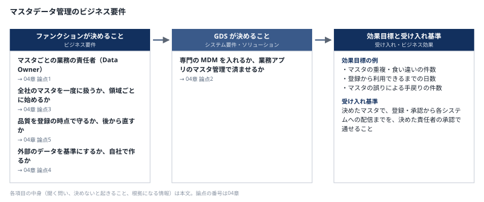

# 05 マスタデータ管理のビジネス要件

## 要旨

MDM の製品を選ぶ前に、ファンクションには**マスタごとに、誰が正本を持ち、誰が登録・承認するか**を決めてもらう。MDM の効果は製品ではなく、この責任の分担で決まる。

この章は、governance/budget-transfer の kickoff 資料（IT 予算移管の要点）にある役割分担を、この技術について具体化したものである。

*図1　マスタデータ管理のビジネス要件（ファンクションが決めたビジネス要件をもとに GDS がシステム要件とソリューションを決め、効果目標と受け入れ基準で確かめる）*

## ファンクションが決めること（ビジネス要件）

### マスタごとの業務の責任者（Data Owner）

- **決めること**：品目・取引先・顧客などのマスタごとに、正本を持つ部門と承認者（→ 04章 論点1）
- **聞く問い**：「このマスタの誤りに気づいたとき、直す責任があるのは誰か」
- **決めないと起きること**：製品を入れても登録の責任者がいないため、食い違いが解消されない
- **根拠になる情報**：マスタの種類、登録・変更の件数、関わる部門

### 全社のマスタを一度に扱うか、領域ごとに始めるか

- **決めること**：どの領域から始めるか（→ 04章 論点3）
- **聞く問い**：「食い違いで困っているマスタはどれか。困っている業務は何か」
- **決めないと起きること**：全社を一度に扱おうとして合意に時間がかかり、成果が出ない
- **根拠になる情報**：マスタの食い違いの実例、業務への影響

### 品質を登録の時点で守るか、後から直すか

- **決めること**：品質を守る方法（→ 04章 論点5）
- **聞く問い**：「登録に時間がかかってもよいか、まず登録して後から直すか」
- **決めないと起きること**：登録が止まる、または誤ったマスタが他のシステムに配られる
- **根拠になる情報**：登録の件数と急ぎの度合い、誤りの影響

### 外部のデータを基準にするか、自社で作るか

- **決めること**：外部のデータを基準にするか（→ 04章 論点4）
- **聞く問い**：「医療機関・医療従事者のマスタを、外部のデータで作るか」
- **決めないと起きること**：外部のデータの利用料と自社での更新の手間を比べないまま決まる
- **根拠になる情報**：外部のデータの利用料、自社で保つ手間

## GDS が決めること

- 専門の MDM を入れるか、業務アプリのマスタ管理で済ませるか（→ 04章 論点2）

## 効果目標と受け入れ基準

- **効果目標の例**：マスタの重複・食い違いの件数、登録から利用できるまでの日数、マスタの誤りによる手戻りの件数
- **受け入れ基準**：決めたマスタで、登録・承認から各システムへの配信までを、決めた責任者の承認で通せること

## 部門に閉じた案件として扱えないとき

- マスタは複数のシステムに配られるため、1つの部門に閉じない
- 品目・規格のマスタは GxP の変更管理の対象になる
- 顧客（医療従事者）のマスタは個人情報を含む

境界の詳細（どのシステムが何を持つか）は [function-allocation](../../../cross-cutting/function-allocation/function-allocation.md) を参照。

---

**出典**（確認日：2026-11-15）

- 役割分担の原則と4つの場面：governance/budget-transfer の kickoff 資料（IT 予算移管の要点、2026-11-02 初版）
- 項目の立て方、問い、例は、04章の論点をもとにした本資料の整理
