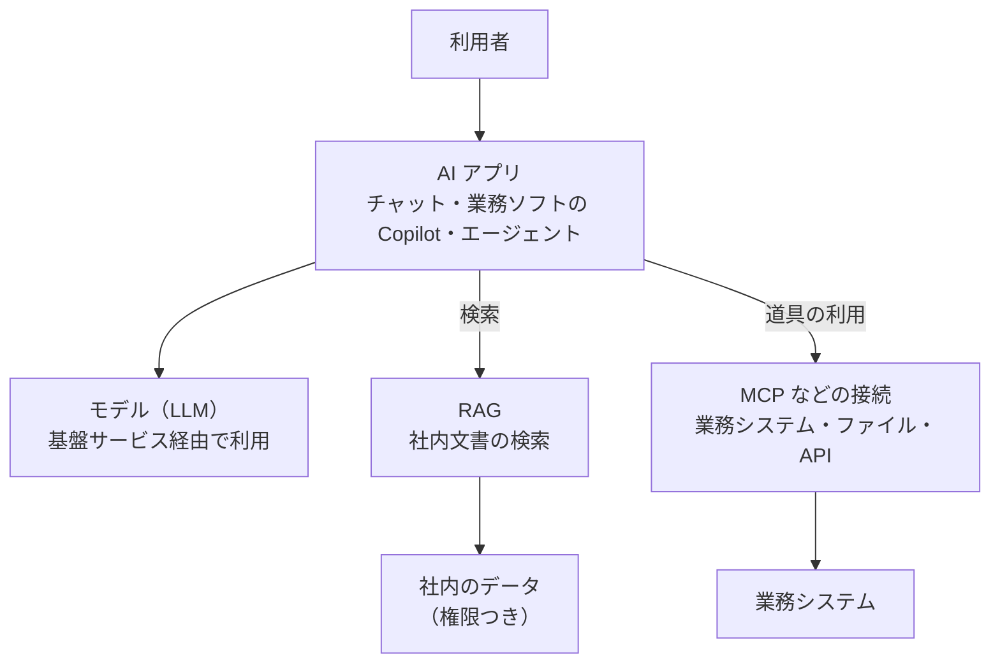

# 02 AI の構造

## 要旨

企業で使う生成 AI は、**モデル**・**モデルを提供する基盤**・**自社のデータや道具とのつなぎ（RAG・MCP）**・**利用者の画面（アプリ）**の4層で捉える。性能の差はモデルで決まるが、**回答の正しさと安全性は、つなぎの層で何を渡すか・何をさせるかでほぼ決まる**（本資料の整理）。

## 全体の構成

*図1　企業の生成 AI の構成（本資料の整理）*

## 層ごとの役割

| 層 | 役割 | 主な論点 |
|---|---|---|
| モデル | 文章を生成する | 性能、費用、対応する言語、データの扱い（学習に使われないか） |
| 基盤サービス | モデルを API で提供し、ID・ネットワーク・ログ・地域の管理を付ける | どのクラウドで使うか（→ 03章） |
| つなぎ（RAG・MCP） | 社内の文書を検索して渡す。業務システムなどの道具を使わせる | どのデータを、誰の権限で渡すか |
| アプリ | 利用者が使う画面。業務ソフトへの組み込み（Copilot など）を含む | 誰に配るか、何に使わせるか |

## RAG：自社のデータを使う

RAG は、利用者の質問に関係する文書を検索し、その内容を LLM に渡して回答させる。モデルを学習し直さなくても、社内の規程や手順書に基づいて答えられる。

注意点（本資料の整理）：

- **検索で見つからなければ、正しく答えられない**。文書が古い・散らばっている・重複していると、回答の質がそのまま落ちる。
- **権限の範囲がそのまま出る**。たとえば Microsoft 365 Copilot は、利用者がすでにアクセスできる範囲のデータを使って回答する。共有設定が広すぎる文書は、AI を通じて見つかりやすくなる（→ workplace 05章）。

## AI エージェントと MCP

AI エージェントは、LLM が道具を選んで使い、複数の手順を自分で進める。道具とのつなぎ方の標準として、Anthropic が2024年11月に公開した **Model Context Protocol（MCP）** が広く使われている。MCP は AI アプリを外部のシステムにつなぐためのオープンな標準で、2025年12月に Linux Foundation の Agentic AI Foundation に寄贈され、中立な団体が管理するようになった。Claude・ChatGPT・Microsoft Copilot・Gemini などが MCP に対応し、公開されている MCP サーバーは1万を超えるとされる。

エージェントは「答える」だけでなく「操作する」ため、誤りの影響が大きい。どの道具を、どの権限で使わせるか、人の確認をどこに挟むかの設計が要る（→ 04章）。

## AI に固有のリスク

OWASP の「Top 10 for LLM Applications 2025」（2024年11月公開）は、LLM を使うアプリの主なリスクを10に整理している。

| 番号 | リスク | 内容（本資料の要約） |
|---|---|---|
| LLM01 | プロンプトインジェクション | 利用者の入力や、検索で取り込んだ外部の文章が、モデルの振る舞いを書き換える |
| LLM02 | 機密情報の漏えい | 個人情報・機密情報がモデルの出力に出る |
| LLM03 | サプライチェーン | 外部のモデルや部品に起因するリスク |
| LLM04 | データとモデルの汚染 | 学習データや参照データに不正な内容を混ぜられる |
| LLM05 | 出力の不適切な扱い | モデルの出力を検証せずに、別のシステムで実行・表示する |
| LLM06 | 過剰な権限（Excessive Agency） | エージェントに必要以上の権限を与える |
| LLM07 | システムプロンプトの漏えい | 隠しておくべき指示や設定が引き出される |
| LLM08 | ベクトルと埋め込みの弱点 | RAG の検索の仕組みの弱点を突かれる |
| LLM09 | 誤情報 | もっともらしい誤りを出力し、それが信じられる |
| LLM10 | 無制限な消費 | 大量の要求で、サービスの停止や費用の急増が起きる |

NIST の生成 AI プロファイル（AI 600-1）も、生成 AI に固有の12のリスクと200を超える推奨策を、AI RMF の4つの機能（統治・把握・測定・管理）に対応づけて示している。

これらの対策のうち、**社内のルールと体制**は governance/ai-security-framework で扱い、本トピックは**仕組みと技術的な対策**を扱う。

---

**出典**（確認日：2026-11-14）

- RAG の考え方：解説記事 — https://luckyplz.pages.dev/blog/ai-evo-08-rag-en/
- Copilot のデータの範囲：No Jitter — https://www.nojitter.com/node/19750
- MCP：Anthropic — https://www.anthropic.com/news/donating%2Dthe%2Dmodel%2Dcontext%2Dprotocol%2Dand%2Destablishing%2Dof%2Dthe%2Dagentic%2Dai%2Dfoundation 、diginomica（対応製品と MCP サーバーの数）— https://diginomica.com/anthropic-openai-and-block-donate-ai-agent-projects-new-linux-foundation-body
- OWASP Top 10 for LLM Applications 2025（2024-11-18 公開）：OWASP の文書 — https://www.mindtwo.de/storage/media/images/4525/owasp-top-10-for-llm-applications-2025.pdf 、一覧 — https://invicti.com/blog/web-security/owasp-top-10-risks-llm-security-2025 、HackerOne — https://www.hackerone.com/ai/owasp-top-10-llms-2025
- NIST AI 600-1：Witness AI — https://witness.ai/blog/nist-ai-600-1-generative-ai-profile/ 、NIST — https://nvlpubs.nist.gov/nistpubs/ai/NIST.AI.600-1.pdf
- 図1、層ごとの論点、RAG の注意点、各リスクの日本語の要約は本資料の整理
