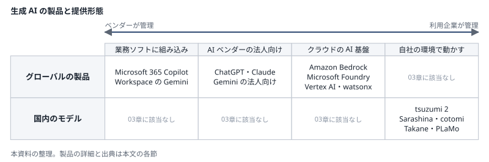

# 03 AI の製品と提供形態

## 要旨

企業が生成 AI を使う形は、大きく**業務ソフトに組み込まれた AI を使う**、**AI ベンダーの法人向けサービスを使う**、**クラウドの AI 基盤の上で自社のアプリを作る**の3つに分かれる。クラウドの AI 基盤は、Gartner の2025年の評価で AWS・Google・IBM・Microsoft がリーダーとされた。国内では、デジタル庁が2026年に国産の大規模言語モデル（LLM）を政府の生成 AI 環境で試す取り組みを始め、NTTデータの tsuzumi 2 などが選ばれた。モデルは複数のクラウドで提供されるようになり、**どのモデルを使うか**より、**自社がすでに使っているクラウドと ID の上で使えるか**が選択の出発点になりやすい（→ 04章、本資料の整理）。提供形態の主流は、ベンダーのクラウドで動くモデルを API や SaaS で使う形である。

*図1　生成 AI の製品と提供形態（縦は製品の区分、横は提供形態。本資料の整理）*

## 提供形態

| 形態 | ベンダーが管理するもの | 利用企業が管理するもの | 例 |
|---|---|---|---|
| 業務ソフトに組み込まれた AI | モデル、基盤、業務ソフトとの連携 | 利用者とライセンス、元になる文書・メールの権限、利用の規程 | Microsoft 365 Copilot、Google Workspace の Gemini |
| AI ベンダーの法人向けサービス | モデル、チャットの画面、拡張機能 | 利用者、社内のデータとの接続、入力してよい情報の規程 | ChatGPT、Claude、Gemini の法人向けプラン |
| クラウドの AI 基盤 | モデルの提供と推論の基盤 | 自社のアプリ・エージェント、プロンプト、参照させるデータ、クラウドの ID・ネットワーク・ログの設定 | Amazon Bedrock、Microsoft Foundry、Google の Vertex AI |
| 自社の環境でモデルを動かす | モデルの提供（ライセンス） | 上記に加えて、GPU のサーバと推論の基盤の運用 | tsuzumi 2 をオンプレミスで動かす形 |

既存の業務ソフトに組み込まれた AI は、既存の文書・メール・会議のデータと権限の上で動き、ライセンスの追加で使える。クラウドの AI 基盤は、API でモデルを呼び出して自社のアプリやエージェントを作る形である（本資料の整理）。

## クラウドの AI 基盤

Gartner の AI Application Development Platforms の Magic Quadrant 2025年版（2025-11-17）では、AWS・Google・IBM・Microsoft がリーダーとされ、Microsoft が「ビジョンの完全性」でもっとも高い位置だった。Gartner はこの市場が2025年に52億ドルを超え、年30%以上伸びていると見ている。

| 基盤 | 提供元 | 補足 |
|---|---|---|
| Amazon Bedrock | AWS | Anthropic の Claude、Meta の Llama、Mistral、Amazon の Nova など多数のモデルを提供。OpenAI のモデルの提供も始まっている。2025年版でリーダー |
| Microsoft Foundry（旧 Azure AI Foundry） | Microsoft | OpenAI の GPT シリーズを Microsoft の製品として提供する。Entra ID などと統合。2025年版でリーダーで、「ビジョンの完全性」でもっとも高い位置 |
| Vertex AI（2026年に Gemini Enterprise Agent Platform に改称と報じられている） | Google | Gemini を提供する。Model Garden で Claude なども提供。2025年版でリーダー |
| watsonx | IBM | 2025年版でリーダー。企業向けの統制（ガバナンス）の機能を強調している |

課金は、モデルに送る文字の量と返ってくる文字の量（トークン数）に応じた従量課金が基本である。モデルの提供状況は、地域・版・時期で頻繁に変わる。採用の判断の前には各社の最新の提供状況を確かめる必要がある（本資料の整理）。

## 業務ソフトに組み込まれた AI

| 製品 | 提供元 | 補足 |
|---|---|---|
| Microsoft 365 Copilot | Microsoft | 2023年11月1日に企業向けに一般提供（一般提供時は1ユーザー月額30ドルの追加ライセンス）。2026年1月から、多くの商用テナントで Copilot の中で Anthropic の Claude のモデルを既定で使えるようにしたと報じられている。Copilot Chat は Microsoft 365 の各プランに含まれる（→ workplace 03章） |
| Google Workspace の Gemini | Google | 2025年1月から Business・Enterprise の各プランに含まれ、別のアドオンは不要になった（→ workplace 03章） |
| 各業務ソフトの AI | ERP・CRM・ITSM などの各ベンダー | 各領域のトピックの 03章を参照（例：it-operations 03章の AI Applications in ITSM） |

## 国内の製品

デジタル庁は2026年3月6日、政府の生成 AI 環境「源内（げんない）」で試す国産の LLM として、15件の応募から7件を選んだ。うち2社が辞退し、5月に次の5社と契約した。2026年度は無償で試用し、2027年4月以降に実証で優れたモデルを有償で調達する予定とされている。

| 製品 | 提供元 | 補足 |
|---|---|---|
| tsuzumi 2 | NTTデータ（NTT グループ） | 2025年10月20日に提供開始。約300億パラメータで、GPU 1枚で動く。Azure のほか、自社の環境（オンプレミス）でも動かせる |
| Sarashina | ソフトバンク（SB Intuitions） | 源内の契約は Sarashina3 mini。2026年6月から、ソフトバンクのクラウド「Cloud PF Type A」（Oracle Alloy を採用）で生成 AI のサービスとして順次提供 |
| cotomi v3 | NEC | 独自に開発したモデル |
| Takane 32B | 富士通 | カナダの Cohere と共同で開発したシリーズ |
| PLaMo 2.0 Prime | Preferred Networks | 独自に開発した商用のモデル |

源内の実証では、tsuzumi 2・Takane 32B・PLaMo 2.0 Prime の3つを「さくらのクラウド」（→ infrastructure 03章）で動かし、海外のモデルと比べる計画とされている。各モデルの価格は本資料では未確認である。

## 他の製品に付属する機能

| 付属する先 | 機能 | 補足（本資料の整理） |
|---|---|---|
| Microsoft 365 の各プラン | Copilot Chat | 追加ライセンスの Microsoft 365 Copilot とは範囲が違う |
| Google Workspace の各プラン | Gemini | 使わない利用者の分も価格に含まれる |
| AWS・Azure・Google Cloud の契約 | 各社の AI 基盤 | クラウドの契約の中で使え、新しい契約は要らないことが多い |

## 市場の動き

| 時期 | できごと |
|---|---|
| 2023年11月1日 | Microsoft 365 Copilot が企業向けに一般提供された |
| 2025年1月 | Google が Gemini を Workspace の各プランに含めた |
| 2025年10月20日 | NTT が tsuzumi 2 の提供を始めた |
| 2025年11月17日 | Gartner が AI Application Development Platforms の Magic Quadrant 2025年版を出した。この時期までに Microsoft は Azure AI Foundry を Microsoft Foundry に改めた |
| 2026年1月 | Microsoft 365 Copilot で Claude のモデルが既定で使えるようになったと報じられた |
| 2026年3月6日 | デジタル庁が、源内で試す国産の LLM を7件選んだ（5月に5社と契約） |
| 2026年6月 | ソフトバンクが、自社のクラウドで Sarashina を使う生成 AI のサービスを始めた |

## 本資料でまだ扱っていないもの

- 各モデルの性能・料金の比較（変化が速いため、必要なときに調べる）
- AI ベンダーの法人向けプラン（ChatGPT・Claude・Gemini）の価格と契約条件
- AI エージェントの構築の製品（エージェントの開発基盤）

---

**出典**（確認日：2026-11-14）

- AI Application Development Platforms の Magic Quadrant 2025年版（2025-11-17）：Google Cloud — https://cloud.google.com/resources/content/2025-gartner-mq-cc-ai-application-development-platforms 、Visual Studio Magazine（リーダー4社、Microsoft の位置、市場の規模、Foundry への改称）— https://visualstudiomagazine.com/articles/2025/12/18/microsoft-again-named-a-leader-in-ai-application-development-platforms-research.aspx 、IBM — https://www.ibm.com/id-id/forms/mkt-54206
- クラウドの AI 基盤の提供モデル：Eden AI（Microsoft Foundry への改称、各基盤のモデル）— https://www.edenai.co/post/bedrock-vs-azure-ai-foundry-vs-vertex-ai-vs-model-studio 、Vertex AI の改称の報道（Damco）— https://www.damcogroup.com/blogs/aws-bedrock-vs-azure-openai-vs-vertex-ai 、Bedrock での OpenAI のモデルの提供（CloudHesive）— https://www.cloudhesive.com/resources/the-enterprise-llm-landscape-in-2026/
- Microsoft 365 Copilot：Microsoft 365 ブログ — https://www.microsoft.com/en-us/microsoft-365/blog/2023/09/21/announcing-microsoft-365-copilot-general-availability/ 、Copilot での Claude の既定化の報道（AlphaBOLD）— https://www.alphabold.com/generative-ai-platforms-for-enterprise-applications/
- Google Workspace の Gemini：9to5Google（2025-01-15）— https://9to5google.com/2025/01/15/google-workspace-gemini-price-increase/
- 源内の国産 LLM の選定：Impress Watch（選定の7件と条件）— https://www.watch.impress.co.jp/docs/news/2091358.html 、ISSOH（5社の契約、さくらのクラウドでの実証、Takane と Cohere）— https://www.issoh.co.jp/md/tech/11305 、エクサウィザーズ（今後の予定）— https://exawizards.com/column/article/ai-article/japanese-domestic-llm/
- tsuzumi 2：@IT（2025-10-23）— https://atmarkit.itmedia.co.jp/ait/articles/2510/23/news048.html 、NTT — https://group.ntt/jp/ir/library/nttis/tsuzumi.html
- Sarashina の提供：INTERNET Watch（2026-04-17）— https://internet.watch.impress.co.jp/docs/news/2102336.html
- 提供形態の分類、選択の出発点、課金の単位の一般化、付属する機能の表は本資料の整理
- 製品の区分は 2026-11 時点の各社の公表情報による。契約の判断の前には各社の最新の資料で確かめる
