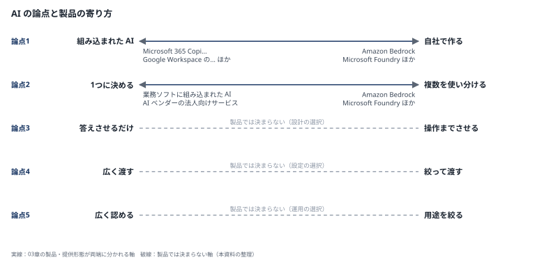

# 04 AI の主要な論点

## 要旨

AI を扱うときに出てくる軸は次の5つである（本資料の整理）。

1. 組み込まれた AI を使うか、自社で作るか
2. 1つのモデル・ベンダーに決めるか、複数を使い分けるか
3. AI に答えさせるだけにするか、操作までさせるか
4. 社内のデータをどこまで AI に渡すか
5. 利用を広く認めるか、用途を絞って認めるか

*図1　AI の論点と製品の寄り方（実線は03章の製品が両端に分かれる軸、破線は製品では決まらない軸。本資料の整理）*

## 論点1：組み込まれた AI を使うか、自社で作るか

| | 組み込まれた AI（Copilot など） | 自社で作る（クラウドの AI 基盤の上） |
|---|---|---|
| 得るもの | すぐに使える。既存の権限とデータの上で動く | 自社の業務とデータに合わせられる。モデルを選べる |
| 失うもの | できることはベンダーが決める。ライセンスの費用が全員分かかりうる | 開発と運用の手間。評価と改善を続ける体制が必要 |

**製品・提供形態との対応**（→ 03章）

| | 組み込まれた AI（Copilot など）に寄るもの | 自社で作る（クラウドの AI 基盤の上）に寄るもの |
|---|---|---|
| 製品・提供形態 | Microsoft 365 Copilot、Google Workspace の Gemini、各業務ソフトに組み込まれた AI | Amazon Bedrock、Microsoft Foundry、Vertex AI、watsonx、自社の環境で動かすモデル（tsuzumi 2 など） |

典型的な懸念：「Copilot を全員に配る価値があるか」「自社専用の AI を作るべきか」

## 論点2：1つのモデル・ベンダーに決めるか、複数を使い分けるか

| | 1つに決める | 複数を使い分ける |
|---|---|---|
| 得るもの | 契約・評価・統制が単純 | 用途ごとに向くモデルを選べる。1社の値上げ・障害・方針変更の影響を避けられる |
| 失うもの | そのベンダーへの依存 | 評価と統制を複数について行う手間 |

モデルは複数のクラウドで提供されるようになっており（→ 03章）、クラウドの AI 基盤を使えば、モデルの切り替えの手間は小さくなる（本資料の整理）。

**製品・提供形態との対応**（→ 03章）

| | 1つに決めるに寄るもの | 複数を使い分けるに寄るもの |
|---|---|---|
| 製品・提供形態 | 業務ソフトに組み込まれた AI、AI ベンダーの法人向けサービス。モデルはベンダーが選ぶ | Amazon Bedrock、Microsoft Foundry、Vertex AI。複数のモデルを1つの基盤で選べる |

## 論点3：AI に答えさせるだけにするか、操作までさせるか

| | 答えさせるだけ | 操作までさせる（AI エージェント） |
|---|---|---|
| 得るもの | 誤りがあっても、人が読んで判断できる | 手順の多い作業を任せられる |
| 失うもの | 作業そのものは人に残る | 誤りやプロンプトインジェクションが、そのまま操作になる。OWASP は「過剰な権限」を主要なリスクに挙げる（→ 02章） |

操作をさせる場合は、使わせる道具と権限を必要なものに絞り、影響の大きい操作の前に人の確認を挟む（本資料の整理）。

**製品・提供形態との対応**（→ 03章）：製品では決まらない（設計の選択）。どの AI 基盤もエージェントを作れ、どこまで操作させるかは利用企業が決める

## 論点4：社内のデータをどこまで AI に渡すか

| | 広く渡す | 絞って渡す |
|---|---|---|
| 得るもの | 回答が業務に即したものになる | 機密情報が出るおそれが小さい |
| 失うもの | 権限の設定の誤りが、そのまま AI の回答に出る | 回答が一般論にとどまる |

**製品・提供形態との対応**（→ 03章）：製品では決まらない（設定の選択）。業務ソフトに組み込まれた AI は既存の権限の上で動くため、権限の設定がそのまま渡す範囲になる

典型的な懸念：「AI に聞いたら見えてはいけない文書が出てきた」「入力した情報が学習に使われないか」

RAG や Copilot は、利用者が持つ権限の範囲でデータを使うため、AI の導入の前に、文書の共有設定と権限の棚卸しが必要になることが多い（→ 02章、identity）。

## 論点5：利用を広く認めるか、用途を絞って認めるか

| | 広く認める | 用途を絞る |
|---|---|---|
| 得るもの | 現場から使い方が生まれる | リスクの評価と管理がしやすい |
| 失うもの | 誤った使い方や、認めていないサービスの利用（シャドー AI）を把握しにくい | 使われずに終わる、または認めていないサービスに流れる |

EU AI 法は、用途によってリスクの段階を分け、高リスクの用途に重い義務を課している。日本の AI 法は罰則を持たない推進のための法律で、リスクへの対応は政府の指針で柔軟に行う考え方をとる。どちらも「用途に応じてリスクを見る」点は共通している（本資料の整理）。

**製品・提供形態との対応**（→ 03章）：製品では決まらない（運用の選択）

---

**出典**（確認日：2026-11-14）

- 5つの軸と各表の内容は、01〜03章をもとにした本資料の整理
- 日本の AI 法の性格（罰則を持たない）：WEEL — https://weel.co.jp/?p=136358 、適正性指針のリスクベースアプローチ：White & Case — https://www.whitecase.com/sites/default/files/2026-04/japan-first-ai-legislation-becomes-law.pdf
- EU AI 法の段階的な適用：Cooley — https://cdp.cooley.com/digital-ai-omnibus-delays-key-deadlines-introduces-new-rules/
- 各論点の「製品・提供形態との対応」は、03章の製品をもとにした本資料の整理
