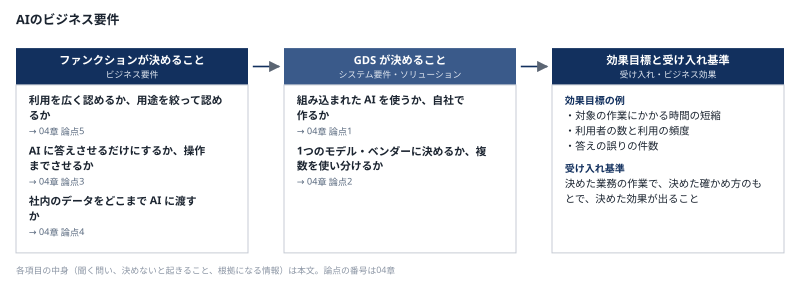

# 05 AIのビジネス要件

## 要旨

AI の製品を選ぶ前に、ファンクションには**どの業務に、どこまで AI を使わせるか**と、**AI に渡してよい社内のデータ**を決めてもらう。製品とモデルは GDS が選ぶが、使い道とリスクの受け入れ方は業務でしか決まらない。

この章は、governance/budget-transfer の kickoff 資料（IT 予算移管の要点）にある役割分担を、この技術について具体化したものである。

*図1　AIのビジネス要件（ファンクションが決めたビジネス要件をもとに GDS がシステム要件とソリューションを決め、効果目標と受け入れ基準で確かめる）*

## ファンクションが決めること（ビジネス要件）

### 利用を広く認めるか、用途を絞って認めるか

- **決めること**：AI を使う業務と目的（→ 04章 論点5）
- **聞く問い**：「どの業務の、どの作業を AI に手伝わせたいか。効果をどう測るか」
- **決めないと起きること**：目的のないまま広く配り、使われずに費用だけが出る
- **根拠になる情報**：業務の作業の量、効果の測り方

### AI に答えさせるだけにするか、操作までさせるか

- **決めること**：AI に任せる範囲（→ 04章 論点3）
- **聞く問い**：「AI の答えを人が確かめてから使うか、AI に操作まで任せるか」
- **決めないと起きること**：誤りがそのまま業務の操作になる、または効果が限られる
- **根拠になる情報**：誤りの影響、確かめる人の負荷

### 社内のデータをどこまで AI に渡すか

- **決めること**：AI に渡してよいデータ（→ 04章 論点4）
- **聞く問い**：「この業務で AI に渡してよい文書・データはどこまでか」
- **決めないと起きること**：権限の設定の誤りがそのまま AI の答えに出る
- **根拠になる情報**：データの分類、社内の規程

## GDS が決めること

- 組み込まれた AI を使うか、自社で作るか（→ 04章 論点1）
- 1つのモデル・ベンダーに決めるか、複数を使い分けるか（→ 04章 論点2）

## 効果目標と受け入れ基準

- **効果目標の例**：対象の作業にかかる時間の短縮、利用者の数と利用の頻度、答えの誤りの件数
- **受け入れ基準**：決めた業務の作業で、決めた確かめ方のもとで、決めた効果が出ること

## 部門に閉じた案件として扱えないとき

- 社内のデータを使う AI は、ID・アクセス管理と文書の共有設定に関わる
- GMP の判断に AI を使う場合は、GxP の要件がかかる
- 個人情報を AI に渡す場合は、個人情報の扱いの判断が要る

境界の詳細（どのシステムが何を持つか）は [function-allocation](../../../cross-cutting/function-allocation/function-allocation.md) を参照。

---

**出典**（確認日：2026-11-15）

- 役割分担の原則と4つの場面：governance/budget-transfer の kickoff 資料（IT 予算移管の要点、2026-11-02 初版）
- 項目の立て方、問い、例は、04章の論点をもとにした本資料の整理
