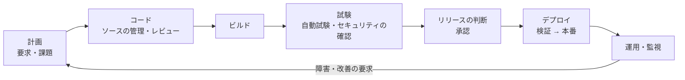

# 02 アプリ開発・DevOps・ローコードの構造

## 要旨

開発の仕組みは、**変更が本番に届くまでの流れ（パイプライン）**、**変更を試す場所（環境）**、**流れの中に組み込む確認（試験・セキュリティ・承認）**の3つでできている。ローコードでも同じ考え方が要り、加えて**誰が・どのデータに・どの部品でつなげてよいか**の統制が中心になる。AI による開発の支援は、速さを上げる一方で、確認の仕組みが弱いと不安定さも増やす。

## 構成要素

| 要素 | 役割 |
|---|---|
| 課題の管理 | 要求・不具合・作業を記録し、優先順位を付ける |
| ソースの管理 | コードと設定の変更の履歴を持ち、レビューの場になる |
| パイプライン（CI/CD） | ビルド・試験・デプロイを自動で実行する |
| 成果物の保管庫 | ビルドしたソフトウェアと、使った部品を保管する |
| 環境 | 開発・検証・本番の、変更を試し、動かす場所 |
| 監視 | 本番での動きを測り、障害と改善の要求を返す（→ it-operations） |

## 仕組み：ライフサイクルとパイプライン

*図1　開発のライフサイクルと CI/CD のパイプライン（本資料の整理）*

- CI は「コード → ビルド → 試験」を変更のたびに自動で回す部分、CD は「リリース → デプロイ」を自動化する部分にあたる。
- GxP のシステムでは、「リリースの判断」に検証の記録と承認が加わる（→ gxp-compliance）。

## 環境の分け方

| 環境 | 用途 | 置くデータ |
|---|---|---|
| 開発 | 開発者が作り、試す | 架空のデータ |
| 検証（テスト・ステージング） | 本番に近い形で、試験と利用者の確認を行う | 架空のデータ、または匿名化したデータ |
| 本番 | 業務で使う | 本物のデータ |

本番には、パイプラインを通った変更だけを出し、直接の変更を許さないのが基本である（本資料の整理）。

## 安全な開発の実践（NIST SSDF）

SSDF は、実践を4つの群に分ける。

| 群 | 内容 |
|---|---|
| 組織の準備（PO） | 安全な開発の要求・役割・道具・基準を決める |
| ソフトウェアの保護（PS） | ソースコードやビルドの成果物を、改ざんや不正な利用から守る |
| よく守られたソフトウェアの作成（PW） | 設計・コードのレビュー・試験で、脆弱性を作り込まない |
| 脆弱性への対応（RV） | 公開後に見つかった脆弱性を特定し、直し、原因を断つ |

1.2 の案では、継続的な改善の実践と、更新を確実に届ける実践が加わる見込みである。

## ローコードの統制の仕組み（Power Platform の例）

| 仕組み | 内容 |
|---|---|
| 環境 | 統制の主な境界。環境ごとにデータベース・権限・データのポリシーを持つ。個人の開発用・チームの検証用・本番に分ける |
| データ損失防止（DLP）のポリシー | 接続の部品（コネクタ）を「業務用」「業務外」「禁止」に分け、業務のデータが業務外のサービスに流れないようにする |
| マネージド環境 | 共有の範囲の制限、品質の確認の強制、利用の状況の報告などを加える有償の機能 |
| CoE（Center of Excellence） | 統制と利用の促進を担う社内の体制。Microsoft の CoE Starter Kit は積極的な保守が終わり、主な機能は管理センターに移った |

アプリの一覧（誰が何を作り、誰と共有しているか）を持つことが、統制の出発点になる（本資料の整理）。

## AI による開発の支援

DORA の2025年の調査では、開発者の約9割が AI の道具を使っている。AI の利用は、開発の速さ（スループット）を上げる方向に働くようになった一方、不安定さ（失敗やり直し）も高める関係が見られた。DORA は AI を、組織の強みも弱みも増幅するものと位置づけている。コードの量が増えるほど、**レビューと自動試験の仕組み**が律速になる（本資料の整理）。

---

**出典**（確認日：2026-11-14）

- SSDF の4つの群：Chainguard — https://www.chainguard.dev/supply-chain-security-101/what-is-the-secure-software-development-framework-ssdf 、1.2 の案で加わる実践：NIST（2026-05-20 の発表資料）— https://csrc.nist.gov/csrc/media/presentations/2026/ssdf-update-and-devsecops-project/20260520-ogata-ssdf-devsecops.pdf 、Cycode — https://cycode.com/blog/nist-ssdf-1-2-changes-compliance-guide/
- Power Platform の環境・DLP・マネージド環境：EPC Group — https://www.epcgroup.net/power-platform-coe-governance-guide 、https://www.epcgroup.net/blog/power-platform-governance-framework 、Microsoft Learn「Center of Excellence (CoE) overview」— https://learn.microsoft.com/en-us/power-platform/guidance/coe/overview 、CoE Starter Kit の保守の終了：Hexaware（2026-06）— https://hexaware.com/blogs/the-coe-starter-kit-is-retiring-will-your-power-platform-governance-adapt-or-drift/ 、DEV Community — https://dev.to/holgerimbery/power-platform-governance-a-practitioners-reference-part-1-120c
- DORA の2025年の調査：Google Cloud（2025-09-23）— https://cloud.google.com/blog/products/ai-machine-learning/announcing-the-2025-dora-report 、報告書 — https://services.google.com/fh/files/misc/2025_state_of_ai_assisted_software_development.pdf 、AI の利用と不安定さ：RedMonk — https://redmonk.com/rstephens/2025/12/18/dora2025/ 、約9割の利用：Honeycomb — https://www.honeycomb.io/blog/what-2025-dora-report-teaches-us-about-observability-platform-quality
- 図1、環境の分け方の表は本資料の整理
