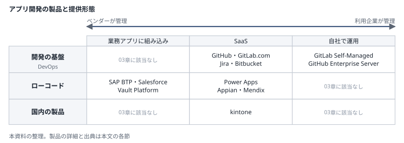

# 03 アプリ開発・DevOps・ローコードの製品と提供形態

## 要旨

開発の製品は、**DevOps の基盤**（ソースの管理・CI/CD・課題の管理）、**ローコードの基盤**、**AI のコード支援**、**業務アプリの拡張の基盤**の4つに分かれる。どの分野でも AI の機能が評価の中心に移り、Gartner はローコードの評価を2026年に「AI-Augmented Low-Code Application Platforms」に改めた。Microsoft のように、DevOps（GitHub・Azure DevOps）・ローコード（Power Platform）・AI のコード支援（GitHub Copilot）をすべて持つ提供元もある。提供形態の主流は SaaS で、課金は開発者または利用者1人あたりの月額が多い。国内ではサイボウズの kintone が、東証プライム上場企業の約半数に使われている。

*図1　アプリ開発の製品と提供形態（縦は製品の区分、横は提供形態。本資料の整理）*

## 主要な製品

### DevOps の基盤

Gartner の2025年の DevOps Platforms の Magic Quadrant（2025年9月22日）は10社を評価した。

| 製品 | ベンダー | 特徴 |
|---|---|---|
| GitLab | GitLab | 2025年版でリーダー（3年連続） |
| Jira・Bitbucket など | Atlassian | 2025年版でリーダー（3年連続） |
| GitHub・Azure DevOps | Microsoft | 評価の対象。位置は本資料では未確認 |
| その他 | Buildkite、CircleCI、CloudBees、Harness、Huawei、JetBrains、Octopus | 評価の対象 |

### ローコードの基盤

Gartner の2025年の Enterprise Low-Code Application Platforms の Magic Quadrant（2025年7月28日）は12社を評価した。

| 位置（2025年版） | ベンダー（製品） |
|---|---|
| リーダー | Appian、Mendix（Siemens）、Microsoft（Power Apps など）、OutSystems、Salesforce、ServiceNow |
| チャレンジャー | Oracle |
| ビジョナリー | Pegasystems、SAP |
| ニッチプレーヤー | Creatio、Retool |

2026年9月28日には「AI-Augmented Low-Code Application Platforms」として新しい版が出た。評価の対象は13社（Appian、Creatio、Globant（GeneXus）、Huawei、Microsoft、Oracle、OutSystems、Pega、Retool、Salesforce、ServiceNow、Siemens（Mendix）、Zoho）で、2025年版にあった SAP は入っていない。OutSystems（10年連続、「ビジョンの完全性」でもっとも高い位置）と Mendix（10年連続）はリーダーと発表している。ほかの各社の位置は本資料では未確認である。

ローコードの基盤の課金は、アプリを使う利用者の数、アプリの数、またはその組み合わせが多い（本資料の整理）。

### AI のコード支援

Gartner の2025年の AI Code Assistants の Magic Quadrant（2025年9月）は、コードと設定を、大規模言語モデルなどの基盤モデルを使って生成・分析する道具を対象とする。

| 位置（2025年版） | ベンダー（製品） |
|---|---|
| リーダー | GitHub（Copilot）、Amazon（Q Developer）、Cognition（Windsurf）、GitLab（Duo）、Google Cloud |
| その他の評価の対象 | JetBrains など（評価の対象は14社） |

Gartner は、2028年までに企業のソフトウェア技術者の90%が AI のコード支援を使うようになると予測している（2024年初めは14%未満）。

### 業務アプリの拡張の基盤

| 製品 | ベンダー | 特徴 |
|---|---|---|
| SAP BTP | SAP | S/4HANA の標準を変えずに、外に拡張を置く（→ erp 付録A） |
| Power Platform | Microsoft | Dynamics 365 の拡張と、Microsoft 365 の業務の自動化の両方に使う |
| Salesforce Platform | Salesforce | Salesforce の上のアプリ開発 |
| Vault Platform | Veeva | Vault の上の拡張（→ veeva-platform 02章） |

## 国内の製品

| 製品 | 提供元 | 補足 |
|---|---|---|
| kintone | サイボウズ | ノーコード・ローコードの業務アプリの基盤。SaaS で、1ユーザー月額の課金。2025年末時点で国内3万9,000社が導入し、東証プライム上場企業の約46%が使う（同社の決算説明資料）。Gartner の上記の評価の対象には入っていない |

kintone 以外の国内のローコードの製品は、本資料ではまだ扱っていない。

## 他の製品に付属する機能

| 付属する先 | 機能 | 補足（本資料の整理） |
|---|---|---|
| Microsoft 365 の各プラン | Power Apps・Power Automate の一部の機能 | Microsoft 365 のデータを使う範囲なら、追加の契約なしで使える場合がある。範囲を超えると Power Platform の別ライセンスが要る |
| GitHub のプラン | GitHub Actions（CI/CD）の実行時間 | プランごとに無料の実行時間があり、超えた分は従量課金 |
| SAP・Salesforce・ServiceNow・Veeva の契約 | 各社の拡張の基盤 | 業務アプリの契約と一緒に買うことが多い（上の「業務アプリの拡張の基盤」） |

## 提供形態

| 形態 | ベンダーが管理するもの | 利用企業が管理するもの | 例 |
|---|---|---|---|
| SaaS | 基盤、製品の更新、ソースとデータの保管 | 設定、利用者・権限、作ったアプリやパイプライン。ソースやデータの置き場所がベンダーのクラウドになる | GitHub、GitLab.com、kintone、Power Apps |
| 自社で運用（自社のサーバ・クラウド） | ソフトウェアの提供と保守 | 上記に加えて、製品の導入・更新・バックアップ。置き場所と接続先を自社で決められる | GitLab Self-Managed、GitHub Enterprise Server、Jira の Data Center 版 |
| 業務アプリに組み込み | 業務アプリと拡張の基盤 | 作った拡張。業務アプリのデータと権限をそのまま使えるが、そのアプリの外では使いにくい | SAP BTP、Salesforce Platform、Vault Platform |

*表は本資料の整理*

## 市場の動き

| 時期 | できごと |
|---|---|
| 2025年7月28日 | Gartner が Enterprise Low-Code Application Platforms の Magic Quadrant 2025年版を出した（12社） |
| 2025年9月 | Gartner が AI Code Assistants の Magic Quadrant 2025年版（14社）と DevOps Platforms の Magic Quadrant 2025年版（2025-09-22、10社）を出した |
| 2026年9月28日 | Gartner がローコードの評価を AI-Augmented Low-Code Application Platforms に改め、13社を評価した |

## 本資料でまだ扱っていないもの

- kintone 以外の国内のローコードの製品と、その比較
- 各製品の価格の水準
- テストの自動化、コードの品質・セキュリティの検査（SAST・SCA）の製品
- 開発の委託（SIer・オフショア）の形と、委託先の開発の工程の管理

---

**出典**（確認日：2026-11-14）

- DevOps Platforms の Magic Quadrant（2025-09-22）：Gartner — https://gartner.com/en/documents/6977166 、GitLab — https://about.gitlab.com/blog/gitlab-named-a-leader-in-the-2025-gartner-magic-quadrant-for-devops-platforms/ 、評価の対象が10社であること：GitLab — https://s204.q4cdn.com/984476563/files/doc_news/GitLab-Recognized-as-a-Leader-in-the-Gartner-Magic-Quadrant-for-DevOps-Platforms-for-the-Third-Consecutive-Year-2025.pdf 、Atlassian — https://www.atlassian.com/blog/company-news/gartner-devops-2025
- Enterprise LCAP の Magic Quadrant（2025-07-28）：Gartner — https://www.gartner.com/doc/6773234 、各社の位置：Process Excellence Network（2025-08-01）— https://www.processexcellencenetwork.com/low-code-automation/news/gartner-releases-magic-quadrant-for-low-code-application-platforms 、Mendix が Siemens の子会社であること：Pretius — https://pretius.com/blog/gartner-quadrant-low-code
- AI-Augmented LCAP の Magic Quadrant（2026-09-28）：Gartner — https://www.gartner.com/doc/8421913 、OutSystems（2026-09-30）— https://outsystems.com/blog/posts/gartner-augmented-ai-lcap-outsystems-a-leader 、評価の対象13社と Mendix の位置：Kissflow — https://kissflow.com/low-code/gartner-magic-quadrant-for-enterprise-low-code
- kintone の導入社数：サイボウズ 2025年12月期 決算説明資料 — https://cybozu.co.jp/company/ir/meeting/pdf/2512_03.pdf
- AI Code Assistants の Magic Quadrant（2025-09）：AWS Insider（2025-09-22）— https://awsinsider.net/articles/2025/09/22/amazon-repeats-as-a-leader-in-ai-code-assistants-report.aspx 、評価の対象の数：Market Chameleon — https://marketchameleon.com/articles/b/2025/9/18/gitlab-leader-2025-gartner-magic-quadrant-ai-code-assistants 、2028年の予測：GitHub — https://github.blog/ai-and-ml/github-copilot/gartner-positions-github-as-a-leader-in-the-2025-magic-quadrant-for-ai-code-assistants-for-the-second-year-in-a-row/
- 業務アプリの拡張の基盤：[erp 付録A](../../../application/erp/appendix/A_erp-market-overview.md)、[veeva-platform 02章](../../../application/veeva-platform/chapters/02_structure.md) の出典を参照。Power Platform と Dynamics 365 の関係：Microsoft Learn — https://learn.microsoft.com/ar-sa/azure/compliance/offerings/offering-gxp
- 課金の単位の一般化、付属する機能の表は本資料の整理
- 製品の区分は 2026-11 時点の各社の公表情報による。契約の判断の前には各社の最新の資料で確かめる
