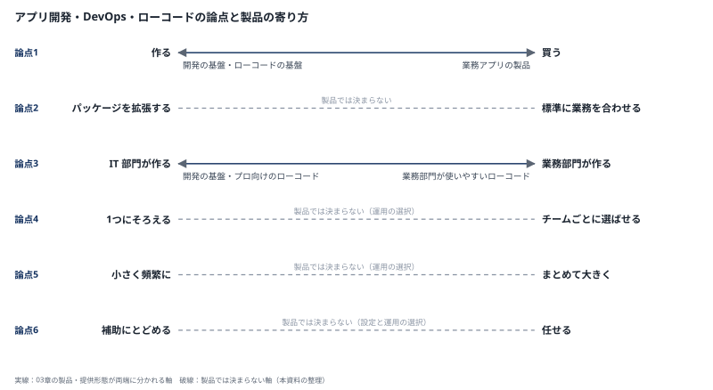

# 04 アプリ開発・DevOps・ローコードの主要な論点

## 要旨

アプリ開発を扱うときに出てくる軸は次の6つである（本資料の整理）。

1. 作るか、買うか（SaaS・パッケージ）
2. パッケージを拡張するか、標準に業務を合わせるか
3. IT 部門が作るか、業務部門が作るか（市民開発）
4. 開発の基盤を1つにそろえるか、チームごとに選ばせるか
5. 小さな変更を頻繁に届けるか、まとめて大きく届けるか
6. AI にどこまでコードを書かせるか

*図1　アプリ開発・DevOps・ローコードの論点と製品の寄り方（実線は03章の製品が両端に分かれる軸、破線は製品では決まらない軸。本資料の整理）*

## 論点1：作るか、買うか

| | 作る（自社開発・ローコード） | 買う（SaaS・パッケージ） |
|---|---|---|
| 得るもの | 自社の業務に合う。差別化の源泉にできる | 早く使える。保守と更新をベンダーに任せられる |
| 失うもの | 開発と保守の人と費用。作った人がいなくなると直せない | 業務を製品に合わせる必要。ベンダーへの依存 |

**製品・提供形態との対応**（→ 03章）

| | 作る（自社開発・ローコード）に寄るもの | 買う（SaaS・パッケージ）に寄るもの |
|---|---|---|
| 製品・提供形態 | 開発の基盤（GitHub、GitLab、Azure DevOps）、ローコードの基盤（Power Apps、OutSystems、Mendix、kintone など） | 業務アプリの製品（各業務のトピックの 03章を参照） |

典型的な懸念：「この業務は他社と同じでよいのか、自社の強みなのか」

## 論点2：パッケージを拡張するか、標準に業務を合わせるか

erp 04章（論点1）と同じ構図である。SaaS では、拡張が多いほど、ベンダーの更新のたびの確認が重くなる（→ erp 04章 論点6、gxp-compliance 04章 論点2）。

**製品・提供形態との対応**（→ 03章）：拡張するときの基盤：SAP BTP、Power Platform、Salesforce Platform、Vault Platform。拡張を業務アプリの外または上に置く。標準に合わせるかどうかは製品では決まらない

## 論点3：IT 部門が作るか、業務部門が作るか

| | IT 部門が作る | 業務部門が作る（市民開発） |
|---|---|---|
| 得るもの | 品質・セキュリティ・保守の水準をそろえられる | 現場の要求に速く応えられる。IT 部門の待ち行列を減らせる |
| 失うもの | 要求の待ち行列が長くなる。小さな改善が後回しになる | 管理されないアプリが増える。作った人の異動で保守できなくなる |

**製品・提供形態との対応**（→ 03章）

| | IT 部門が作るに寄るもの | 業務部門が作る（市民開発）に寄るもの |
|---|---|---|
| 製品・提供形態 | 開発の基盤（GitHub、GitLab、Azure DevOps）、プロ向けのローコード（OutSystems、Mendix） | 業務部門が使いやすいローコード（Power Apps、kintone） |

典型的な懸念：「Excel のマクロと同じことが、ローコードで起きるのではないか」

ローコードの基盤は、環境・DLP・アプリの一覧の仕組みで、業務部門が作ることを前提にした統制を持つ（→ 02章）。GxP の記録を扱うアプリは、作り手に関わらずバリデーションの対象になる（→ gxp-compliance 04章 論点5）。

## 論点4：開発の基盤を1つにそろえるか、チームごとに選ばせるか

| | 1つにそろえる | チームごとに選ばせる |
|---|---|---|
| 得るもの | 道具・権限・監査・費用を一元化できる。人の異動が楽になる | チームの事情に合った道具を使える |
| 失うもの | 合わないチームの生産性が落ちる | 統制と費用が分散する。ソースや成果物がどこにあるか分からなくなる |

**製品・提供形態との対応**（→ 03章）：製品では決まらない（運用の選択）。ただし Microsoft は DevOps・ローコード・AI のコード支援をすべて持ち、1つにそろえやすい

## 論点5：小さな変更を頻繁に届けるか、まとめて大きく届けるか

| | 小さく頻繁に | まとめて大きく |
|---|---|---|
| 得るもの | 1回の変更の影響が小さく、問題の原因を特定しやすい | 承認と試験の回数が少ない |
| 失うもの | 自動化された試験とパイプラインが前提になる | 1回の変更の影響が大きく、失敗したときに戻しにくい |

it-operations 04章（論点2：変更を慎重に絞るか、速く回すか）の、開発の側から見た同じ論点である。

**製品・提供形態との対応**（→ 03章）：製品では決まらない（運用の選択）。小さく頻繁に届けるには、CI/CD を持つ開発の基盤（GitHub Actions、GitLab）が前提になる

## 論点6：AI にどこまでコードを書かせるか

| | 補助にとどめる（候補の提示） | 任せる（AI エージェントによる変更） |
|---|---|---|
| 得るもの | 人がすべての変更を理解している | 手順の多い作業を任せられる |
| 失うもの | 速さの効果は限られる | レビューと試験が追いつかないと、不安定さが増す（→ 02章） |

**製品・提供形態との対応**（→ 03章）：製品では決まらない（設定と運用の選択）。AI のコード支援の製品（GitHub Copilot、Amazon Q Developer、GitLab Duo など）は、補助と変更の任せ方の両方に使える

典型的な懸念：「AI が書いたコードを、誰が理解して責任を持つのか」「社内のコードを AI のサービスに送ってよいか」（→ ai 04章）

---

**出典**（確認日：2026-11-14）

- 6つの軸と各表の内容は、01〜03章と erp・it-operations・gxp-compliance・ai の04章をもとにした本資料の整理
- 各論点の「製品・提供形態との対応」は、03章の製品をもとにした本資料の整理
