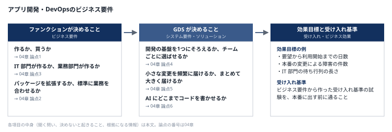

# 05 アプリ開発・DevOpsのビジネス要件

## 要旨

開発の手段を選ぶ前に、ファンクションには**作って差別化したい業務か、製品に合わせてよい業務か**と、**業務部門の中で作ってよい範囲**を決めてもらう。

この章は、governance/budget-transfer の kickoff 資料（IT 予算移管の要点）にある役割分担を、この技術について具体化したものである。

*図1　アプリ開発・DevOpsのビジネス要件（ファンクションが決めたビジネス要件をもとに GDS がシステム要件とソリューションを決め、効果目標と受け入れ基準で確かめる）*

## ファンクションが決めること（ビジネス要件）

### 作るか、買うか

- **決めること**：作るか、買うか（→ 04章 論点1）
- **聞く問い**：「この業務は他社と違うやり方で強みにしたいか、標準のやり方でよいか」
- **決めないと起きること**：差別化しない業務まで作り、開発と保守の費用が続く
- **根拠になる情報**：業務の独自性、競合の動き

### IT 部門が作るか、業務部門が作るか

- **決めること**：業務部門が作ってよい範囲（→ 04章 論点3）
- **聞く問い**：「業務部門の中で、自分たちで作って使ってよいアプリはどこまでか」
- **決めないと起きること**：管理されないアプリが増える、または小さな改善が IT の待ち行列に並ぶ
- **根拠になる情報**：作りたいアプリの種類、扱うデータ、利用者の範囲

### パッケージを拡張するか、標準に業務を合わせるか

- **決めること**：パッケージを拡張するか（→ 04章 論点2）
- **聞く問い**：「製品の標準に合わせられない業務はどれか」
- **決めないと起きること**：拡張が増え、更新のたびの確認が重くなる
- **根拠になる情報**：業務ごとの理由（→ erp 05章）

## GDS が決めること

- 開発の基盤を1つにそろえるか、チームごとに選ばせるか（→ 04章 論点4）
- 小さな変更を頻繁に届けるか、まとめて大きく届けるか（→ 04章 論点5）
- AI にどこまでコードを書かせるか（→ 04章 論点6）

## 効果目標と受け入れ基準

- **効果目標の例**：要望から利用開始までの日数、本番の変更による障害の件数、IT 部門の待ち行列の長さ
- **受け入れ基準**：ビジネス要件から作った受け入れ基準の試験を、本番に出す前に通ること

## 部門に閉じた案件として扱えないとき

- 他のシステムの API を使うアプリは、データ連携の扱いになる
- GxP の記録を扱うアプリは、ローコードでも検証の対象になる
- 個人情報を扱うアプリは、市民開発の範囲から外す

境界の詳細（どのシステムが何を持つか）は [function-allocation](../../../cross-cutting/function-allocation/function-allocation.md) を参照。

---

**出典**（確認日：2026-11-15）

- 役割分担の原則と4つの場面：governance/budget-transfer の kickoff 資料（IT 予算移管の要点、2026-11-02 初版）
- 項目の立て方、問い、例は、04章の論点をもとにした本資料の整理
