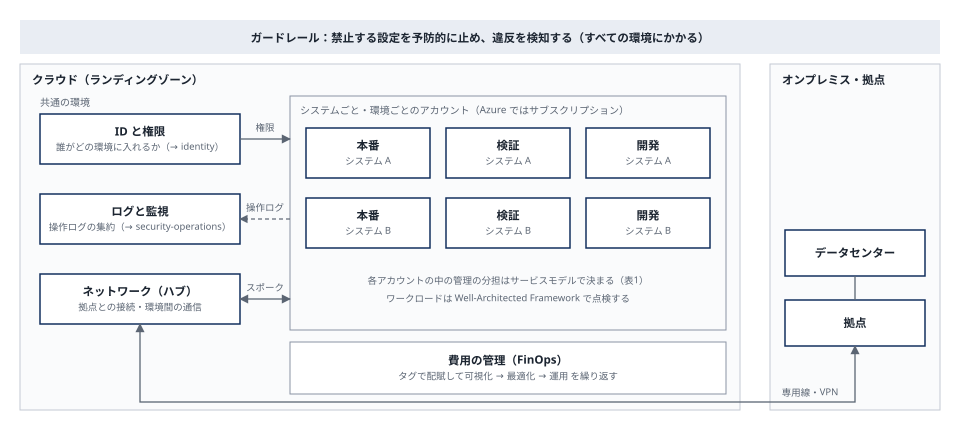

# 02 クラウド・インフラの構造

## 要旨

クラウド・インフラは、**どの層までを事業者に任せるか（サービスモデル）**、**その上で自社が守る範囲（責任共有モデル）**、**組織として環境をどう区切り、統制するか（ランディングゾーン）**、**費用をどう管理するか（FinOps）**の4つで捉える。

## サービスモデルと管理の範囲

| 層 | オンプレミス | IaaS | PaaS | SaaS |
|---|---|---|---|---|
| データ・利用者の権限 | 自社 | 自社 | 自社 | 自社 |
| アプリケーション | 自社 | 自社 | 自社 | 事業者 |
| OS・ミドルウェア | 自社 | 自社 | 事業者 | 事業者 |
| 仮想化・サーバー・ストレージ・ネットワーク | 自社 | 事業者 | 事業者 | 事業者 |
| データセンター（建物・電源） | 自社 | 事業者 | 事業者 | 事業者 |

*表1　サービスモデルごとの管理の分担（NIST SP 800-145 の定義をもとにした本資料の整理）*

NIST の定義では、IaaS の利用者は基盤そのものは管理しないが、OS・ストレージ・配置したアプリケーションを管理し、ホストのファイアウォールなど一部のネットワーク部品も管理する。PaaS の利用者は OS やストレージを管理せず、配置したアプリケーションとその実行環境の設定を管理する。

## 責任共有モデル

AWS は、セキュリティとコンプライアンスを事業者と顧客の**共有の責任**とし、次のように分けている。

- **クラウド「の」セキュリティ（事業者の責任）**：クラウドのサービスを動かす基盤（ハードウェア、ソフトウェア、ネットワーク、施設）を守る。
- **クラウド「の中」のセキュリティ（顧客の責任）**：顧客のデータ、OS とファイアウォールの設定、暗号化、権限の設定など。範囲は、顧客が選んだサービスによって決まる。

例：Amazon EC2（IaaS）では、ゲスト OS の更新とセキュリティパッチ、その上のアプリケーション、セキュリティグループ（仮想ファイアウォール）の設定が顧客の責任になる。

クラウドに移しても、**データ・権限・設定の誤りは自社の責任のまま残る**（本資料の整理）。

## ランディングゾーン

組織でクラウドを使うときは、システムごとに思い思いに環境を作るのではなく、最初に**共通の土台**を作る。これをランディングゾーンと呼ぶ。AWS では、複数のアカウントに分けて統制された環境の参照アーキテクチャとされ、AWS Control Tower がその構築と統制の自動化を担う。

ランディングゾーンで最初に決めるもの（本資料の整理）：

| 項目 | 決めること |
|---|---|
| 環境の区切り方 | 本番・検証・開発、システムごとにアカウント（Azure ではサブスクリプション）を分ける |
| ID と権限 | 誰がどの環境に入れるか（→ identity） |
| ネットワーク | 拠点・データセンターとの接続、環境間の通信（ハブ＆スポーク型など） |
| ログと監視 | 操作ログをどこに集めるか（→ security-operations、it-operations） |
| ガードレール | 禁止する設定（公開してはならないストレージなど）を予防的に止め、違反を検知する |

*図1　ランディングゾーンの構成（本資料の整理）*

デジタル庁のガバメントクラウドも、本人確認と MFA で入口を守り、IaC のテンプレートで環境を作り、予防的・発見的な統制とダッシュボードで重要なセキュリティ設定の違反を見つける構成をとっている。

## 設計の指針：Well-Architected Framework

主要なクラウド事業者は、ワークロード（個々のシステム）の設計の良し悪しを点検するための枠組みを公開している。AWS Well-Architected Framework は、運用上の優秀性・セキュリティ・信頼性・パフォーマンス効率・コスト最適化・持続可能性の6つの柱で構成される。Microsoft も Azure 向けに Well-Architected Framework を持ち、クラウドの導入の進め方は別の Cloud Adoption Framework（CAF）で扱っている。

## 費用の管理：FinOps

クラウドの費用は使った分だけ変動するため、予算を年に一度決めるだけでは管理できない。FinOps Foundation（Linux Foundation のプロジェクト）は、FinOps を、技術への支出の事業価値を最大化し、データに基づく適時の判断を可能にし、財務上の説明責任を生む、運用の枠組みと文化の実践と定義している。

| 段階 | 内容 |
|---|---|
| Inform（可視化） | 費用と使用量のデータを集め、誰が何に使っているかを配賦する |
| Optimize（最適化） | 可視化したデータをもとに、効率を上げる機会を見つける（資源の大きさの見直し、割引の購入など） |
| Operate（運用） | 組織の変更を実行し、継続的に改善する |

3つの段階は一度きりの順番ではなく、繰り返し回す。費用の配賦は、リソースに付ける**タグ**の付け方が土台になる（本資料の整理）。

---

**出典**（確認日：2026-11-14）

- サービスモデルの管理範囲：NIST SP 800-145 — https://nvlpubs.nist.gov/nistpubs/Legacy/SP/nistspecialpublication800-145.pdf 、https://www.govinfo.gov/content/pkg/GOVPUB-C13-PURL-gpo17628/pdf/GOVPUB-C13-PURL-gpo17628.pdf
- 責任共有モデル：AWS「Shared Responsibility Model」— https://aws.amazon.com/en/compliance/shared-responsibility-model/ 、AWS Well-Architected セキュリティの柱 — https://docs.aws.amazon.com/wellarchitected/latest/security-pillar/shared-responsibility.html
- ランディングゾーンと Control Tower：AWS のガイダンスの整理 — https://zencloudau.github.io/vaf-sa/cloud-reference/aws.html 、Azure のランディングゾーン（ハブ＆スポーク）— https://corporate-blog.global.fujitsu.com/apac/2021-01-07/understanding-the-importance-of-a-cloud-adoption-framework
- ガバメントクラウドの統制：デジタル庁資料（2025-01-24）— https://www.oracle.com/jp/a/ocom/docs/oracle-sapporo-govcloud-jp.pdf
- Well-Architected Framework：AWS — https://docs.aws.amazon.com/wellarchitected/latest/framework/definitions.html 、Microsoft Learn — https://learn.microsoft.com/en-us/azure/well-architected/what-is-well-architected-framework
- FinOps：FinOps Foundation — https://www.finops.org/?p=163 、定義の引用（Finout）— https://www.finout.io/blog/ultimate-guide-to-finops-principles-phases-and-technology 、Microsoft Learn — https://learn.microsoft.com/en-us/cloud-computing/finops/framework/finops-framework
- 表1、ランディングゾーンで決める項目、タグの位置付けは本資料の整理
- 図1は、本章の内容をもとにした本資料の整理
