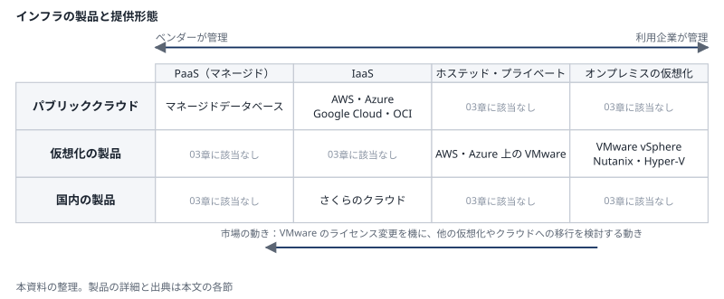

# 03 クラウド・インフラの製品と提供形態

## 要旨

製品は、**パブリッククラウド**（IaaS・PaaS）と、**オンプレミス・プライベートクラウドの仮想化**の2つに分かれる。パブリッククラウドは AWS・Microsoft・Google の3社が市場の6割強を占め、Gartner の2026年の評価では Oracle と Alibaba Cloud を含む5社がリーダーとされた。仮想化では VMware が中心だったが、2023年の Broadcom による買収後に契約形態が大きく変わり、Nutanix・Hyper-V などへ移るかどうかが各社の論点になっている（→ 04章）。主流の提供形態は、基盤の運用を事業者に任せる IaaS・PaaS であり、国内でもガバメントクラウドの対象は外資4社と国内1社である。

*図1　インフラの製品と提供形態（縦は製品の区分、横は提供形態。本資料の整理）*

## パブリッククラウド

Gartner の Strategic Cloud Platform Services の Magic Quadrant 2026年版（2026-09-01）では、AWS・Google・Microsoft・Oracle・Alibaba Cloud がリーダーとされた。AWS は「実行能力」でもっとも高い位置、Google は「ビジョンの完全性」でもっとも高い位置と、それぞれ発表している。Alibaba Cloud は初めてリーダーに入った。2025年版（2025-08-04）のリーダーは、Alibaba Cloud を除く4社だった。

| 事業者 | 2026年第2四半期のシェア | 補足 |
|---|---|---|
| AWS（Amazon Web Services） | 28% | 首位を保つが、Microsoft・Google のほうが成長率が高い。Gartner のリーダーに16年連続 |
| Microsoft Azure | 20% | Microsoft 365・Entra ID と同じ事業者。2023年版から2026年版までリーダー（同社の発表） |
| Google Cloud | 15% | Google Workspace・Vertex AI（→ ai 03章）と同じ事業者。2025年版・2026年版の評価で「ビジョンの完全性」がもっとも高い位置（同社の発表） |
| Oracle Cloud Infrastructure | 4% | 成長率の高い第2集団に挙げられている。Gartner のリーダーに4年連続。AWS・Azure・Google Cloud のデータセンター内で Oracle Database を動かすサービスも提供 |
| その他（Alibaba Cloud、CoreWeave など GPU 専業のネオクラウド、IBM、SAP など） | 各1〜2% | 上位40社のうち9社が GPU 専業のネオクラウド |

シェアは IaaS・PaaS・ホステッドプライベートクラウドの売上による（Synergy Research Group）。課金は、仮想サーバの時間・ストレージの容量・データの転送量などの**使った量**が基本で、1年・3年の利用を約束して割り引く契約もある。

## オンプレミス・プライベートクラウドの仮想化

### VMware（Broadcom）

Broadcom は2023年11月22日に VMware の買収を完了し、直後に次の変更を行った。

| 変更 | 内容 |
|---|---|
| 永続ライセンスの販売終了 | 永続ライセンスと、その保守（SnS）の更新の販売を終了。サブスクリプション（1・3・5年）だけになった |
| 製品の集約 | 主な提供を vSphere Foundation と VMware Cloud Foundation（VCF）の2つにまとめた |
| 課金の単位 | vSphere は CPU のコア数単位で、1 CPU あたり最低16コア分の購入が必要 |
| 既存の顧客 | 保守契約が有効な永続ライセンスは引き続き使えるが、保守の更新はできない。サブスクリプションへの乗り換え（trade-in）を割引で提供 |

保守が切れた後は、更新プログラムとサポートを受けられなくなる。

### VMware 以外の仮想化の基盤

| 製品 | 提供元 | 補足 |
|---|---|---|
| Nutanix Cloud Infrastructure（AHV） | Nutanix | サーバとストレージを一体で扱う HCI の製品。VMware からの移行先として各社が挙げる |
| Hyper-V・Azure Local（旧 Azure Stack HCI） | Microsoft | Windows Server に含まれる仮想化。Microsoft のライセンスがすでにある企業で候補になる |
| Red Hat OpenShift Virtualization | Red Hat（IBM） | コンテナの基盤の上で仮想マシンも動かす |
| Proxmox VE、KVM | オープンソース | ライセンス費用がかからない。保守は自社または保守事業者が担う |

移行先の一覧は、NTT東日本や複数の調査会社の整理による。各製品の Gartner などの評価の位置は本資料では未確認である。

## 国内の製品

### ガバメントクラウドと国内の事業者

デジタル庁のガバメントクラウドの対象は、2026年8月時点で AWS・Google Cloud・Microsoft Azure・Oracle Cloud Infrastructure・さくらのクラウドの5つである。外資の4つは2022年10月に、さくらのクラウドは2023年11月に「2025年度末までに全技術要件を満たすこと」を条件に選ばれ、2026年3月に条件を満たした。2023年度の公募では305項目の技術要件が示された。移行済みのシステムでは AWS の比率が高いと報じられており、特定の事業者への依存が課題とされている。

| 製品 | 提供元 | 補足 |
|---|---|---|
| さくらのクラウド | さくらインターネット | 国内の事業者で唯一のガバメントクラウドの対象。デジタル庁の国産の生成 AI の実証の基盤にも使われている（→ ai 03章） |

NTT・富士通・IIJ などの国内のクラウドとデータセンターの事業者は、本資料ではまだ扱っていない。

## 他の製品に付属する機能

| 付属する先 | 機能 | 補足（本資料の整理） |
|---|---|---|
| Microsoft のライセンス | Windows Server の Hyper-V | Windows Server のライセンスに含まれる |
| Oracle Database | Oracle Database@AWS・@Azure・@Google Cloud | 他社のクラウドの中で Oracle のデータベースを使う。データベースの契約はクラウドの調達と分けて考える必要がある |

## 提供形態

| 形態 | ベンダーが管理するもの | 利用企業が管理するもの | 例 |
|---|---|---|---|
| IaaS | データセンター、物理サーバ、仮想化の層 | OS、ミドルウェア、アプリ、データ、ネットワークとアクセスの設定 | AWS の EC2、Azure の Virtual Machines |
| PaaS（マネージドサービス） | 上記に加えて OS・ミドルウェア・更新の適用 | アプリ、データ、設定、権限 | クラウドのマネージドデータベース |
| ホステッドプライベートクラウド | 事業者のデータセンターと、顧客専用の基盤 | OS から上、または契約で決めた範囲 | AWS・Azure 上で動く VMware の環境 |
| オンプレミスの仮想化 | ソフトウェアの提供と保守 | 建屋・物理サーバ・ストレージ・仮想化の層を含めてすべて | VMware vSphere、Nutanix、Hyper-V |

クラウドでは、**事業者と利用企業の責任の分担**（共有責任モデル）が形態ごとに変わる。GxP の観点での分担は cross-cutting/gxp-compliance 03章を参照（本資料の整理）。

## 市場の動き

| 時期 | できごと |
|---|---|
| 2022年10月 | デジタル庁が、AWS・Google Cloud・Microsoft Azure・Oracle Cloud Infrastructure をガバメントクラウドの対象に選んだ |
| 2023年11月22日 | Broadcom が VMware の買収を完了し、永続ライセンスの販売を終えた |
| 2025年8月4日 | Gartner が Strategic Cloud Platform Services の Magic Quadrant 2025年版を出した（リーダーは AWS・Google・Microsoft・Oracle） |
| 2026年3月 | さくらのクラウドが、ガバメントクラウドの全技術要件を満たした |
| 2026年第2四半期 | クラウドの市場の成長率が8年ぶりの高さになった（Synergy Research Group） |
| 2026年9月1日 | Gartner が同じ Magic Quadrant の2026年版を出し、Alibaba Cloud が初めてリーダーに入った |
| 2027年10月（予定） | Nutanix は、vSphere 8 のサポート終了と VCF 9 への移行の期限を2027年10月としている（同社の整理） |

## 本資料でまだ扱っていないもの

- データベースの製品（Oracle Database、SQL Server、クラウドのマネージドデータベースなど）と、その提供形態
- ネットワークの製品（SD-WAN、閉域網、クラウドとの専用線接続など）
- 国内のデータセンター事業者・ホスティング事業者
- VMware 以外の仮想化の製品の、Gartner などの評価

---

**出典**（確認日：2026-11-14）

- 市場シェア：Synergy Research Group（2026-07-30）— https://www.srgresearch.com/articles/q2-cloud-market-passes-143-billion-highest-growth-rate-in-eight-years 、The Register（第2集団・ネオクラウド）— https://assets.theregister.com/2026/08/01/2026/
- Strategic Cloud Platform Services の Magic Quadrant 2026年版（2026-09-01）：AWS（16年連続、実行能力）— https://aws.amazon.com/blogs/migration-and-modernization/aws-named-a-leader-in-gartners-2026-strategic-cloud-platform-services-magic-quadrant-16-years-running/ 、Google Cloud（2026-09-03）— https://cloud.google.com/blog/products/compute/google-named-a-leader-in-2026-gartner-magic-quadrant-for-scps 、Microsoft（2023〜2026年版）— https://azure.microsoft.com/en-us/blog/enterprise-ai-transformation-relies-on-the-end-to-end-platform-azure-was-built-for-this-moment/ 、Oracle（4年連続）— https://www.cio.com/article/4237664/oracle-named-a-leader-in-2026-gartner-magic-quadrant-for-strategic-cloud-platform-services.html 、Alibaba Cloud（初のリーダー）— https://www.alibabacloud.com/about/gartner-scps-2026
- 同 2025年版（2025-08-04）：AWS — https://aws.amazon.com/jp/blogs/news/aws-named-as-a-leader-in-2025-gartner-magic-quadrant-for-strategic-cloud-platform-services-for-15-years-in-a-row 、Google Cloud — https://cloud.google.com/blog/products/compute/google-is-a-leader-in-gartner-magic-quadrant-for-scps 、Oracle（他社クラウド内の Oracle Database）— https://www.oracle.com/jp/cloud/gartner-mq-strategic-cloud-platform-services-leader/
- ガバメントクラウド：選定時期の整理 — https://www.issoh.co.jp/column/details/16643/ 、デジタル庁「ガバメントクラウド整備のための技術要件等に係る市場調査」（2025-08）— https://www.digital.go.jp/assets/contents/node/basic_page/field_ref_resources/e98a2d2e-f6da-4dce-a3c3-360a38616d8d/e499cb93/20250808_procurement_request_for_information_outline_01.pdf 、CIO.com（AWS の比率の報道）— https://www.cio.com/article/4045652/
- 国産の生成 AI の実証でのさくらのクラウドの利用：ISSOH（2026-10）— https://www.issoh.co.jp/md/tech/11305
- VMware の変更：Longview Systems — https://www.longviewsystems.com/blog/broadcom-acquisition-and-the-impact-to-your-vmware-licensing/ 、StarWind（製品の集約）— https://www.starwindsoftware.com/blog/changes-to-vmware-licensing-policy-at-the-end-of-2023/ 、Curvature（コア単位・期間）— https://curvature.com/?p=39334 、Computing（保守終了後の扱い）— https://computing.co.uk/news/4156147/broadcom-shifts-vmware-subscription-model-perpetual-license-sales
- VMware の代替の基盤：NTT東日本「VMware の代替」— https://business.ntt-east.co.jp/content/cloudsolution/column-707.html 、cloudmagazin（2026-03-18、Hyper-V・Nutanix・Proxmox）— https://www.cloudmagazin.com/en/2026/03/18/vmware-broadcom-kostenfalle-2026-alternativen-proxmox-nutanix/ 、Nutanix（2027年10月の期限）— https://www.nutanix.com/jp/vm
- 付属する機能の表、提供形態の表は本資料の整理
- 製品の区分は 2026-11 時点の各社の公表情報による。契約の判断の前には各社の最新の資料で確かめる
