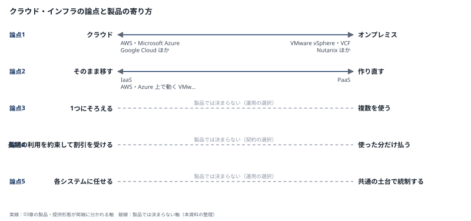

# 04 クラウド・インフラの主要な論点

## 要旨

クラウド・インフラを扱うときに出てくる軸は次の5つである（本資料の整理）。

1. クラウドに移すか、オンプレミスに置くか
2. 移すときに、そのまま移すか、作り直すか
3. 1つのクラウドにそろえるか、複数を使うか
4. 費用を固定で抑えるか、変動のまま柔軟に使うか
5. 環境を各システムに任せるか、共通の土台で統制するか

*図1　クラウド・インフラの論点と製品の寄り方（実線は03章の製品が両端に分かれる軸、破線は製品では決まらない軸。本資料の整理）*

## 論点1：クラウドに移すか、オンプレミスに置くか

| | クラウド | オンプレミス |
|---|---|---|
| 得るもの | ハードウェアの調達・更新・保守が要らない。必要な分だけすぐに用意できる | 構成と更新時期を自社で決められる。利用量が一定なら費用が読める |
| 失うもの | 費用が使用量で変動する。事業者の障害・仕様変更の影響を受ける | ハードウェアの更新の手間と費用。データセンターと要員の確保 |

**製品・提供形態との対応**（→ 03章）

| | クラウドに寄るもの | オンプレミスに寄るもの |
|---|---|---|
| 製品・提供形態 | AWS、Microsoft Azure、Google Cloud、Oracle Cloud Infrastructure、Alibaba Cloud、さくらのクラウド。ホステッドプライベートクラウド（AWS・Azure 上の VMware の環境）は中間 | VMware vSphere・VCF、Nutanix、Hyper-V・Azure Local、Red Hat OpenShift Virtualization、Proxmox VE |

典型的な懸念：「ハードウェアの保守期限が来る」「クラウドの費用が想定より高い」

オンプレミスの前提も変わりうる。VMware の永続ライセンスと保守の更新の販売終了（→ 03章）のように、オンプレミスの基盤ソフトの契約変更が、移行の判断のきっかけになることがある。

## 論点2：そのまま移すか、作り直すか

| | そのまま移す（仮想マシンのまま） | 作り直す（PaaS・マネージドサービスを使う） |
|---|---|---|
| 得るもの | 早く、アプリを変えずに移せる | OS・ミドルウェアの管理を事業者に任せられる（→ 02章 表1）。伸縮しやすい |
| 失うもの | OS の更新・パッチなどの管理は自社に残り、クラウドの利点が小さい | アプリの改修が必要。その事業者のサービスへの依存が強まる |

**製品・提供形態との対応**（→ 03章）

| | そのまま移す（仮想マシンのまま）に寄るもの | 作り直す（PaaS・マネージドサービスを使う）に寄るもの |
|---|---|---|
| 製品・提供形態 | IaaS（仮想マシン）、AWS・Azure 上で動く VMware の環境 | PaaS（クラウドのマネージドサービス） |

典型的な懸念：「移したのに運用が楽にならない」「特定のクラウドから抜けられなくなる」

## 論点3：1つのクラウドにそろえるか、複数を使うか

| | 1つにそろえる | 複数を使う（マルチクラウド） |
|---|---|---|
| 得るもの | 設計・運用・人材・契約の窓口が1つで済む。割引を集中できる | 1社への依存を避けられる。用途ごとに強いサービスを選べる |
| 失うもの | その事業者への依存。障害・価格改定の影響をそのまま受ける | 統制・監視・ID・ネットワークを、クラウドごとに作る必要がある |

ガバメントクラウドでも、移行済みのシステムが AWS に偏っていることが、特定の事業者への依存として課題とされている（→ 03章）。

**製品・提供形態との対応**（→ 03章）：製品では決まらない（運用の選択）。ただし Oracle Database@AWS・@Azure・@Google Cloud のように、他社のクラウドの中で使えるサービスは複数のクラウドの併用を助ける

## 論点4：費用を固定で抑えるか、変動のまま柔軟に使うか

| | 長期の利用を約束して割引を受ける | 使った分だけ払う |
|---|---|---|
| 得るもの | 単価が下がる | 使わなくなればすぐに費用が止まる |
| 失うもの | 約束した分は、使わなくても払う | 単価が高い。費用が読みにくい |

**製品・提供形態との対応**（→ 03章）：製品では決まらない（契約の選択）。どのクラウドも、1年・3年の利用を約束して割り引く契約と、使った分だけの課金の両方を持つ。VMware のサブスクリプション（1・3・5年）は約束の側にしかない

典型的な懸念：「毎月の請求額が読めない」「誰がどれだけ使っているか分からない」

どちらを選ぶにも、まず費用を誰のものか配賦して見えるようにする必要がある（FinOps の Inform → 02章）。

## 論点5：環境を各システムに任せるか、共通の土台で統制するか

| | 各システムに任せる | 共通の土台（ランディングゾーン）で統制する |
|---|---|---|
| 得るもの | 立ち上げが早い。各システムの事情に合わせられる | 権限・ネットワーク・ログ・禁止設定がそろう。監査と監視がしやすい |
| 失うもの | 設定がばらつき、設定の誤り（公開してはならないデータの公開など）を見つけにくい | 最初に土台を作る手間。各システムの自由度が下がる |

責任共有モデルでは、設定の誤りは顧客の責任になる（→ 02章）。

**製品・提供形態との対応**（→ 03章）：製品では決まらない（運用の選択）。ランディングゾーンは、どのクラウドでも利用企業が作る

---

**出典**（確認日：2026-11-14）

- 5つの軸と各表の内容は、01〜03章をもとにした本資料の整理
- 責任共有モデル：AWS — https://aws.amazon.com/en/compliance/shared-responsibility-model/
- 各論点の「製品・提供形態との対応」は、03章の製品をもとにした本資料の整理
