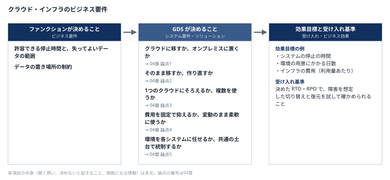

# 05 クラウド・インフラのビジネス要件

## 要旨

インフラの選択の大半は GDS が決める。ファンクションに決めてもらうのは、**システムがどれだけ止まってよいか**と、**データをどこに置いてよいか**の2つである。

この章は、governance/budget-transfer の kickoff 資料（IT 予算移管の要点）にある役割分担を、この技術について具体化したものである。

*図1　クラウド・インフラのビジネス要件（ファンクションが決めたビジネス要件をもとに GDS がシステム要件とソリューションを決め、効果目標と受け入れ基準で確かめる）*

## ファンクションが決めること（ビジネス要件）

### 許容できる停止時間と、失ってよいデータの範囲

- **決めること**：システムごとの RTO・RPO
- **聞く問い**：「このシステムが止まったとき、業務は何時間まで続けられるか。どこまでのデータを失ってよいか」
- **決めないと起きること**：すべてのシステムに同じ冗長化をかけて費用が膨らむ、または重要なシステムの冗長化が足りない
- **根拠になる情報**：業務の時間帯、代替の手順、止まったときの損失

### データの置き場所の制約

- **決めること**：データを置いてよい国・地域
- **聞く問い**：「このデータを国外に置いてよいか。規制や顧客との契約の制約はあるか」
- **決めないと起きること**：置き場所の制約が後から見つかり、移し替えになる
- **根拠になる情報**：規制、顧客との契約、個人情報の有無

## GDS が決めること

- クラウドに移すか、オンプレミスに置くか（→ 04章 論点1）
- そのまま移すか、作り直すか（→ 04章 論点2）
- 1つのクラウドにそろえるか、複数を使うか（→ 04章 論点3）
- 費用を固定で抑えるか、変動のまま柔軟に使うか（→ 04章 論点4）
- 環境を各システムに任せるか、共通の土台で統制するか（→ 04章 論点5）

## 効果目標と受け入れ基準

- **効果目標の例**：システムの停止の時間、環境の用意にかかる日数、インフラの費用（利用量あたり）
- **受け入れ基準**：決めた RTO・RPO で、障害を想定した切り替えと復元を試して確かめられること

## 部門に閉じた案件として扱えないとき

- 共通の土台（ランディングゾーン）の上に置くため、部門ごとに環境を作らない
- GxP のシステムを置く場合、基盤の適格性評価が要る

境界の詳細（どのシステムが何を持つか）は [function-allocation](../../../cross-cutting/function-allocation/function-allocation.md) を参照。

---

**出典**（確認日：2026-11-15）

- 役割分担の原則と4つの場面：governance/budget-transfer の kickoff 資料（IT 予算移管の要点、2026-11-02 初版）
- 項目の立て方、問い、例は、04章の論点をもとにした本資料の整理
