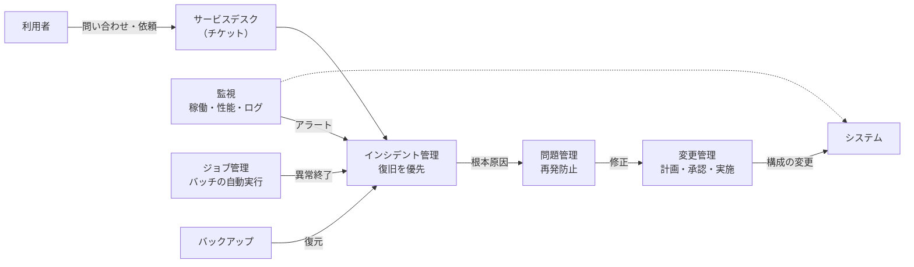

# 02 IT運用の構造

## 要旨

IT運用は、**利用者からの入口（サービスデスク）**、**システムの状態を見る目（監視）**、**決まった処理を回す手（ジョブ管理）**、**壊れたときに戻す備え（バックアップ）**の4つが、**変更の管理**でつながった構造である。どこまで止まってよいかを数値で決める**サービスレベル**が、4つの運用の水準を決める（本資料の整理）。

## 全体の流れ

*図1　IT運用の構成要素と流れ（本資料の整理）*

## IT サービス管理（ITIL 4）

ITIL 4 の34のプラクティスは、一般管理・サービス管理・技術管理の3つに分かれる。IT運用の日常で中心になるのは、サービス管理のうち次のものである（本資料の整理）。

| プラクティス | 何をするか |
|---|---|
| サービスデスク | 利用者の問い合わせと依頼の窓口 |
| インシデント管理 | 障害を、まず早く元に戻す |
| 問題管理 | 繰り返す障害の根本原因を見つけて取り除く |
| 変更の実施（変更管理） | 変更を計画し、影響を評価して承認し、実施する |
| サービス要求管理 | アカウントの発行・PC の手配など、決まった依頼をこなす |
| サービスレベル管理 | 提供する水準を利用者と取り決め、守れているかを測る |

ITIL 4 は、ITIL v3 の「サービスライフサイクル」に代えて、サービスバリューシステムとサービスバリューチェーンを中心に置いている。

## サービスレベル：SLO とエラーバジェット

Google の SRE は、信頼性の目標（SLO：Service Level Objective）を数値で決め、**100% から SLO を引いた分をエラーバジェット**（許容される失敗の量）として扱う。たとえば SLO が 99.99% なら、エラーバジェットは 0.01% である。

- エラーバジェットが残っていれば、新しいリリースを進めてよい。
- 使い切ったら、リリースを止め、信頼性の改善に力を移す。

この考え方は、「障害ゼロ」を目標にして変更を止めがちな運用と、変更を急ぐ開発の利害の対立を、1つの数値で調整するためのものである。SLO を決めても、それを判断に使う方針（エラーバジェットポリシー）に組織が合意していなければ、単なる報告用の指標になる。

## 監視（オブザーバビリティ）

Gartner は、オブザーバビリティのプラットフォームを、アプリケーション・サービス・インフラの健全性・性能・振る舞いを理解するための製品と定義している。従来の「決めた項目が閾値を超えたら知らせる」監視に加えて、ログ・メトリクス・トレース（処理の経路）を合わせて分析し、**なぜ遅いか・どこで止まったか**を調べられることが求められる（本資料の整理）。

## ジョブ管理

ジョブ管理は、決まった日時や周期だけでなく、ファイルの作成やメールの受信などの出来事を契機に処理を実行し、前提となる複数の処理の終了を確かめてから次の処理を実行する。異常終了した場合の自動のリトライや、原因を取り除いた後の途中からの再開もできる。

クラウドのワークフローサービス（AWS Step Functions、Azure Logic Apps）は、途中で異常終了したときに、その部分だけを飛ばして先へ進めるといった柔軟な対応が難しく、最初からやり直しても問題のない設計にしておく必要があると、日立は整理している。

## バックアップ：3-2-1 ルール

バックアップの基本は **3-2-1 ルール**である。データの複製を3つ（元のデータと2つのバックアップ）持ち、2種類の異なる媒体に保存し、1つは別の場所に置く。CISA と NIST も、このルールを基本として示している。

ランサムウェアは、届く範囲にあるバックアップを探して消したり暗号化したりするため、近年は次の拡張が使われている。

| 拡張 | 追加される条件 |
|---|---|
| 3-2-1-1-0 | 1つは書き換えできない（イミュータブル）かネットワークから切り離した複製にする。復元の検証で誤りが0であることを確かめる |

バックアップは、**復元できることを試して初めて意味を持つ**（本資料の整理）。

---

**出典**（確認日：2026-11-14）

- ITIL 4 の34のプラクティスと3つの分類、サービスバリューシステム：IT Process Maps — https://wiki.en.it-processmaps.com/index.php/ITIL_4 、TOPdesk — https://topdesk.com/en/?p=22450 、Ivanti — https://www.ivanti.com/glossary/itil-4
- SLO とエラーバジェット：O'Reilly『SLO Adoption and Usage in SRE』— https://www.oreilly.com/library/view/slo-adoption-and/9781492075370/preface01.html 、Google SRE Workbook「Implementing SLOs」— https://sre.google/workbook/implementing-slos/ 、O'Reilly「Tenets of SRE」— https://oreilly.com/ideas/tenets-of-sre
- オブザーバビリティの定義：Gartner の市場定義の要約 — https://research.oz.spotlightar.com/reports/magic-quadrant-observability-platforms-2025/market-definition
- ジョブ管理の機能：日立ソリューションズ「JP1/AJS3」— https://www.hitachi-solutions.co.jp/jp1/partnership/jp1ajs3.html 、クラウドのワークフローとの違い：日立 — https://www.hitachi.co.jp/Prod/comp/soft1/jp1/feature/cloud_job_management/index.html
- 3-2-1 ルールと拡張：HYCU — https://www.hycu.com/blog/3-2-1-backup-rule-explained-how-it-works-why-it-matters 、Veeam — https://www.veeam.com/blog/what-is-3-2-1-backup-rule.html 、CISA の指摘の引用（computingforgeeks）— https://computingforgeeks.com/?p=180822
- 図1、日常の中心となるプラクティスの選び方、オブザーバビリティと従来の監視の違いは本資料の整理
