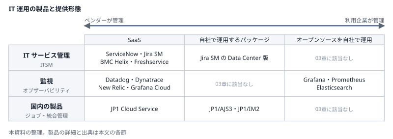

# 03 IT運用の製品と提供形態

## 要旨

製品は、**IT サービス管理（ITSM）**、**監視（オブザーバビリティ）**、**ジョブ管理などの国内の統合運用管理**の3つに分かれる。ITSM は ServiceNow が中心で、Gartner は2026年に ITSM 基盤の Magic Quadrant を4年ぶりに復活させ、ServiceNow・Atlassian・Freshworks などをリーダーとした。監視は Datadog・Dynatrace などの SaaS が中心で、2026年1月には Palo Alto Networks が Chronosphere を買収した。国内では日立の JP1 が監視・ジョブ管理・バックアップなどを1つのブランドでそろえている。提供形態の主流は SaaS だが、JP1 のように自社で運用するパッケージも残っている。

*図1　IT 運用の製品と提供形態（縦は製品の区分、横は提供形態。本資料の整理）*

## IT サービス管理（ITSM）

Gartner は2023年に ITSM の Magic Quadrant を Market Guide に置き換え、2024年からは「AI Applications in IT Service Management」の Magic Quadrant を出してきた。2026年には ITSM Platforms の Magic Quadrant を復活させ、2つの評価が並ぶ形になった。

| 評価 | 公表日 | 評価の対象 | リーダー |
|---|---|---|---|
| ITSM Platforms | 2026-07-27 | 16社 | 4社。ServiceNow・Atlassian・Freshworks（各社の発表）と、もう1社（本資料では未確認） |
| AI Applications in ITSM | 2026-08-17 | 9社（Atlassian・Automation Anywhere・BigPanda・BMC Helix・Rezolve.ai・ServiceNow など） | 本資料では未確認 |
| AI Applications in ITSM | 2025年 | 10社 | ServiceNow だけ（同社の発表） |

ITSM Platforms の2026年版では、ManageEngine・Halo・TeamDynamix がチャレンジャー、Ivanti・Salesforce・TOPdesk などがニッチプレーヤーで、ビジョナリーはいなかった。

| 製品 | 提供元 | 補足 |
|---|---|---|
| ServiceNow IT Service Management | ServiceNow | ITSM Platforms の2026年版でリーダー。同時に出た Critical Capabilities では3つの用途で最高点（同社の発表）。2025年版の AI Applications in ITSM で唯一のリーダー |
| Jira Service Management | Atlassian | ITSM Platforms の2026年版でリーダー（同社の発表）。AI Applications in ITSM の2025年版では Niche Player。生成 AI（Rovo）を組み込み、旧 Opsgenie の運用機能を追加費用なしで含める |
| BMC Helix ITSM | BMC Helix | 大企業向けで、監視（BMC Helix Operations Management）と組み合わせられる。2022年の ITSM の Magic Quadrant でリーダーで、当時から定価が高い製品の1つとされていた。2026年版の位置は本資料では未確認 |
| Freshservice | Freshworks | ITSM Platforms の2026年版で、チャレンジャーからリーダーに上がった。IT 資産管理・運用管理も同じ基盤で扱い、AI（Freddy AI）を組み込む |
| ManageEngine ServiceDesk Plus | ManageEngine（Zoho） | ITSM Platforms の2026年版でチャレンジャー。Zoho の自社のデータセンターで動かし、AI（Zia）を組み込む |

課金は、サービスデスクの担当者（エージェント）1人あたりの月額・年額が一般的である（本資料の整理）。

## 監視（オブザーバビリティ）

Gartner の Observability Platforms の Magic Quadrant 2026年版（2026-07-13）は19社を評価し、次の8社をリーダーとした。2025年版（20社を評価）と比べると、Coralogix が加わり、Splunk がチャレンジャーに移った。

| 製品 | 提供元 | 補足 |
|---|---|---|
| Datadog | Datadog | SaaS。インフラ監視・APM・ログ管理などを統合。6年連続でリーダーで、2026年版では「実行能力」でもっとも高い位置（同社の発表） |
| Dynatrace | Dynatrace | 16回目のリーダー（同社の発表）。2025年版では「実行能力」でもっとも高い位置だった |
| Grafana Cloud | Grafana Labs | オープンソースの Grafana が基盤。3年連続でリーダーで、「ビジョンの完全性」でもっとも高い位置（同社の発表） |
| New Relic | New Relic | 2012年以来、この評価でリーダー。データの量に応じた課金のため、費用が想定を超える場合があると Gartner は指摘した（2025年版） |
| Elastic | Elastic | オープンソースの Elasticsearch が基盤。使いこなすには社内の技術力が要ると Gartner は指摘した（2025年版） |
| IBM Instana | IBM | Apptio・HashiCorp と同じソフトウェア部門に属する（2025年版の Gartner の整理） |
| Chronosphere | Chronosphere（Palo Alto Networks） | データの量を抑えて費用を下げる機能が強み。2026年1月に Palo Alto Networks が買収した |
| Coralogix | Coralogix | 2026年版で初めてリーダー。ログ・メトリクス・トレースを流れながら処理する |

チャレンジャーは Alibaba Cloud・AWS・LogicMonitor・Microsoft・Splunk（Cisco）、ビジョナリーは BMC Helix・Honeycomb、ニッチプレーヤーは Apica・HPE・ScienceLogic・SolarWinds である。Splunk は SIEM の Splunk と同じ会社である（→ security-operations 03章）。課金は、監視する機器（ホスト）の数、取り込むデータの量、利用者の数などの組み合わせで、製品ごとに異なる（本資料の整理）。

## 国内の製品

### JP1（日立）

JP1 は日立が長年提供する統合システム運用管理ソフトウェアのブランドで、統合監視・ネットワーク管理・ジョブ管理・性能監視・運用の自動化・資産管理とソフトウェア配布・バックアップ・サービスデスクなどの製品をそろえている。

| 製品 | 提供元 | 補足 |
|---|---|---|
| JP1/Automatic Job Management System 3（JP1/AJS3） | 日立 | ジョブ管理。SAP ERP のジョブや RPA の処理も、他のジョブと同じように実行・監視できる |
| JP1 Cloud Service/Job Management | 日立 | JP1/AJS3 相当の機能を SaaS で提供 |
| JP1/Integrated Management 2（JP1/IM2） | 日立 | 統合監視 |

JP1 は Gartner の上記の評価の対象には入っていない（本資料の整理）。

## 他の製品に付属する機能

| 付属する先 | 機能 | 補足（本資料の整理） |
|---|---|---|
| AWS・Azure・Google Cloud | Amazon CloudWatch、Azure Monitor、Google Cloud Observability | クラウドの利用料の中で使える監視。AWS と Microsoft は Observability の評価でチャレンジャー |
| Atlassian のライセンス | Jira Service Management の運用機能（旧 Opsgenie） | Jira Service Management に追加費用なしで含まれる |
| Microsoft 365 E3/E5 | Intune の端末管理（→ workplace 03章） | IT 資産の一部を ITSM とは別に管理することになる |

## 提供形態

| 形態 | ベンダーが管理するもの | 利用企業が管理するもの | 例 |
|---|---|---|---|
| SaaS | 基盤、製品の更新、監視データの保管 | 業務の流れ（申請・承認・変更管理）の設定、監視の対象と警報の条件、データの保持期間、権限 | ServiceNow、Freshservice、Datadog、JP1 Cloud Service |
| 自社で運用するパッケージ | ソフトウェアの提供と保守 | 上記に加えて、サーバ・データベース・更新の適用 | JP1/AJS3、JP1/IM2、Jira Service Management の Data Center 版 |
| オープンソースを自社で運用 | なし（コミュニティ） | すべて | Grafana・Prometheus・Elasticsearch を自社で動かす形 |

監視の SaaS では、**送るデータの量がそのまま費用になる**ことが多い。どのログ・メトリクスを送るかを決める運用が、費用を左右する（→ 04章、本資料の整理）。

## 市場の動き

| 時期 | できごと |
|---|---|
| 2023年 | Gartner が ITSM の Magic Quadrant を Market Guide に置き換えた |
| 2025年7月 | Gartner が Observability Platforms の Magic Quadrant 2025年版を出した（20社） |
| 2025年11月19日 | Palo Alto Networks が Chronosphere の買収（33.5億ドル）に合意した |
| 2026年1月29日 | Palo Alto Networks が Chronosphere の買収を完了した |
| 2026年7月13日 | Gartner が Observability Platforms の Magic Quadrant 2026年版を出した（19社、Coralogix が初めてリーダー） |
| 2026年7月27日 | Gartner が ITSM Platforms の Magic Quadrant を復活させた（16社） |
| 2026年8月17日 | Gartner が AI Applications in ITSM の Magic Quadrant 2026年版を出した（9社） |

## 本資料でまだ扱っていないもの

- バックアップの製品（Veeam など）と、クラウドのバックアップサービス
- 海外のジョブ管理製品（Control-M など）
- 運用の外部委託（運用保守のアウトソーシング、マネージドサービス）の形態
- 各製品の価格の水準

---

**出典**（確認日：2026-11-14）

- ITSM の Magic Quadrant の置き換え：InvGate — https://blog.invgate.com/pt/quadrante-magico-gartner-aplicacoes-ia-itsm 、ManageEngine（2023年の廃止と2026年の復活）— https://www.manageengine.com/au/products/service-desk/itsm/itsm-gartner-magic-quadrant.md
- ITSM Platforms の Magic Quadrant 2026年版（2026-07-27）：Gartner の要約 — https://www.gartner.com/en/documents/8168829 、各象限の顔ぶれと評価社数：ITSM.tools — https://itsm.tools/?p=38195 、ServiceNow（2026-07-29）— https://www.servicenow.com/workflow/news/magic-quadrant-leader-itsm-why-that-matters.html 、Atlassian — https://www.atlassian.com/blog/company-news/gartner-itsm-platforms-2026 、Freshworks — https://www.freshworks.com/theworks/company-news/gartner-mq-itsm-2026-leader/ 、ManageEngine（Zoho のデータセンター、Zia）— https://www.manageengine.com/products/service-desk/itsm/itsm-gartner-magic-quadrant.md
- AI Applications in ITSM（2025）：Gartner の評価対象 — https://www.gartner.com/en/documents/6907166 、ServiceNow の発表 — https://www.servicenow.com/fr/workflow/enterprise-it/leader-ai-applications-itsm.html 、Atlassian の位置と特徴（レポート抜粋）— https://usehalo.com/wp-content/uploads/2025/09/Magic_Quadrant_for_A_823161_ndx.pdf
- AI Applications in ITSM（2026-08-17、9社）：Gartner — https://www.gartner.com/en/documents/8270821 、Rezolve.ai — https://www.rezolve.ai/lp/gartner-magic-quadrant-2026
- BMC Helix ITSM の2022年の位置と価格：Gartner の2022年版の転載（Scribd）— https://www.scribd.com/document/720218632/Gartner-Ivanti-ITSM
- Freshservice の構成：Freshworks の発表（Macau Business）— https://macaubusiness.com/freshworks-named-a-leader-in-the-2026-gartner-magic-quadrant-for-it-service-management-platforms/
- Observability Platforms（2026-07-13、19社）：各象限の顔ぶれ：Network World（2026-07-17）— https://www.networkworld.com/article/4197973/ai-workloads-shake-up-observability-market.html 、Datadog — https://investors.datadoghq.com/news-releases/news-release-details/datadog-named-leader-2026-gartnerr-magic-quadranttm 、Dynatrace — https://www.dynatrace.com/news/press-release/dynatrace-named-a-leader-in-the-2026-gartner-magic-quadrant-for-observability-platforms-for-the-16th-time/ 、Grafana Labs — https://grafana.com/press/2026/07/15/grafana-labs-named-a-leader-in-2026-gartner-magic-quadrant-for-observability-platforms-and-positioned-furthest-in-completeness-of-vision/ 、Coralogix — https://coralogix.com/gartner-magic-quadrant-observability-platforms-2026/
- Observability Platforms（2025、20社）：評価対象 — https://www.gartner.com/en/documents/6688834 、各社の強みと注意点（Network World の転載）— https://gixtools.net/?p=20127960 、New Relic（2012年以来）— https://newrelic.com/jp/blog/nerdlog/gartner-magic-quadrant-observability-2025 、Chronosphere — https://chronosphere.io/learn/magic-quadrant-observability-leader-2025/ 、Dynatrace — https://www.dynatrace.com/news/press-release/2025-gartner-magic-quadrant-for-observability-platform/
- Chronosphere の買収：Palo Alto Networks の IR — https://investors.paloaltonetworks.com
- JP1：IT Leaders（2019）— https://it.impress.co.jp/articles/-/17326 、日立ソリューションズ（JP1/AJS3）— https://www.hitachi-solutions.co.jp/jp1/partnership/jp1ajs3.html 、日立（クラウド版）— https://www.hitachi.co.jp/Prod/comp/soft1/jp1/feature/automation/jp1_job_cloud_migration/index.html
- 課金の単位の一般化、付属する機能の表、提供形態の表、JP1 が Gartner の評価の対象に入っていない点は本資料の整理
- 製品の区分は 2026-11 時点の各社の公表情報による。契約の判断の前には各社の最新の資料で確かめる
