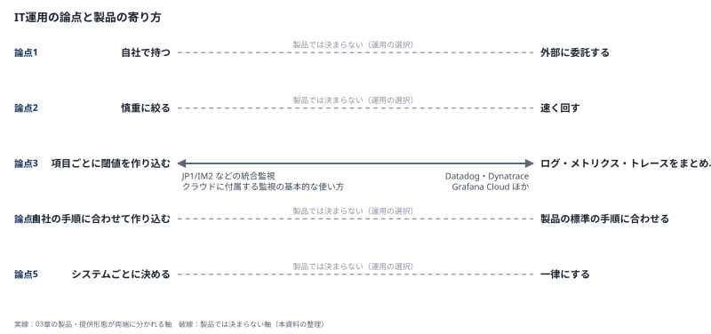

# 04 IT運用の主要な論点

## 要旨

IT運用を扱うときに出てくる軸は次の5つである（本資料の整理）。

1. 運用を自社で持つか、外部に委託するか
2. 変更を慎重に絞るか、速く回すか
3. 監視を項目ごとに作り込むか、まとめて集めて後から調べるか
4. ITSM を作り込むか、標準の手順に合わせるか
5. どこまで止まってよいかを、システムごとに決めるか、一律にするか

*図1　IT運用の論点と製品の寄り方（実線は03章の製品が両端に分かれる軸、破線は製品では決まらない軸。本資料の整理）*

## 論点1：運用を自社で持つか、外部に委託するか

| | 自社で持つ | 外部に委託する |
|---|---|---|
| 得るもの | システムと業務の知識が社内に残る。判断が速い | 24時間の体制と要員を確保しやすい |
| 失うもの | 要員の確保と育成。特定の人に知識が偏る | 委託先に知識がたまり、委託先を替えにくくなる。手順にないことへの対応が遅い |

**製品・提供形態との対応**（→ 03章）：製品では決まらない（運用の選択）。運用の外部委託は 03章ではまだ扱っていない

典型的な懸念：「運用が特定の担当者に頼っている」「委託先を替えたいが、中身が分からない」

## 論点2：変更を慎重に絞るか、速く回すか

| | 慎重に絞る | 速く回す |
|---|---|---|
| 得るもの | 変更による障害が減る | 改善と修正が早く届く |
| 失うもの | 修正の遅れが積み上がり、一度の変更が大きく危険になる | 変更による障害が増えうる |

SRE のエラーバジェットは、この論点を SLO という1つの数値で調整する仕組みである（→ 02章）。

**製品・提供形態との対応**（→ 03章）：製品では決まらない（運用の選択）。どの ITSM 製品も変更管理の手順を持ち、承認の重さは利用企業が設定する

## 論点3：監視を項目ごとに作り込むか、まとめて集めて後から調べるか

| | 項目ごとに閾値を作り込む | ログ・メトリクス・トレースをまとめて集める（オブザーバビリティ） |
|---|---|---|
| 得るもの | 費用が小さい。分かっている障害を確実に知らせる | 想定していなかった障害の原因も、後から調べられる |
| 失うもの | 想定外の障害に気づけない、原因が分からない | 集めるデータの量が費用を左右する（SIEM と同じ構造 → security-operations 04章） |

**製品・提供形態との対応**（→ 03章）

| | 項目ごとに閾値を作り込むに寄るもの | ログ・メトリクス・トレースをまとめて集める（オブザーバビリティ）に寄るもの |
|---|---|---|
| 製品・提供形態 | JP1/IM2 などの統合監視、クラウドに付属する監視（Amazon CloudWatch、Azure Monitor）の基本的な使い方 | Datadog、Dynatrace、Grafana Cloud、New Relic、Elastic、IBM Instana、Chronosphere、Coralogix |

## 論点4：ITSM を作り込むか、標準の手順に合わせるか

| | 自社の手順に合わせて作り込む | 製品の標準の手順（ITIL に沿った型）に合わせる |
|---|---|---|
| 得るもの | 現行の業務をそのまま再現できる | 製品の更新と AI などの新機能をそのまま使える |
| 失うもの | 製品の更新のたびに改修が必要 | 手順を変える必要がある |

ERP の「標準に合わせるか、作り込むか」と同じ構造の論点である（→ erp 04章）。

**製品・提供形態との対応**（→ 03章）：製品では決まらない（運用の選択）。どの ITSM 製品も標準の手順を持ち、設定と拡張で作り込める

## 論点5：どこまで止まってよいかを、システムごとに決めるか、一律にするか

| | システムごとに決める | 一律にする |
|---|---|---|
| 得るもの | 重要なシステムに運用の力を集中できる | 決めるのが簡単 |
| 失うもの | 重要度の決定と見直しの手間 | 重要でないシステムに過剰な体制、重要なシステムに不足 |

業務プロセスごとに、許容できる停止時間（RTO）と失ってよいデータの範囲（RPO）を決めておく点は、ERP でも同じである（→ erp 04章）。

**製品・提供形態との対応**（→ 03章）：製品では決まらない（運用の選択）

---

**出典**（確認日：2026-11-14）

- 5つの軸と各表の内容は、01〜03章をもとにした本資料の整理
- 各論点の「製品・提供形態との対応」は、03章の製品をもとにした本資料の整理
