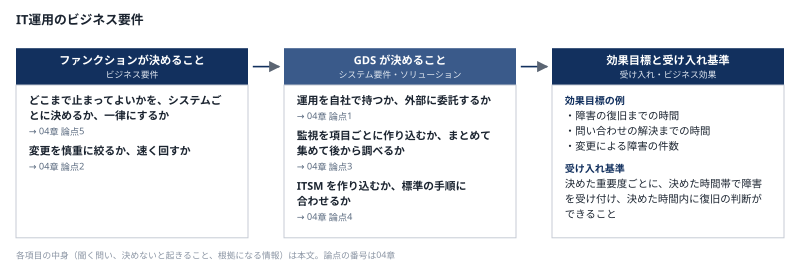

# 05 IT運用のビジネス要件

## 要旨

IT運用の製品と体制を選ぶ前に、ファンクションには**システムごとに、どこまで止まってよいか**と、**夜間・休日にどこまで対応が要るか**を決めてもらう。運用の体制と費用は、この重要度で決まる。

この章は、governance/budget-transfer の kickoff 資料（IT 予算移管の要点）にある役割分担を、この技術について具体化したものである。

*図1　IT運用のビジネス要件（ファンクションが決めたビジネス要件をもとに GDS がシステム要件とソリューションを決め、効果目標と受け入れ基準で確かめる）*

## ファンクションが決めること（ビジネス要件）

### どこまで止まってよいかを、システムごとに決めるか、一律にするか

- **決めること**：システムごとの重要度（→ 04章 論点5）
- **聞く問い**：「このシステムが止まったとき、業務への影響はどの程度か。夜間・休日も対応が要るか」
- **決めないと起きること**：すべてのシステムに同じ体制をかけ、費用が膨らむ、または重要なシステムの体制が足りない
- **根拠になる情報**：業務の時間帯、止まったときの損失、代替の手順

### 変更を慎重に絞るか、速く回すか

- **決めること**：変更を受け入れられる頻度と時間帯（→ 04章 論点2）
- **聞く問い**：「システムの変更を、いつ・どれくらいの頻度で受け入れられるか」
- **決めないと起きること**：業務の繁忙期に変更が入り、障害が業務に響く
- **根拠になる情報**：業務の繁忙期、変更の承認者

## GDS が決めること

- 運用を自社で持つか、外部に委託するか（→ 04章 論点1）
- 監視を項目ごとに作り込むか、まとめて集めて後から調べるか（→ 04章 論点3）
- ITSM を作り込むか、標準の手順に合わせるか（→ 04章 論点4）

## 効果目標と受け入れ基準

- **効果目標の例**：障害の復旧までの時間、問い合わせの解決までの時間、変更による障害の件数
- **受け入れ基準**：決めた重要度ごとに、決めた時間帯で障害を受け付け、決めた時間内に復旧の判断ができること

## 部門に閉じた案件として扱えないとき

- 運用の対象のシステムは、全社の監視・ITSM の仕組みに乗せる
- GxP のシステムは、変更管理とバックアップに求められる水準がある

境界の詳細（どのシステムが何を持つか）は [function-allocation](../../../cross-cutting/function-allocation/function-allocation.md) を参照。

---

**出典**（確認日：2026-11-15）

- 役割分担の原則と4つの場面：governance/budget-transfer の kickoff 資料（IT 予算移管の要点、2026-11-02 初版）
- 項目の立て方、問い、例は、04章の論点をもとにした本資料の整理
