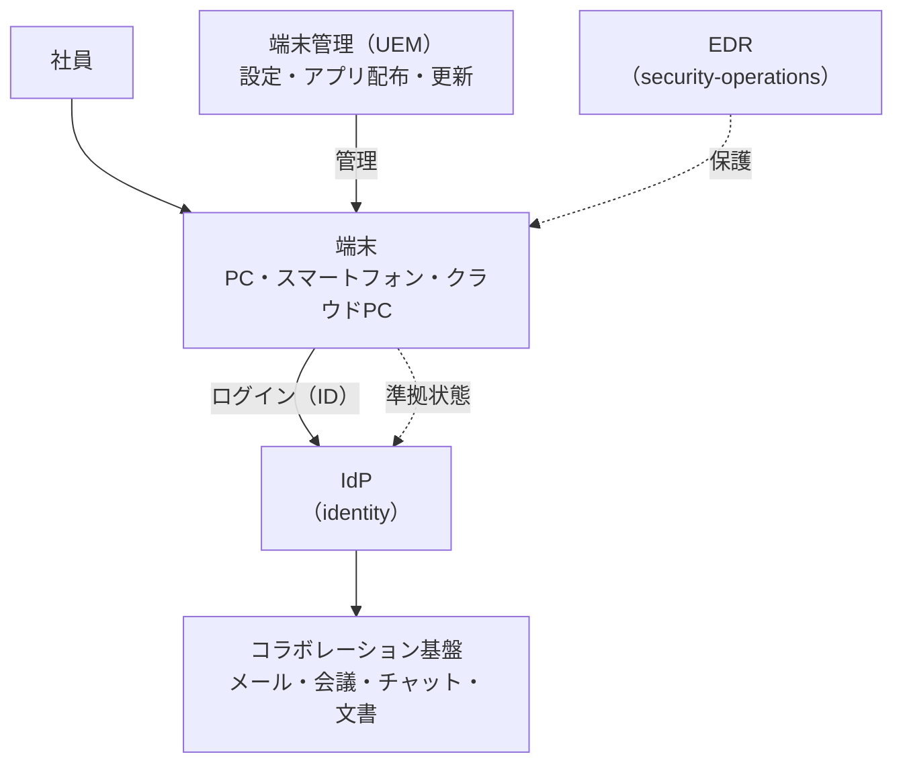

# 02 ワークプレイスの構造

## 要旨

ワークプレイスは、**端末**・**コラボレーション基盤**・**端末管理**の3層が、**ID**（identity）でつながる構造である。いずれの層も、ベンダーが決める**更新の周期とサポート期限**の上に乗っており、ワークプレイスの運用は、その周期に合わせて全社員の環境を更新し続ける仕事になる（本資料の整理）。

## 全体の構成

*図1　ワークプレイスの構成要素（本資料の整理）*

端末が会社の管理下にあり、方針（暗号化・OS の更新など）を満たしているかを UEM が判定し、その結果を IdP の条件付きアクセスが使う。たとえば、管理されていない端末からは機密の文書にアクセスさせない、といった制御ができる（→ identity 05章）。

## 端末の提供形態

| 形態 | 内容 | 補足 |
|---|---|---|
| 物理 PC | 社員ごとに PC を配る | OS のサポート期限とハードウェアの更新周期に合わせて入れ替える |
| 仮想デスクトップ（VDI） | データセンターまたはクラウドで動くデスクトップに、手元の端末から接続する | Azure Virtual Desktop など。構成の自由度が高いが、設計と運用の専門知識が要る |
| クラウド PC（DaaS） | 1人1台の仮想の PC をクラウドで借りる | Windows 365。Azure Virtual Desktop の上に作られ、仮想化の細部は事業者が扱う。ユーザー単位の月額 |

Microsoft は、仮想化の専門知識を持つ組織や、より柔軟な構成が必要な場合には Azure Virtual Desktop を勧めている。

## OS とアプリの更新

- **OS のサポート期限**：Windows 10 は2025年10月14日にサポートが終わった。端末は動き続けるが、延長セキュリティ更新（ESU）の対象でなければ、セキュリティ更新は届かない。法人向けの ESU は1台あたり初年度61ドルで、年ごとに倍になり、最長3年である。
- **アプリの更新**：Microsoft 365 Apps は更新チャネル（Current Channel、Monthly Enterprise Channel など）によって新機能が届く時期が違う。例として、Microsoft 365 Copilot は一般提供の時点で Current Channel から先に使えるようになり、Monthly Enterprise Channel では約1か月遅れて使えるようになった。

どのチャネルを使うかは、新機能を早く使う利点と、変更による業務への影響（検証の手間）の釣り合いで決める（本資料の整理）。

## コラボレーション基盤のライセンス

コラボレーション基盤のライセンスは、機能の束（スイート）として買うのが基本だが、束の中身は変わる。

| 変更の例 | 内容 |
|---|---|
| Teams の切り離し（2024年4月） | 新規の顧客は、Microsoft 365 E3/E5・Office 365 E1/E3/E5 を Teams を含まない版で買い、Teams を別に買う。既存の顧客は、Teams を含む版の更新・追加もできる |
| 生成 AI の追加 | Microsoft 365 Copilot は、E3・E5 などの上に追加するライセンス（1ユーザー月額30ドル） |
| セキュリティ機能の段階 | 端末保護の Defender for Endpoint は、E3 に Plan 1（防御だけ）、E5 に Plan 2（EDR を含む）が含まれる（→ security-operations 03章） |

---

**出典**（確認日：2026-11-14）

- Windows 365 と Azure Virtual Desktop：Microsoft 365 ブログ — https://www.microsoft.com/en-us/microsoft-365/blog/?p=237041
- Windows 10 のサポート終了後の扱いと ESU の価格：TechRepublic — https://www.techrepublic.com/article/news-windows-10-esu-cheat-sheet/ 、Petri — https://petri.com/?p=762768
- Copilot と更新チャネル：Redmond Channel Partner（2023-11-01）— https://rcpmag.com/articles/2023/11/01/microsoft-365-copilot-at-ga.aspx
- Teams の切り離し：Microsoft Tech Community — https://techcommunity.microsoft.com/t5/partner-news/important-notice-changes-to-microsoft-365-office-365-and/ba-p/4100985 、Directions on Microsoft — https://www.directionsonmicrosoft.com/?p=111269
- Copilot の価格：Microsoft 365 ブログ — https://www.microsoft.com/en-us/microsoft-365/blog/2023/09/21/announcing-microsoft-365-copilot-general-availability/
- 図1、更新チャネルの選び方、ワークプレイスの運用の位置付けは本資料の整理
